# STAT6207 Applied Deep Learning — L1 学习笔记

> **课件**：`2026_6207_lecture_L1_v0.pdf`（68 页）
> **授课**：Dr. Ming Cheung，11 Sept 2026
> **本讲主题**：课程介绍 → 什么是机器学习 → 监督学习与 KNN
> **适合对象**：零机器学习基础。本笔记默认你只学过一点函数、平均数和 Python 基础。

---

## 目录

- [0. 本讲地图：这一节到底在讲什么](#0-本讲地图这一节到底在讲什么)
- [Part A. 课程介绍（P1–P13）](#part-a-课程介绍p1p13)
- [Part B. 什么是机器学习（P14–P31）](#part-b-什么是机器学习p14p31)
  - [B1. 分类与回归](#b1-分类与回归)
  - [B2. 一条直线：$y=mx+c$](#b2-一条直线ymxc)
  - [B3. 从感知到控制：自动驾驶](#b3-从感知到控制自动驾驶)
  - [B4. 深度学习与 GPU](#b4-深度学习与-gpu)
  - [B5. 机器学习的流水线](#b5-机器学习的流水线)
  - [B6. 最好的 $m$ 和 $c$：损失函数](#b6-最好的-m-和-c损失函数)
  - [B7. 梯度下降：蒙着眼睛下山](#b7-梯度下降蒙着眼睛下山)
- [Part C. 机器学习简史（P32–P39）](#part-c-机器学习简史p32p39)
- [Part D. 监督学习：从例子中学一个类（P40–P53）](#part-d-监督学习从例子中学一个类p40p53)
  - [D1. 家庭用车例子与特征向量](#d1-家庭用车例子与特征向量)
  - [D2. 训练集、假设类与容量](#d2-训练集假设类与容量)
  - [D3. 噪声、模型复杂度与奥卡姆剃刀](#d3-噪声模型复杂度与奥卡姆剃刀)
  - [D4. 训练 / 验证 / 测试](#d4-训练--验证--测试)
  - [D5. 过拟合、欠拟合与学习曲线](#d5-过拟合欠拟合与学习曲线)
  - [D6. 网格搜索与模型选择](#d6-网格搜索与模型选择)
- [Part E. Python 与 NumPy（P54–P58）](#part-e-python-与-numpyp54p58)
- [Part F. K 近邻 KNN（P59–P65）](#part-f-k-近邻-knnp59p65)
  - [F1. KNN 是"懒学生"](#f1-knn-是懒学生)
  - [F2. 三种距离](#f2-三种距离)
  - [F3. 空间、标准化与 CNN](#f3-空间标准化与-cnn)
  - [F4. 手算例子](#f4-手算例子)
  - [F5. sklearn 代码](#f5-sklearn-代码)
- [Part G. 收尾（P66–P68）](#part-g-收尾p66p68)
- [公式总表](#公式总表)
- [术语表](#术语表)
- [10 个最容易错的地方](#10-个最容易错的地方)
- [本讲 10 句话总结](#本讲-10-句话总结)

---

## 0. 本讲地图：这一节到底在讲什么

如果把整门课比作"学做菜"，那么：

- **L1（本讲）**：认识厨房、认识刀和锅、学会最基本的一道菜（KNN）。
- **L2–L4**：学更高级的菜系（迁移学习、ResNet、LLM、Transformer）。
- **L5–L6**：学视觉与多模态（CNN、ViT、VLM）。

L1 只回答三个问题：

1. **机器学习到底是什么？** —— 不是写死规则，而是让程序从数据里"调参数"。
2. **怎么衡量学得好不好？** —— 用损失函数（loss）和训练/验证/测试集。
3. **最简单的算法长什么样？** —— KNN：看离你最近的 K 个邻居是谁，就跟着投票。

本讲的核心逻辑链（务必记住这张图）：

```
数据 (data)
  → 特征 (features) + 标签 (labels)
  → 模型 (model / hypothesis)  ── 例如 y = mx + c
  → 损失 (loss)                ── 预测和答案差多少
  → 优化 (optimization)        ── 梯度下降调参数
  → 评估 (validation / test)   ── 换新数据还准不准
  → 部署 (deployment)
```

**学完本讲你应该能**：

- 区分分类（classification）与回归（regression）。
- 解释 $y=mx+c$ 里每个符号，并说明 $m,c$ 为什么是"学出来的"。
- 用自己的话讲清梯度下降，以及学习率过大/过小会怎样。
- 解释训练集、验证集、测试集的区别，以及为什么要分开。
- 判断过拟合与欠拟合，并说出至少两种缓解方法。
- 手算 KNN 的欧氏距离并做多数投票。
- 解释为什么 KNN 之前要做标准化。

---

## Part A. 课程介绍（P1–P13）

### P1 封面

> **原文**：STAT6207 Applied Deep Learning, 11 Sept 2026, By Dr. Ming Cheung

**中文**：STAT6207 应用深度学习，2026 年 9 月 11 日，张明博士。

**零基础讲解**：这门课的名字里有两个词：

- **Applied（应用）**：重点是把模型用起来，而不是纯数学证明。
- **Deep Learning（深度学习）**：用"很多层的神经网络"做机器学习，是机器学习的一个子集。

> 类比：机器学习是"会学习"的大类；深度学习是其中"用深神经网络学习"的一支。

---

### P2 Agenda（议程）

> **原文**：
> • Course Introduction
> • What are machine learning
> • Supervised Learning and KNN

**中文**：课程介绍；什么是机器学习；监督学习与 KNN。

**零基础讲解**：这三块就是本讲的 Part A / B / D+F。注意老师把 KNN 放在第一节课，是因为它**几乎不需要训练**，最适合用来建立"特征、距离、标签、投票"这些直觉。

---

### P3 What is STAT6207

> **原文**：
> 1. Learn the theory of machine learning and deep learning;
> 2. Understand machine learning applications to solve real problems in generative adversarial networks, large language model, etc.;
> 3. Gain hands on experience through projects and activities using agentic coders and Python libraries, such as OpenCode, PyTorch and Numpy, with projects

**中文**：
1. 学习机器学习与深度学习的理论；
2. 理解机器学习在真实问题中的应用，例如生成对抗网络（GAN）、大语言模型（LLM）等；
3. 通过项目和活动获得动手经验，使用智能编程工具（agentic coder）以及 Python 库，如 OpenCode、PyTorch、NumPy。

**零基础讲解**：课程有三条腿——**理论（Theory）／应用（Application）／动手（Hands on）**。

- **Theory**：为什么模型能学？什么叫泛化？
- **Application**：GAN 生成图片、LLM 聊天，这些是怎么实现的？
- **Hands on**：用 PyTorch 写代码，用 OpenCode 帮你写代码。

> 这门课不是"背书课"。老师明确说：AI 可以帮你写代码，但你要理解概念（见 P5–P6）。

---

### P4 Prerequisite / Background（先修背景）

> **原文**：
> • Mathematics: multivariable calculus, linear algebra and probability
> • Coding: OpenCode, Python and NumPy, probability and machine learning.
> • Course material and other information will be posted on Blackboard
> • Pre-slide for the week will be released every Wednesday

**中文**：
- 数学：多元微积分、线性代数、概率论；
- 编程：OpenCode、Python 与 NumPy，以及概率与机器学习基础；
- 课程材料会发布在 Blackboard；
- 每周三发布本周的预习幻灯片。

**零基础讲解**：看到"多元微积分"不要慌，本讲真正用到的只有三样：

1. **导数**：函数在某一点的斜率，告诉你"往哪个方向走会让函数变小"。
2. **向量/矩阵**：把多个特征排成一列，方便批量计算。
3. **平均数/概率**：投票、求期望。

后面用到时我会现学现卖地补，不需要你提前啃完微积分。

---

### P5 Policy on Generative AI（生成式 AI 使用政策）

> **原文**：
> • You are permitted to use generative AI (e.g., ChatGPT, Claude, Grok, etc.) and the Agentic Coder (i.e., OpenCode), in assignments, programming exams, and projects
> • When generative AI is used to produce code, text, or reports, students must transparently declare its use by including an appendix for grading:
>   • A shareable link to the conversation(s) with the AI (including all prompts and AI-generated outputs), if web-based AI is used.
>   • In case of using agentic coders, the session transcript must be submitted.
>   • A detailed description of all modifications made to the AI-generated content.
> • Do not use it to skip learning

**中文**：允许在作业、编程考试和项目中使用生成式 AI（ChatGPT、Claude、Grok 等）和智能编程工具（OpenCode）。但必须**透明申报**：附上可分享的对话链接（包含所有 prompt 和 AI 输出）；若用 agentic coder，要提交会话记录；并详细说明你对 AI 生成内容做了哪些修改。**不要用它来跳过学习。**

**零基础讲解**：政策的核心是"**可以用，但要交代**"。这就像写论文引用别人的观点：用了就要标注。

> 💡 对本课程的实际建议：让 AI 解释概念、生成初稿、debug 都可以；但每次提交前问自己——"如果考试让我手写这段，我写得出来吗？"

---

### P6 My expectations in Teaching（教学期望）

> **原文**：
> • Please ask me questions about the materials, and feel free to ask me any time even during my presentation
> • Discussion is part of the learning; you are welcome to discuss your challenges with me during the breaks and after classes. You don't learn to swim by reading about water.
> • Agentic Coders and LLM are tools for build, but you should spend the time to understand the concepts and build them

**中文**：随时提问，讲课时也可以打断；讨论是学习的一部分，欢迎课间和课后交流——"读游泳书是学不会游泳的"；Agentic Coder 和 LLM 是构建工具，但你应该花时间理解概念并亲手构建。

**零基础讲解**：老师的比喻很到位：**看懂了 ≠ 会做了**。所以本笔记每节都有手算/代码练习，别只看。

---

### P7 Course Introduction（章节封面）

> **原文**：Course Introduction

**中文**：课程介绍。

（封面页，无知识点。）

---

### P8 Marking Scheme (Final Project)（评分方案：期末项目）

> **原文**：
> Format: 1 presentation and 1 report
> Data processing and Methods
> • apply what you have learned or any techniques on the data to achieve the expected results
> • state clearly what methodology or algorithms you used and how you used them to process the data in your report
> Experimental results
> • state clearly your result in your report.
> • You use tables, graphs, charts or other visualization methods to demonstrate your conclusion.
> • You draw interesting conclusions/insights from your results.
> Presentation and Organization
> • Your report is organized in a way that is logical and easy for the reader to understand
> • The overall language you used in your report should be concise and able to clearly convey your idea.
> • Only selected groups will present their works to the guests.

**中文**：形式为一次展示 + 一份报告。评分维度：
- **数据处理与方法**：把所学（或任何技术）用到数据上达到预期结果；在报告中清楚说明用了什么方法/算法、怎么用的。
- **实验结果**：清楚陈述结果；用表格、图、图表等可视化来支撑结论；从结果中得出有意思的结论/洞见。
- **展示与组织**：报告逻辑清楚、易读；语言简洁、能清楚传达想法；只有被选中的小组会向嘉宾展示。

**零基础讲解**：这份评分标准其实在暗示"高分报告长什么样"：

1. **方法可复现**：别人照你的描述能重做。
2. **结果有证据**：不要只说"效果很好"，要给表和图。
3. **结论有洞察**：不只报数字，要解释"为什么"。
4. **表达清楚**：图比大段文字有力，但图要有标题、坐标轴、单位。

> 考试/项目提示：从 L1 开始就养成习惯——每次实验记录**数据、超参数、随机种子、结果**。

---

### P9–P10 Last Semester Reports / Grading（上学期报告与评分）

> **原文**：Last Semester Reports / Last Semester Grading

**中文**：上学期报告展示 / 上学期评分情况。

**零基础讲解**：这两页是往届样例，用来让你知道期望水平。图片是学生作品截图，本笔记不逐张翻译。可提取的图在 `images/L1_p09_fig3.png` 等。

> 观察重点：好的报告通常有清晰的"问题 → 数据 → 方法 → 结果 → 结论"结构。

---

### P11 Course Topics (To be confirmed)（课程主题）

> **原文**：

| Lecture | Topics |
|---|---|
| 1–2 | ML Foundations (Supervised Learning, KNN, Transfer Learning & ResNet) |
| 3–4 | LLM, Architectures & Efficiency (RAG, CoT, Agentic AI, Transformers, Quantization, etc.) |
| 5–6 | Computer Vision & Multimodal AI (CNNs, Vision Transformers, Visual Encoders, VLMs & Face Recognition Demos) |
| 7 | Examination |
| 8–10 | Deep Learning Core & Unsupervised Learning (Embeddings, Autoencoders, Clustering, GNNs, Backprop, Optimizers & Deployment) |
| 11–12 | Generative AI, RL & Advanced Paradigms (GANs, Stable Diffusion, Federated Learning & Reinforcement Learning Reward Models) |
| 13 | Ethics, Course Review & Future Horizons (Bias, Ethics, Course Review) |
| 14 | Project Presentation |

**中文**：第 1–2 讲机器学习基础（监督学习、KNN、迁移学习与 ResNet）；第 3–4 讲大语言模型、架构与效率（RAG、思维链、Agentic AI、Transformer、量化等）；第 5–6 讲计算机视觉与多模态 AI（CNN、视觉 Transformer、视觉编码器、VLM、人脸识别演示）；第 7 讲考试；第 8–10 讲深度学习核心与无监督学习（嵌入、自编码器、聚类、图神经网络、反向传播、优化器与部署）；第 11–12 讲生成式 AI、强化学习与高级范式（GAN、Stable Diffusion、联邦学习、强化学习奖励模型）；第 13 讲伦理、复习与未来展望；第 14 讲项目展示。

**零基础讲解**：这张表是你的"学习路线图"。可以看到：

- **L1–L2 是地基**：没有监督学习和 KNN，后面的 ResNet、Transformer 都会变成天书。
- **L3–L4 是当前最热的方向**：LLM 与效率优化。
- **L5–L6 是视觉**：CNN 是 ResNet 的基础，ViT 是 Transformer 在图像上的应用。
- **L8–L10 才讲反向传播和优化器**：也就是说，L1 先给你"梯度下降"的直觉，后面再补严格推导。

---

### P12 Course Topics compare to 2025（与 2025 年课程相比）

> **原文**：
> • Added in 2026
> • More on Agentic AI and the use of OpenCode
> • LLM-based clustering
> • KV caches, MoE, quantization & mix-precision
> • Using Local LLMs (e.g., Qwen, Gemma) for deep learning applications

**中文**：2026 年新增内容：更多关于 Agentic AI 和 OpenCode 的使用；基于 LLM 的聚类；KV cache、混合专家（MoE）、量化与混合精度；使用本地 LLM（如 Qwen、Gemma）做深度学习应用。

**零基础讲解**：这些是"今年新加的考点/项目方向"。名词先混个脸熟：

- **Agentic AI**：会自己规划步骤、调用工具的 AI。
- **KV cache**：缓存注意力计算中的 Key/Value，加速生成。
- **MoE（Mixture of Experts）**：很多"专家"网络，每个输入只激活少数几个，省算力。
- **Quantization（量化）**：把 16 位浮点数压成 8 位/4 位，模型更小更快。
- **Local LLM**：跑在自己电脑上的大模型，隐私好、免费。

---

### P13 Agenda（再次议程）

> **原文**：Course Introduction / What are machine learning / Supervised Learning and KNN

**中文**：课程介绍 / 什么是机器学习 / 监督学习与 KNN。

**零基础讲解**：正式进入技术部分。

---

## Part B. 什么是机器学习（P14–P31）

### B1. 分类与回归

#### P14 What is Machine Learning

> **原文**：
> How do you tell if they are dogs or cats?
> How do you tell if they are bananas or apples?
> • Classification
> • Regression


**中文**：你怎么判断它们是狗还是猫？怎么判断是香蕉还是苹果？——分类；回归。

**零基础讲解**：这两张图代表机器学习的两大任务：

- **分类（Classification）**：输出是**类别**，是离散的。比如"猫/狗""垃圾邮件/正常邮件""家庭用车/其他车"。
- **回归（Regression）**：输出是**数值**，是连续的。比如"这套房卖多少钱""明天温度多少""这辆车的油耗"。

一个记忆口诀：**分类猜"哪一类"，回归猜"多少"**。

> 补充定义（Tom Mitchell, 1997）：如果一个程序在任务 $T$ 上的表现 $P$，随着经验 $E$ 的增加而提高，我们就说它从经验 $E$ 中学习。
> 用"识别猫狗"举例：$T$=判断图片是猫还是狗；$E$=大量已标注的猫狗图片；$P$=分类准确率。

**为什么不用传统编程？** 传统编程是"人写规则"：

```python
if has_pointy_ears and has_whiskers:
    return "cat"
```

但猫的耳朵可能被遮住、光线可能很暗、品种千差万别，规则写不完。机器学习反过来：**给例子，让程序自己找规律**。

---

#### P15 What is Machine Learning – Classification

> **原文**：
> • Using a straight line equation as the separator.
> • Variables: $x$ and $y$
> • Constants: $m$ and $c$
> • On graph:
>   • $m$ = gradient
>   • $c$ = y-axis intercept

$$y = mx + c$$


**中文**：用一条直线作为分界线。变量是 $x$ 和 $y$；常量是 $m$ 和 $c$。图上：$m$ 是斜率（gradient），$c$ 是 y 轴截距。

**零基础讲解**：

- $x$：输入（横轴），比如"价格"。
- $y$：输出（纵轴），比如"某个人是否买"。
- $m$：直线的**斜率**，表示 $x$ 每增加 1，$y$ 增加多少。
- $c$：直线与 y 轴的交点，表示 $x=0$ 时 $y$ 等于多少。

$$\text{斜率 } m=\frac{\Delta y}{\Delta x}=\frac{\text{纵向变化}}{\text{横向变化}}$$

**通俗解释**：
- $\Delta y$（读作 delta y）是"纵向走了多远"；
- $\Delta x$ 是"横向走了多远"；
- 两者相除就是"每往右走一格，往上升多少"。

**例子**：$y=2x+1$。当 $x=3$ 时，$y=2\times3+1=7$。斜率 $m=2$ 意味着 $x$ 每加 1，$y$ 加 2；截距 $c=1$ 意味着直线在 $x=0$ 时经过 $y=1$。

> ⚠️ **注意课件用词**：幻灯片把 $m,c$ 叫"constants（常量）"。在**数学**里它们确实是给定直线的常数；但在**机器学习**里，它们是**参数（parameters）**——正是我们要从数据里学出来的东西。$x$ 才是输入，$y$ 是输出。这个区别非常重要，考试常考。

**分类怎么用直线？** 图中蓝点和红点代表两类。直线就是"决策边界（decision boundary）"：

- 直线一侧 → 判为类别 0；
- 另一侧 → 判为类别 1。

但真实数据往往不是一条直线能分开的（图中就有很多点落在"错误"的一侧），所以需要**更好的模型**或**更多特征**。

---

#### P16 What is Machine Learning（自动驾驶：该怎么办？）

> **原文**：What should the driver do?

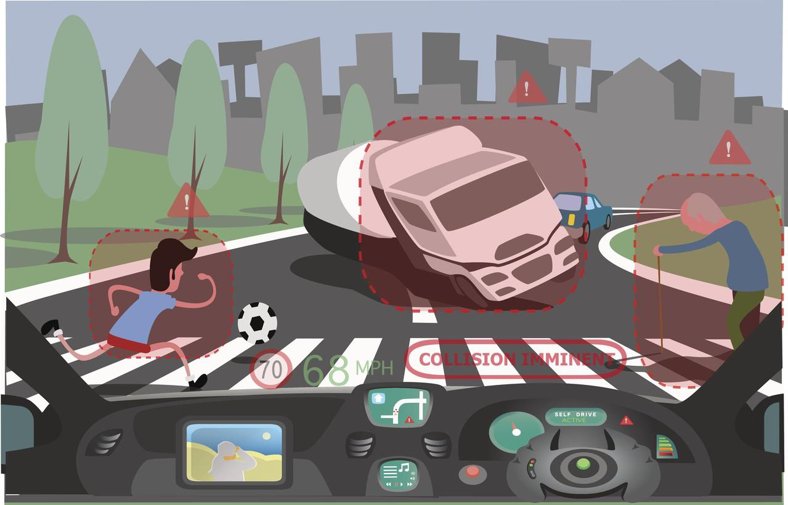

**中文**：司机应该怎么做？

**零基础讲解**：这张图是一个**序列决策**问题，不只是"分类一张图"：

1. **感知（perception）**：前方有小孩追球、右侧有老人、对向有车、车速 68 mph。
2. **预测（prediction）**：小孩可能会冲进马路；老人可能走得慢。
3. **决策（decision）**：刹车？左转？鸣笛？
4. **控制（control）**：踩刹车的力度、方向盘角度。

传统编程很难写全"如果小孩追球且右侧有老人且对向有车……"的规则。机器学习的方法是从**人类驾驶数据**中学习"看到这种画面，老司机一般怎么做"。

> 注意：这是**多模态、实时、安全攸关**的问题。本课程后面会用自动驾驶讲"端到端学习"（end-to-end learning）。

---

#### P17 What is Machine Learning – Labeling

> **原文**：Where do you want the car to go?

**中文**：你想让车去哪里？

**零基础讲解**：这一页讲**标注（labeling）**。

- 对分类：每张图要标"这是猫/狗"。
- 对自动驾驶：每帧画面要标"方向盘应该转多少度""应该加速还是刹车"。
- 对回归：每个样本要标"真实房价是多少"。

**标签就是"标准答案"**。监督学习（supervised learning）的本质就是：**用一堆"题目 + 标准答案"去调整模型，让它以后遇到新题也能答对**。

> 标注很贵：请人标 10 万张图要花很多钱和时间。这也是为什么"自监督学习""迁移学习"（L2）很重要——尽量少用标签。

---

#### P18 What is Machine Learning（自动驾驶的两种思路）

> **原文**：（图为三种自动驾驶架构）
> Input Image → Mediated Perception (e.g., Mobileye, Google) → Driving Control
> Input Image → Behavior Reflex (e.g., ALVINN, LeCun et al.) → Driving Control
> Input Image → Direct Perception (ours) → Driving Control

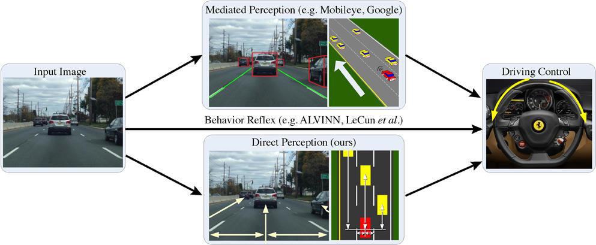

**中文**：输入图像 →（1）间接感知（先检测车道、车辆等，再决策）→ 驾驶控制；（2）行为反射（直接把图像映射到方向盘）→ 驾驶控制；（3）直接感知（本文方法：直接估计车道、距离等）→ 驾驶控制。

**零基础讲解**：三种"拆步骤"的方式：

1. **Mediated Perception（中介感知/模块化）**：先做目标检测，把"车在哪、车道在哪"变成结构化信息，再规划。优点是可解释，缺点是误差会累积（检测错→规划错）。
2. **Behavior Reflex（行为反射/端到端）**：一个神经网络直接看图输出方向盘角度。优点是简单，缺点是可解释性差、需要大量数据。
3. **Direct Perception（直接感知）**：不检测完整物体，只估计"车道线位置、与前车距离"等少量关键量，再控制。是折中方案。

> 这三个词后面会反复出现：**模块化（modular） vs 端到端（end-to-end）**。深度学习的趋势是端到端，但安全关键场景仍需要可解释的中间量。

---

#### P19 Machine Learning vs. Deep Learning (Video)

> **原文**：Introduction to Deep Learning: Machine Learning vs. Deep Learning

**中文**：深度学习入门：机器学习 vs 深度学习（视频）。

**零基础讲解**：视频的核心信息通常是：

- **机器学习**：需要人**手工设计特征**（feature engineering）。比如判断苹果，人要告诉程序"看颜色、形状、纹理"。
- **深度学习**：**自动学特征**。给原始像素，网络自己学出"边缘→纹理→部件→物体"。

> 类比：传统 ML 像你告诉厨师"先切丁、再焯水、再爆炒"；深度学习像给厨师一堆成品照片，让他自己琢磨火候和步骤。

---

#### P20 What is Deep Learning

> **原文**：
> • "Deep" refers to the layered model architectures which are usually deeper than conventional learning models
> • Human brain has much deeper layered architecture with increasing levels of abstraction

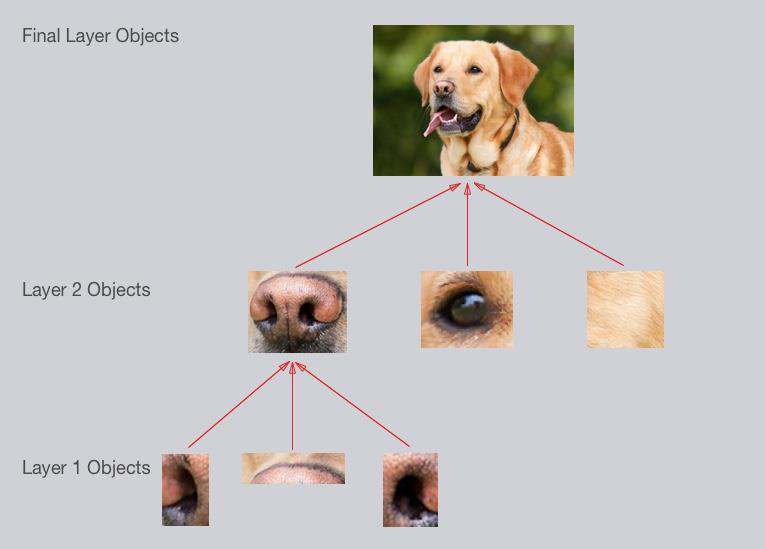

**中文**："深"指的是分层模型架构，通常比传统学习模型更深；人脑有更深的分层结构，抽象层次逐级提高。

**零基础讲解**：**"深" = 层数多**，不是"深奥"。

一个图像网络可能这样分层：

```
像素 (pixels)
  → 边缘 (edges)
  → 纹理 / 角点 (textures, corners)
  → 部件 (parts: 眼睛、轮子)
  → 物体 (objects: 猫、车)
  → 场景 (scene: 猫在沙发上)
```

每一层都在前一层的输出上做变换，越往后越"抽象"。

> **深度学习 ⊂ 机器学习 ⊂ 人工智能**。不要把它们当成三个并列的东西。

---

#### P21 GPU vs. CPU

> **原文**：GPU vs. CPU

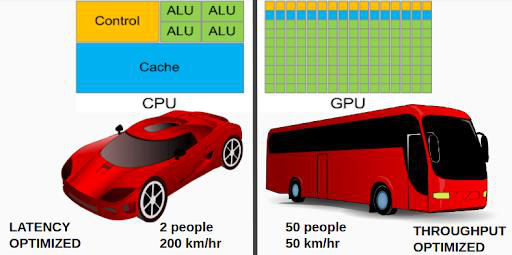

**中文**：图形处理器 vs 中央处理器。

**零基础讲解**：

- **CPU**：少数几个"很聪明"的核心，擅长复杂逻辑、串行任务。像**几个博士生**。
- **GPU**：成千上万个"简单"的核心，擅长同时做大量相同的算术。像**一万个小学生同时做加法**。

深度学习最耗时的运算是**矩阵乘法**（大量乘加），正好适合 GPU 并行。所以：

- 训练大模型 → 用 GPU（甚至多卡）；
- 推理小模型 → CPU 也能跑，但慢。

> 类比：CPU 是"一个名厨做一桌菜"，GPU 是"一千个帮厨同时切菜"。切菜这种重复劳动，人多就快。

---

#### P22 What is Machine Learning – Regression

> **原文**：
> • Goal: Find an equation that fits the data
> • Using a predefined function
> Feature 1 / Feature 2

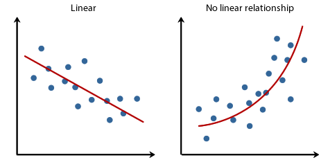

**中文**：目标：找到一个能拟合数据的方程；使用一个预先定义的函数。特征 1 / 特征 2。

**零基础讲解**：回归就是"找一条线/曲线，让它尽量穿过数据点"。

- 输入可以有多个特征：$x_1$（面积）、$x_2$（楼层）、$x_3$（地铁距离）。
- 输出是连续值：$y$（房价）。
- 模型是一个带参数的函数：$\hat y = f(x_1,x_2,x_3;\theta)$。

最简单的形式是**线性回归**：

$$\hat y = w_1x_1+w_2x_2+\cdots+w_dx_d+b$$

**通俗解释**：
- $\hat y$（读作 y-hat）是**预测值**，hat 表示"估计出来的"；
- $x_1,\dots,x_d$ 是 $d$ 个特征；
- $w_1,\dots,w_d$ 是**权重（weights）**，表示每个特征有多重要；
- $b$ 是**偏置（bias）**，相当于直线的截距。

> 当只有一个特征时，它就退化成 $y=wx+b$，也就是 P15 的 $y=mx+c$（只是换了字母）。

---

#### P23 What is Machine Learning（完整流程）

> **原文**：
> • Data Collections
> • Training & Visualization
> • Deployment & Fine-tuning

**中文**：数据收集；训练与可视化；部署与微调。

**零基础讲解**：这是机器学习项目的"三段式"：

```
1. 数据收集            2. 训练与可视化           3. 部署与微调
   采集 → 清洗            划分训练/验证/测试         上线服务
   标注 → 特征            选模型 → 训练 → 调参       监控 → 收集新数据
                          画损失曲线/混淆矩阵         → 继续微调
```

**每一段都可能翻车**：

- 数据：标签错了、样本偏差（只收集了白天照片）。
- 训练：过拟合、学习率不对、数据泄漏。
- 部署：线上分布和训练分布不一样（domain shift）。

> 一句话：**数据和评估比模型更重要**。初学者最容易犯的错是"只盯着模型结构"。

---

### B6. 最好的 $m$ 和 $c$：损失函数

#### P24 What is the best $m$ and $c$?

> **原文**：What is the best $m$ and $c$?

$$y = mx + c$$

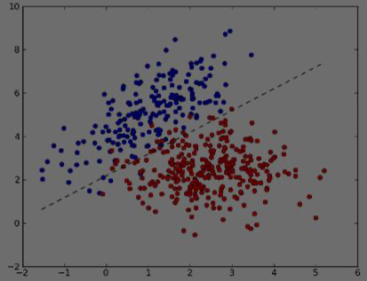

**中文**：最好的 $m$ 和 $c$ 是什么？

**零基础讲解**：一条直线由 $m,c$ 两个数完全确定。不同的 $(m,c)$ 得到不同的直线，拟合好坏不同。怎么量化"好坏"？——算**误差**。

**均方误差（Mean Squared Error, MSE）**：

$$J(m,c)=\frac{1}{n}\sum_{i=1}^{n}\big(y_i-(mx_i+c)\big)^2$$

**通俗解释**：
- $n$：样本数量；
- $i$：第 $i$ 个样本的编号（从 1 到 $n$）；
- $y_i$：第 $i$ 个样本的**真实答案**；
- $mx_i+c$：模型对第 $i$ 个样本的**预测值** $\hat y_i$；
- $y_i-\hat y_i$：**残差（residual）**，预测偏了多少；
- 平方 $(\cdot)^2$：让正负误差都变成正数，并且**重罚大误差**；
- $\frac1n\sum$：对所有样本求平均。

> 为什么不直接用绝对误差？因为平方函数光滑、可导，求梯度方便；而且平方会放大离群点的影响（这既是优点也是缺点）。

**手算例子**：三个点 $(1,2),(2,4),(3,6)$，假设 $c=0$，只学 $m$。

$$J(m)=\frac13\big[(2-m)^2+(4-2m)^2+(6-3m)^2\big]$$

- $m=0$：$J=\frac13(4+16+36)=\frac{56}{3}\approx18.67$；
- $m=1$：$J=\frac13(1+4+9)=\frac{14}{3}\approx4.67$；
- $m=2$：$J=0$（完美拟合）。

所以最优的 $m=2$。但现实中我们不会"试遍所有 $m$"，而是用梯度下降**一步步逼近**。

---

#### P25 What is Machine Learning – Classification（山峰比喻）

> **原文**：
> How to get the best classification result with least error (the peak)?
> The best $m$ and $c$ are here
> You are here


**中文**：如何以最小误差获得最好的分类结果（山顶）？最好的 $m$ 和 $c$ 在这里；你在这里。

**零基础讲解**：这是一个**优化的比喻**：

- 你站在山坡的某个位置（当前的 $m,c$）；
- 山顶是"表现最好"的点；
- 你看不见全局，只能用脚感受"哪边是上坡"，然后往上走。

> ⚠️ **重要澄清**：幻灯片说"peak（山顶）＝ least error（最小误差）"，这是把纵轴当成"表现/好度"。但在实际公式里，我们通常把纵轴定义为**损失/误差**，此时最优解在**谷底**，我们要**下山**。
>
> 两种说法是同一件事，只是纵轴翻转了：
> - 纵轴 = 准确率/表现 → 往**上**爬；
> - 纵轴 = 误差/损失 → 往**下**走。
>
> 考试如果问"梯度下降是下山还是上山"，标准答案是：**沿着损失函数下降的方向（下山）**。

---

#### P26 Training – following the slope

> **原文**：Training – following the slope

**中文**：训练——沿着斜率走。


**零基础讲解**：如果你在浓雾中的山上，只能看到脚边一小块地：

1. 用脚探一探，找到**最陡的下坡方向**；
2. 朝那个方向走一小步；
3. 停下来，再探一次；
4. 重复，直到走到谷底（或走不动了）。

这就是**梯度下降（gradient descent）**。"一小步"的大小叫**学习率（learning rate）**。

---

#### P27 What is Machine Learning – Classification（参数空间）

> **原文**：
> • You start somewhere and you want to reach the peak (least error)
> • How's about the data?

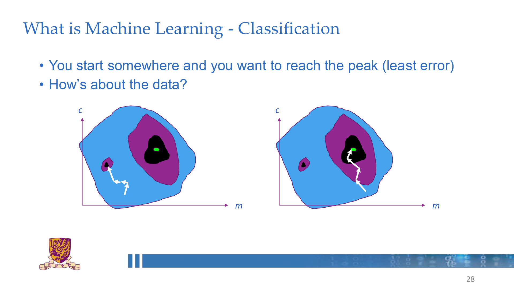

**中文**：你从某处出发，想到达山顶（误差最小）；那数据呢？

**零基础讲解**：这一页把视角从"数据空间"换到"**参数空间**"：

- 横轴是 $m$，纵轴是 $c$；
- 每一个点 $(m,c)$ 对应一条直线；
- 每个点有一个**损失值** $J(m,c)$，可以画成等高线/地形图；
- "你在这里"是初始猜测（比如 $m=0,c=0$）；
- "最优解"是损失最小的点。

**"How's about the data?"** 的意思是：地形不是凭空来的，它由**数据**决定。数据变了，地形就变了，最优的 $m,c$ 也变了。

> 对线性回归 + MSE，这个地形是一个**碗（凸函数）**，只有一个最低点。所以梯度下降一定能找到全局最优（只要学习率不太大）。对神经网络，地形可能有多个山谷，只能找到**局部最优**。

**图中左右两幅图的区别**（这是本页最值得看的地方）：

- 左图：起点在左边的小黑坑附近，梯度下降滑进了这个**局部最优（local minimum）**，再也出不来——它误以为这就是最低点。
- 右图：起点不同，路径绕过了小坑，最终到达中心的**全局最优（global minimum）**。

**通俗解释**：局部最优 = "附近最低的山谷"，全局最优 = "整个地形最低的山谷"。在真实的高维损失曲面里，还可能出现**鞍点（saddle point）**——某个方向是下坡、另一个方向是上坡，梯度接近 0 但并不是最优。

> 实践中的对策：随机初始化多个起点、用带动量的优化器（Momentum/Adam）、学习率预热与衰减。这些在 L8–L10 会展开。

---

#### P28 Training – following the slope（切线）

> **原文**：Training – following the slope

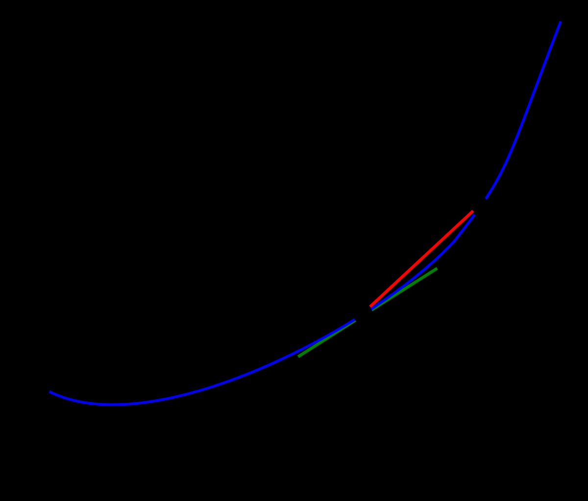

**中文**：训练——沿着斜率走。

**零基础讲解**：图中蓝线是损失曲线，红/绿线是不同点的**切线**。

- 切线越陡，说明"走一小步，损失变化很大"；
- 切线接近水平，说明快到谷底了，应该走小步；
- 切线的**斜率**就是**导数（derivative）**。

**一维情况**：先看导数的严格定义（课件中的公式）：

$$\frac{df(x)}{dx}=\lim_{h\to 0}\frac{f(x+h)-f(x)}{h}$$

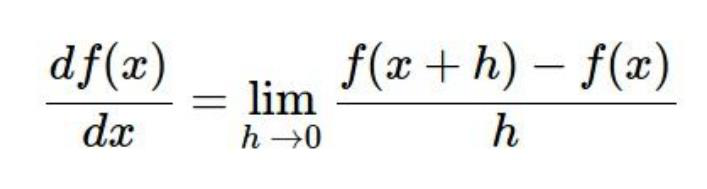

**通俗解释**：
- $f(x+h)-f(x)$：自变量从 $x$ 走到 $x+h$ 时，函数值变了多少；
- 除以 $h$：把"变化量"摊到"每走一格"上，得到**平均斜率**；
- $\lim_{h\to0}$：让 $h$ 无限小，平均斜率就变成**该点的瞬时斜率**，即导数；
- 所以导数 = "当前这一步，往右走一点点，函数上升多快"。

**导数的符号告诉你方向**：

$$\frac{dJ}{d\theta}\begin{cases}>0 & \text{增大 }\theta\text{ 会让 }J\text{ 变大} \Rightarrow \text{应该减小 }\theta\\[4pt] <0 & \text{增大 }\theta\text{ 会让 }J\text{ 变小} \Rightarrow \text{应该增大 }\theta\\[4pt] =0 & \text{到达极值点}\end{cases}$$

**通俗解释**：导数是"方向盘"。
- 导数为正 → 往右走会上升 → 那我们就往**左**走；
- 导数为负 → 往右走会下降 → 那我们就往**右**走。

所以更新方向永远是**导数的反方向**，这就是"**负梯度方向**"。

---

#### P29 Gradient Descent（梯度下降核心图）

> **原文**：Gradient Descent
> Initial Weight / Incremental Step / Gradient / Derivative of Cost / Minimum Cost

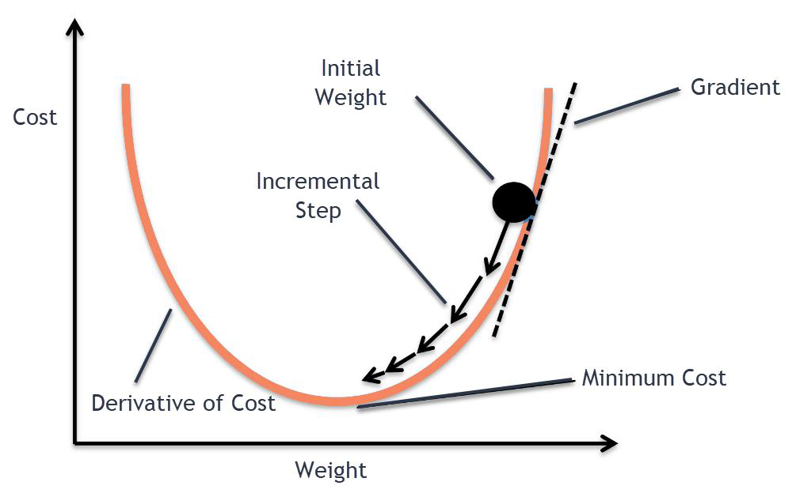

**中文**：梯度下降。初始权重 / 增量步 / 梯度 / 成本导数 / 最小成本。

**零基础讲解**：这张图是整节课**最重要的一张图**。

- 横轴：权重 $w$（可以是 $m$ 或 $c$，或神经网络里成千上万个参数之一）；
- 纵轴：成本/损失 $J(w)$；
- 黑球：当前参数；
- 虚线：当前点的切线，斜率 = 导数；
- 小箭头：每次更新的**步长**；
- 最低点：最优参数。

**核心公式**：

$$\theta_{t+1}=\theta_t-\eta\,\frac{dJ}{d\theta}\Big|_{\theta_t}$$

**通俗解释**：
- $\theta$（theta）：要学的参数（统称）；
- $t$：第 $t$ 次迭代；
- $\eta$（eta）：**学习率**，控制每步走多大；
- $\frac{dJ}{d\theta}$：损失对参数的导数，即"斜率"；
- 前面的负号：**往斜率相反的方向走**（下坡）；
- 整个式子：新参数 = 旧参数 − 学习率 × 斜率。

**多参数版本**（$m$ 和 $c$ 同时更新）：

$$\theta_{t+1}=\theta_t-\eta\nabla_\theta J(\theta_t)$$

**通俗解释**：
- $\nabla_\theta J$（读作 nabla）是**梯度**，把所有偏导数排成一个向量；
- 它指向"损失上升最快的方向"；
- 加负号就是"下降最快的方向"。

对 $J(m,c)=\frac1n\sum(y_i-mx_i-c)^2$，偏导数是：

$$\frac{\partial J}{\partial m}=-\frac{2}{n}\sum_{i=1}^{n}x_i\big(y_i-(mx_i+c)\big)$$

$$\frac{\partial J}{\partial c}=-\frac{2}{n}\sum_{i=1}^{n}\big(y_i-(mx_i+c)\big)$$

**通俗解释**：
- $\partial$（读作 partial）是偏导数，意思是"只对 $m$ 求导，把 $c$ 当常数"；
- 第一式：每个样本的误差乘以它的 $x_i$，再求和。$x_i$ 越大，这个样本对 $m$ 的影响越大；
- 第二式：只把误差求和。因为 $c$ 对每个样本的影响都是 1；
- 负号来自"预测值前面有负号"（$y_i-(mx_i+c)$ 对 $m$ 求导是 $-x_i$）。

**手算一遍（固定 $c=0$）**：数据 $(1,2),(2,4),(3,6)$，初始 $m=0$，学习率 $\eta=0.05$。

$$J(m)=\frac13\big[(2-m)^2+(4-2m)^2+(6-3m)^2\big]$$

$$\frac{dJ}{dm}=-\frac23\big[1(2-m)+2(4-2m)+3(6-3m)\big]=-\frac23(28-14m)$$

| 步数 | 当前 $m$ | 导数 $dJ/dm$ | 更新后 $m$ |
|---|---|---|---|
| 0 | 0.000 | −18.667 | 0.933 |
| 1 | 0.933 | −9.956 | 1.431 |
| 2 | 1.431 | −5.311 | 1.697 |
| 3 | 1.697 | −2.827 | 1.838 |
| 4 | 1.838 | −1.512 | 1.914 |
| 5 | 1.914 | −0.803 | 1.954 |

可以看到 $m$ 一步步逼近 2，导数越来越接近 0，步子自动变小。这就是"**跟着斜率走**"。

> **学习率怎么选？**
> - 太小（如 $10^{-6}$）：走得像蜗牛，训练很久不收敛。
> - 太大（如 $\eta=0.5$）：一步跨过谷底，甚至越走越远（发散）。
> - 合适：损失曲线平滑下降。
>
> 常见做法：从 $0.001$ 或 $0.01$ 试起，或用 Adam 等自适应优化器（后面讲）。

**三个必须分清的概念**：
- **参数（parameter）**：模型自己学，如 $m,c$、神经网络权重。
- **超参数（hyperparameter）**：人来设，如学习率、KNN 的 $K$、层数。
- **迭代（iteration）**：更新一次参数；**epoch**：把训练集完整过一遍。

---

#### P30 Gradient Descent（二维损失地形）

> **原文**：Gradient Descent
> negative gradient direction / original W / $w_1$ / $w_2$

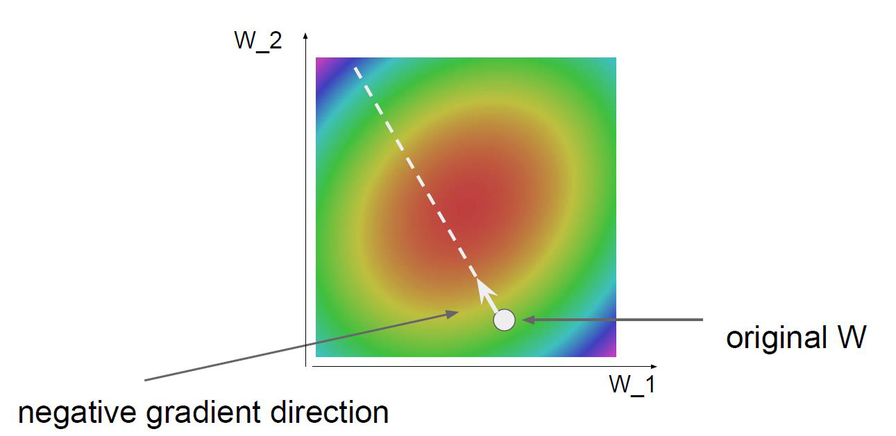

**中文**：梯度下降。负梯度方向 / 原始权重 / $w_1$ / $w_2$。

**零基础讲解**：当模型有两个参数 $w_1,w_2$ 时，损失地形是一个**曲面**（图上用颜色表示高度：红=高损失，蓝=低损失）。

- 白点：当前参数；
- 白色箭头：**负梯度方向**，即最陡的下坡方向；
- 虚线：实际走的路径（因为每走一步都要重新算梯度，所以路径是折线）。

**为什么不是直线冲向最低点？** 因为梯度只告诉你"当前位置"的最陡方向；走一步后位置变了，方向也变了。

> 高维神经网络有百万甚至十亿个参数，无法画图，但道理完全一样：**算梯度 → 走一小步 → 重复**。

---

#### P31 Deep Learning: TensorFlow Playground

> **原文**：Try deep learning on a browser: http://playground.tensorflow.org/

**中文**：在浏览器里试深度学习：http://playground.tensorflow.org/

**零基础讲解**：这是 Google 做的一个教学玩具，强烈建议你打开玩 10 分钟：

- 左侧选数据集（两个圆、螺旋、异或）；
- 中间选特征（$X_1,X_2,X_1^2,\dots$）、隐藏层数和神经元数；
- 右上角设置学习率、正则化；
- 点击运行，看决策边界怎么变、损失怎么降。

**可以亲手验证的结论**：
1. 没有隐藏层 → 只能画直线，螺旋数据分不开（**欠拟合**）。
2. 隐藏层太多/神经元太多 → 边界扭曲，训练损失很低但测试损失高（**过拟合**）。
3. 学习率太大 → 损失剧烈震荡甚至爆炸。
4. 加 L2 正则化 → 边界更平滑。

> 这个玩具把本讲后面所有概念（容量、过拟合、学习率、正则化）都可视化了，考试前可以再玩一次。

---

## Part C. 机器学习简史（P32–P39）

> 这一部分老师讲得比较快，考试通常考"谁在什么年代提出了什么"。先建立时间线，细节混脸熟即可。

### P32 History (1950s–1960s)

> **原文**：
> • The Dartmouth Workshop (1956): brought together researchers who aimed to simulate human intelligence using computers.
> • Early Neural Networks: developed the concept of perceptrons, which were basic artificial neurons capable of learning. However, perceptrons had limitations, and interest in neural networks declined due to their inability to solve complex problems.

**中文**：1956 年达特茅斯会议，聚集了希望用计算机模拟人类智能的研究者。早期神经网络提出了**感知机（perceptron）**——能学习的基本人工神经元；但感知机有局限（连 XOR 都解决不了），无法处理复杂问题，研究兴趣下降。

**零基础讲解**：

- **1956 达特茅斯会议**：通常被视为"人工智能"作为学科的起点。
- **感知机（1958, Rosenblatt）**：最早的人工神经元。它做一件事：把输入加权求和，超过阈值就输出 1，否则 0。

$$y=\begin{cases}1 & \text{若 }\sum_i w_ix_i+b>0\\0 & \text{否则}\end{cases}$$

**通俗解释**：$w_i$ 是每个输入的"重要性"，$b$ 是"门槛"。就像你决定要不要出门：天气、温度、心情各有权重，加起来超过某个门槛就出门。

- **局限**：单层感知机只能画**一条直线**，解决不了 XOR（异或）问题。这导致神经网络进入第一次"寒冬"。

---

### P33 History (1960s–1980s)

> **原文**：
> • Symbolic AI and Expert Systems: using explicit rules and logic to solve problems with knowledge bases and reasoning engines
> • The Backpropagation Algorithm (1986): developed by Geoffrey Hinton, David Rumelhart, and Ronald Williams, allowed for efficient training of multi-layered neural networks

**中文**：符号 AI 与专家系统：用显式规则和逻辑，配合知识库与推理引擎解决问题。1986 年反向传播算法（Hinton、Rumelhart、Williams）使多层神经网络能够高效训练。

**零基础讲解**：

- **符号 AI**：人把知识写成规则，例如"如果发烧且咳嗽，则可能是感冒"。优点是解释性强，缺点是规则写不完、维护困难。
- **反向传播（backpropagation）**：一种高效计算"每个参数对损失有多大责任"的方法。核心是**链式法则**：

$$\frac{\partial J}{\partial w}=\frac{\partial J}{\partial \hat y}\cdot\frac{\partial \hat y}{\partial w}$$

**通俗解释**：如果输出错了，先看最后一层错多少，再把"责任"一层层往回传，算出每个权重该改多少。没有它，深层网络几乎没法训练。

> 这门课 L8–L10 会详细讲反向传播，现在只要知道：**它是深度学习的发动机**。

---

### P34 History (1990s–2010s)

> **原文**：
> • Support Vector Machines (SVMs): popular for classify data by finding optimal decision boundaries.
> • Rise of Big Data and Data-Driven Approaches: led to increased interest in data-driven approaches, such as decision trees, random forests, and ensemble methods.
> • Deep Learning and Neural Networks: multiple layers, achieved remarkable success in various domains, including computer vision, natural language processing, and speech recognition.

**中文**：支持向量机（SVM）通过寻找最优决策边界来分类，很流行。大数据与数据驱动方法兴起：决策树、随机森林、集成方法。深度学习与神经网络：多层结构在计算机视觉、自然语言处理、语音识别等领域取得显著成功。

**零基础讲解**：

- **SVM**：不仅找一条能分开的线，还要找"**间隔最大**"的那条线（最稳妥）。核技巧（kernel）还能处理非线性。
- **决策树/随机森林**：一系列 if-else 问题；随机森林是很多棵树的投票。
- **集成（ensemble）**：三个臭皮匠，顶个诸葛亮。

---

### P35 History (2010–2020)

> **原文**：
> • ImageNet Breakthrough (AlexNet): won the ImageNet competition by a wide margin using a Convolutional Neural Network (CNN) trained on GPUs. This event catalyzed the modern deep learning boom and shifted computer vision away from hand-engineered features.
> • Generative Adversarial Networks (GANs): a generator network against a discriminator network in a zero-sum game framework, enabling realistic image synthesis and data augmentation.
> • The Transformer Architecture: by replacing recurrent structures with multi-head self-attention mechanisms, Transformers enabled massive parallelization during training and became the foundational architecture for modern NLP and vision.

**中文**：
- **AlexNet**：用 GPU 训练的 CNN 在 ImageNet 比赛上大幅领先，点燃现代深度学习热潮，让计算机视觉从"手工特征"转向"学习特征"。
- **GAN**：生成器 vs 判别器的零和博弈，能合成逼真图像、做数据增强。
- **Transformer**：用多头自注意力替代循环结构，训练时可大规模并行，成为现代 NLP 与视觉的基础架构。

**零基础讲解**：

- **2012 AlexNet** 是深度学习的"iPhone 时刻"。在此之前，图像识别靠 SIFT、HOG 等手工特征；之后，端到端 CNN 全面胜出。
- **GAN 的直觉**：生成器是"造假币的"，判别器是"验钞的"。两者互相竞争，造假技术越来越真。
- **Transformer 的直觉**：一句话里每个词都去"看"其他所有词，决定该关注谁（**注意力**）。因为没有循环，能并行处理整个句子，所以能用 GPU 大规模训练——这就是 GPT 的基础。

---

### P36 History (2020+)

> **原文**：
> • OpenAI introduced GPT-3 (175 billion parameters), demonstrating that scaling autoregressive Transformer models enables strong few-shot and zero-shot learning capabilities across diverse language tasks without task-specific fine-tuning.
> • Denoising Diffusion Probabilistic Models (DDPMs) surpassed GANs in visual generation quality. Systems like Latent Diffusion (Stable Diffusion) made high-fidelity text-to-image synthesis efficient and accessible.
> • OpenAI released ChatGPT, pairing Large Language Models with Reinforcement Learning from Human Feedback (RLHF). This unlocked highly coherent instruction-following and conversational interactions, triggering widespread enterprise and consumer adoption.

**中文**：
- GPT-3（1750 亿参数）证明：规模化自回归 Transformer 具备强 few-shot / zero-shot 能力，无需针对每个任务微调。
- DDPM（去噪扩散概率模型）在视觉生成质量上超过 GAN；Latent Diffusion（Stable Diffusion）让高质量文生图高效且易用。
- ChatGPT 把 LLM 与人类反馈强化学习（RLHF）结合，实现高度连贯的指令遵循与对话，引发广泛采用。

**零基础讲解**：

- **few-shot / zero-shot**：只给几个例子（few-shot）甚至不给例子（zero-shot），模型就能做新任务。
- **自回归（autoregressive）**：一个词一个词地预测下一个词。
- **扩散模型（diffusion）**：先给图片加噪声，再学着从噪声里一步步"去噪"还原图片。Stable Diffusion 在"潜空间"里做，所以快。
- **RLHF**：先用人类偏好数据训练一个"打分员"，再用强化学习让模型输出更符合人类喜好的回答。ChatGPT 的"会聊天"很大程度来自这一步。

---

### P37 History (2020+)

> **原文**：
> • Machine learning shifted toward natively multimodal architectures capable of processing text, vision, audio, and code simultaneously. Advances in reasoning-focused architectures, Mixture of Experts (MoE), parameter-efficient fine-tuning (PEFT)
> • Agentic Workflow: Decomposes complex tasks via chain-of-thought, tree-of-thought, or self-reflection loops to correct errors dynamically. Implemented the capacity to execute external tools including code interpreters, web search, API endpoints, databases, and filesystem operations.

**中文**：机器学习转向原生多模态架构，能同时处理文本、视觉、音频和代码；推理导向架构、混合专家（MoE）、参数高效微调（PEFT）取得进展。Agentic 工作流：通过思维链、思维树或自我反思循环分解复杂任务并动态纠错；能调用外部工具，包括代码解释器、网页搜索、API、数据库和文件系统。

**零基础讲解**：

- **多模态（multimodal）**：一个模型同时理解图、文、音、视频。
- **MoE**：模型里有很多"专家"子网络，每次只激活少数几个，参数量大但计算量可控。
- **PEFT**：不重训整个大模型，只训练一小部分（如 LoRA），省显存。
- **Agentic workflow**：AI 不只回答，还会"规划→调用工具→看结果→纠错"。

```
目标 → 拆解任务 → 调用工具（搜索/代码/数据库）→ 观察结果
         ↑                                      ↓
         └────────── 反思与纠错 ←───────────────┘
```

---

### P38 History of Machine Learning（四大方向）

> **原文**：Federated learning / Reinforcement Learning / Generative AI / Large language model

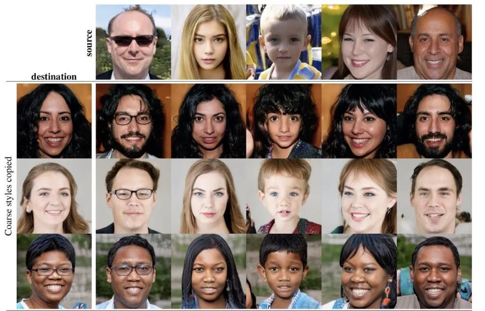

**中文**：联邦学习 / 强化学习 / 生成式 AI / 大语言模型。

**零基础讲解**：

- **联邦学习（Federated Learning）**：数据留在本地（手机、医院），只上传模型更新，保护隐私。
- **强化学习（RL）**：智能体通过"奖励/惩罚"试错学习，像训练小狗。
- **生成式 AI**：生成新内容（图、文、音）。
- **LLM**：海量文本训练的大语言模型。

> 这四块对应课程后半段（L11–L12）。

---

### P39 Agentic AI

> **原文**：Agentic AI

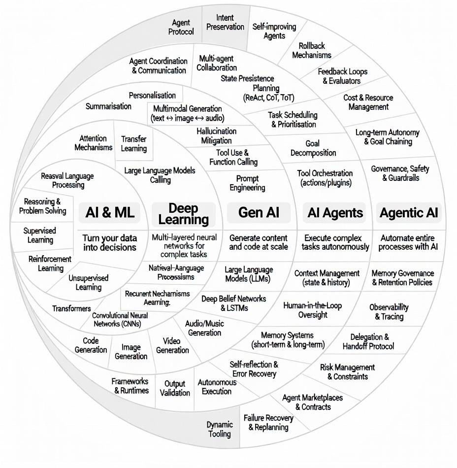

**中文**：智能体 AI。

**零基础讲解**：一个 agent 通常包含：

1. **感知（Perceive）**：读取用户请求、工具返回结果。
2. **规划（Plan）**：把大任务拆成小步骤（思维链）。
3. **行动（Act）**：调用搜索、代码、API。
4. **观察（Observe）**：看工具输出。
5. **反思（Reflect）**：发现错了就改计划，循环。

> 这正是你让我（AI 导师）做的事：读 PDF → 规划笔记结构 → 写文件 → 检查 → 修正。OpenCode 就是这类 agent 的编程环境。

---

## Part D. 监督学习：从例子中学一个类（P40–P53）

> 这是 L1 的**理论核心**，也是最容易考的部分。

### P40 Agenda（进入第三部分）

> **原文**：Course Introduction / What are machine learning / Supervised Learning and KNN

**中文**：课程介绍 / 什么是机器学习 / 监督学习与 KNN。

**零基础讲解**：前两部分是"什么是 ML"和"怎么训练"，从这里开始进入**监督学习的具体例子**：用"家庭用车"这个二分类问题，把特征、假设、噪声、过拟合串起来。

---

### D1. 家庭用车例子与特征向量

#### P41 Learning a Class from Examples

> **原文**：
> • Goal: Identify family cars from all cars. Class 1 - family cars; Class 0 - others
> • Feature engineering: find features shared by all class 1 but not class 0.
> • Prediction: is the car $x$ (not in training data) a family car?
> • Represent each car $x$ as a feature vector $x=(x_1,x_2,\dots,x_n)^T$
> • e.g., $x_1$ = price, $x_2$ = engine power.

**中文**：目标：从所有汽车中识别"家庭用车"。类别 1 = 家庭用车；类别 0 = 其他。特征工程：找出所有类别 1 都有、而类别 0 没有的特征。预测：一辆不在训练数据里的车 $x$，是不是家庭用车？把每辆车表示成特征向量 $x=(x_1,x_2,\dots,x_n)^T$，例如 $x_1$=价格，$x_2$=发动机功率。


**零基础讲解**：

- **特征（feature）**：描述一个物体的可量化属性。车：价格、功率、座位数、油耗、车长。
- **特征向量（feature vector）**：把多个特征排成一列。

$$x=\begin{bmatrix}x_1\\x_2\\\vdots\\x_n\end{bmatrix},\qquad x^T=[x_1,x_2,\dots,x_n]$$

**通俗解释**：
- $x$ 是**列向量**（竖着写）；
- $x^T$ 是它的**转置（transpose）**，变成横着写；
- 课件写 $(x_1,\dots,x_n)^T$ 是为了在行文里节省空间，本质还是列向量。

**例子**：一辆车 $x=(18\text{ 万}, 150\text{ 马力})^T$。

> **特征工程（feature engineering）** 是传统机器学习的关键：选对特征，模型事半功倍；选错特征（比如用"车漆颜色"判断家庭用车），模型学不到东西。深度学习的一大优势就是**自动学特征**。

---

#### P42 Training Set $S_{train}$

> **原文**：
> • A set of $n$ examples: $S_{train}=\{(x_1,y_1),\dots,(x_n,y_n)\}$
> • Each $(x_i,y_i)$ is a car
> • Feature vector (2 features): $x_i=(f_{i1},f_{i2})$
> • Class label:
>   $$y=\begin{cases}1 & \text{for family cars }(+)\\0 & \text{for others }(-)\end{cases}$$

**中文**：$n$ 个样本的集合：$S_{train}=\{(x_1,y_1),\dots,(x_n,y_n)\}$。每个 $(x_i,y_i)$ 是一辆车。特征向量（2 个特征）：$x_i=(f_{i1},f_{i2})$。类别标签：家庭用车为 1（正类），其他为 0（负类）。

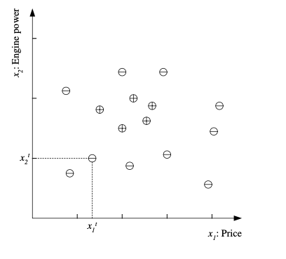

**零基础讲解**：

- **训练集**就是"带答案的题库"。
- $x_i$：第 $i$ 辆车的特征；$y_i$：它的答案（0 或 1）。
- $f_{i1}$：第 $i$ 辆车的第 1 个特征（价格）；$f_{i2}$：第 2 个特征（功率）。

> 符号习惯：$x_i$ 的 $i$ 是**样本编号**；$f_{ij}$ 的 $j$ 是**特征编号**。别搞混。

**监督学习的两个子类型**：
- $y$ 是离散类别 → **分类**（如本例）。
- $y$ 是连续数值 → **回归**。

---

### D2. 训练集、假设类与容量

#### P43 Hypothesis Class $C$

> **原文**：
> • The rectangle corresponds to a model (a.k.a. hypothesis) specified by 4 points: $(p_1,e_1),(p_2,e_1),(p_1,e_2)$ and $(p_2,e_2)$
> • The learning algorithm finds a hypothesis $h$ to approximate the class $C$ as closely as possible.
> • Make sure that the hypothesis class $H$ is flexible enough (or has enough capacity) to learn $C$, i.e., to find $h$ that is as similar as possible to $C$.

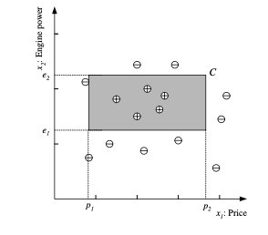

**中文**：矩形对应一个模型（也叫假设），由 4 个点确定：$(p_1,e_1),(p_2,e_1),(p_1,e_2),(p_2,e_2)$。学习算法找到一个假设 $h$，尽可能逼近真实类别 $C$。要确保假设类 $H$ 足够灵活（有足够容量）来学习 $C$，即找到尽可能接近 $C$ 的 $h$。

**零基础讲解**：这一页有几个关键区分：

| 符号 | 含义 | 通俗说法 |
|---|---|---|
| $C$ | 真实概念（true concept） | "家庭用车"的客观标准 |
| $H$ | 假设空间（hypothesis class） | 我们**允许**模型长什么样，比如"所有轴对齐矩形" |
| $h$ | 一个具体假设 | 某一个具体的矩形 |

- **矩形**由 4 个边界确定：左 $p_1$、右 $p_2$、下 $e_1$、上 $e_2$。

$$h(x)=\begin{cases}1 & \text{若 }p_1\le x_1\le p_2\text{ 且 }e_1\le x_2\le e_2\\0 & \text{否则}\end{cases}$$

**通俗解释**：
- $x_1$ 是价格，$x_2$ 是功率；
- $(p_1,p_2)$ 是价格区间，$(e_1,e_2)$ 是功率区间；
- 落在矩形内 → 判为家庭用车。

- **容量（capacity）**：$H$ 能表达多少种不同的形状。
  - 矩形容量小 → 只能表达"价格和功率都在某范围内"，简单但可能不够。
  - 任意曲线容量大 → 能拟合复杂边界，但容易过拟合。

> 这张图还暗示：真实概念 $C$ 可能是"斜着的"或"带缺口"的，而 $H$ 只能画轴对齐矩形。**如果 $C$ 不在 $H$ 里，无论怎么训练都只能近似**。这就是"归纳偏置"的由来（见 P52）。

---

### D3. 噪声、模型复杂度与奥卡姆剃刀

#### P44 Noise and Model Complexity

> **原文**：
> • Sources of noise:
>   • Measurement (input)
>   • Labelling (output)
>   • Hidden attributes
> • Simple rectangle (linear) model is preferred
>   • Simpler to use with lower computational complexity
>   • Easier to train with lower space complexity
>   • Easier to explain with higher interpretability
>   • Better generalization with lower variance (Occam's razor)

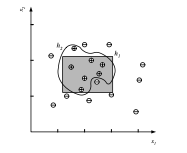

**中文**：噪声来源：测量（输入）、标注（输出）、隐藏属性。更简单的矩形（线性）模型更可取：计算复杂度低、训练更容易且空间复杂度低、更容易解释（可解释性高）、泛化更好且方差更低（奥卡姆剃刀）。

**零基础讲解**：

**三类噪声**：
1. **测量噪声（input）**：传感器误差。价格记错、秤不准。
2. **标注噪声（output）**：人标错了。把豪华车标成家庭车。
3. **隐藏属性（hidden attributes）**：影响结果但没记录的因素。比如"车主是否二胎"——它影响买不买家庭车，但你的特征里没有。

> 噪声让"100% 正确"变得不可能。模型要学会**忽略噪声、抓住规律**，而不是死记每个点。

**为什么简单模型好？**

| 维度 | 简单模型 | 复杂模型 |
|---|---|---|
| 计算 | 快 | 慢 |
| 存储 | 小 | 大 |
| 可解释性 | 高 | 低 |
| 方差 | 低 | 高 |
| 偏差 | 高 | 低 |

- **奥卡姆剃刀（Occam's razor）**：同样能解释数据时，选更简单的假设。
- **方差（variance）**：换一批训练数据，模型变化有多大。复杂模型对数据太敏感，方差大。
- **偏差（bias）**：模型本身的假设与真实规律的差距。简单模型假设太强，偏差大。

> 图中灰色矩形是简单模型，黑色波浪线是复杂模型。波浪线把每个训练点都圈进去了，但它学到的很可能是**噪声**，换个数据集就崩了。

> ⚠️ 课件说"simple rectangle (linear) model"——严格说，轴对齐矩形不是线性函数，只是"简单/低容量"模型。考试按"简单模型"理解即可。

---

#### P45 三类车的重叠

> **原文**：Sports car / Luxury sedan / Family car / Price / Engine Power / ?

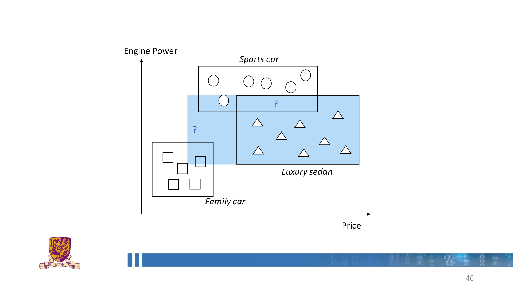

**中文**：跑车 / 豪华轿车 / 家庭用车 / 价格 / 发动机功率 / ？

**零基础讲解**：这张图说明**现实中的类别经常重叠**：

- **家庭用车**：价格低、功率低（左下）。
- **跑车**：价格中高、功率高（上方）。
- **豪华轿车**：价格高、功率中低（右侧）。
- 图中两处 **"?"** 是重叠区：
  - 家庭用车与跑车的重叠：价格不算高、但功率偏高 → 可能是"运动型小车"；
  - 家庭用车与豪华轿车的重叠：价格偏高、但功率不高 → 可能是"入门豪华车/大空间车"。

**怎么办？**
1. **加特征**：座位数、后备箱容积、油耗、车门数——家庭用车的判别力更强。
2. **换模型**：不用矩形，用能画斜线/曲线的模型（逻辑回归、SVM、树、神经网络）。
3. **接受不确定性**：输出概率而不是硬标签（如"70% 是家庭车"）。

> 这页是 P43 "假设类容量"的现实版：**不是模型不努力，是特征/假设空间不够**。

---

### D4. 训练 / 验证 / 测试

#### P46 Process of Training

> **原文**：
> • Build and train a model with only Training data, and measure the performance with the validation data
> • For different hyperparameters / models, measure the performance with the validation data
> • With the best hyperparameters / models, measure using testing data (in this course, it is the submission)

**中文**：只用训练数据构建和训练模型，用验证数据衡量性能；对不同超参数/模型，用验证数据衡量；用最好的超参数/模型，在测试数据上衡量（本课程中就是提交结果）。

**零基础讲解**：这是**机器学习最重要的纪律**：

```
训练集（Training）    → 用来更新参数（模型"看书学习"）
验证集（Validation）  → 用来选超参数/选模型（"模拟考"）
测试集（Test）        → 最后只测一次（"高考"）
```

**为什么不能拿测试集调参？** 因为一旦你用测试集选了模型，测试集的信息就"泄漏"进模型了，它就不再是"没见过的数据"，你得到的分数会**虚高**。

> 本课程中，测试集就是**提交（submission）**——你只能提交有限次数，不能反复试。

---

#### P47 Training, Testing and Validation Sets

> **原文**：（图）Training Data / Validation Data / Test Data
> （Text book）/（Homework）/（Public exam）

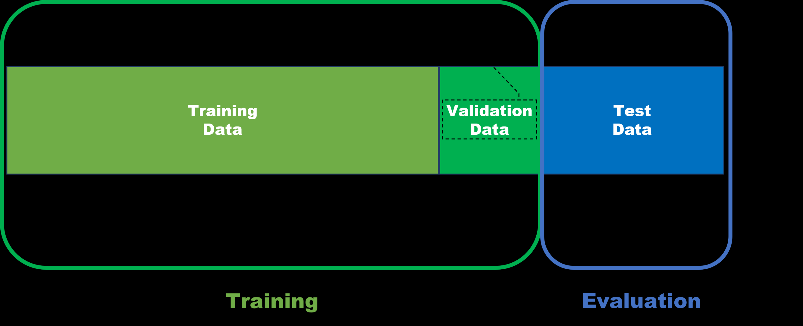

**中文**：训练数据 / 验证数据 / 测试数据；教科书 / 作业 / 公开考试。

**零基础讲解**：老师的类比非常准确：

- **训练集 = 教科书**：你可以在上面反复学习、做笔记。
- **验证集 = 作业**：用来检查自己哪里没懂，可以反复做、对答案。
- **测试集 = 公开考试**：只能考一次，考完才知道真实水平。

**常见划分比例**：
- 小数据：60% / 20% / 20%，或 70% / 15% / 15%。
- 大数据：98% / 1% / 1%（数据够多时，验证/测试不需要很大）。
- 交叉验证（cross-validation）：数据少时，把训练集分成 $K$ 份，轮流拿一份做验证（后面课会讲）。

**三条铁律**：
1. 测试集**绝不**参与训练或调参。
2. 预处理（如标准化）的参数（均值、方差）只能从**训练集**算，再应用到验证/测试集。
3. 划分要**随机且分层**（保持各类比例），避免某一类全在测试集。

> 第 2 条叫"数据泄漏（data leakage）"，是初学者最常犯的错误之一。比如你先用全部数据算均值再标准化，测试集的信息就漏进训练了。

---

### D5. 过拟合、欠拟合与学习曲线

#### P48 Process of Training（误差曲线）

> **原文**：
> • Training set: drops at the beginning, saturated after
> • Testing set: drops at the beginning but higher than training set, and goes up after a point (overfitted)

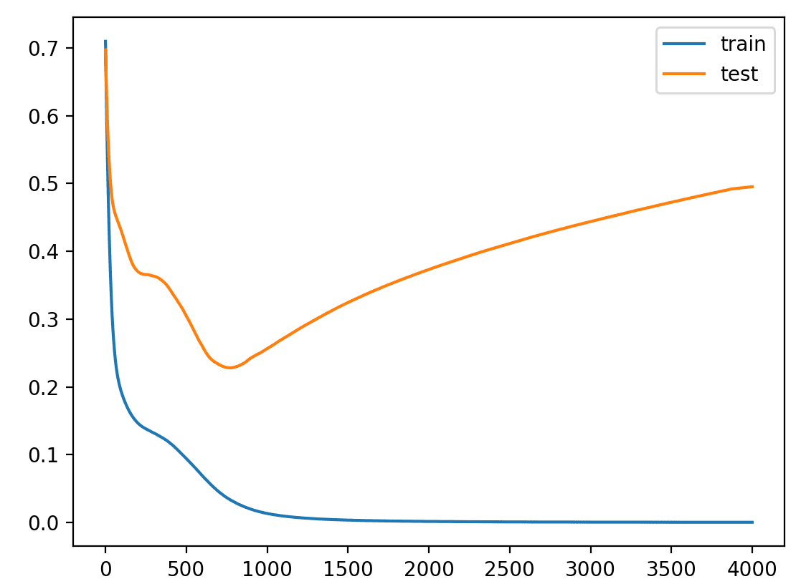

**中文**：训练集误差：开始下降，之后饱和。测试集误差：开始也下降，但始终高于训练集，并在某一点之后**上升**（过拟合）。

**零基础讲解**：横轴是 **epoch**（把训练集完整过一遍的次数），纵轴是误差。

- **训练误差**（蓝线）：一路下降，最后接近 0。因为模型在"背"训练数据。
- **测试误差**（橙线）：先降后升，呈 **U 形**。
  - 前半段：模型还在学规律，测试误差也降。
  - 最低点：**最佳停止点**（early stopping）。
  - 后半段：模型开始背噪声，训练误差继续降，但测试误差升 → **过拟合**。

**为什么会这样？** 模型容量足够大时，它可以把每个训练样本的噪声都记住。但噪声在新数据上不重复，所以测试表现变差。

**实用技巧**：
- **Early stopping**：在验证误差开始上升时停。
- **正则化（regularization）**：给复杂度加惩罚。
- **Dropout**：训练时随机"关掉"一些神经元。
- **数据增强**：把图片旋转/裁剪，增加多样性。
- **更多数据**：最有效，但最贵。

> 注意：图中测试误差始终高于训练误差，这是正常的。**训练误差不是目标，验证/测试误差才是。**

---

#### P49 Tuning models using Grid Search（网格 vs 随机）

> **原文**：Tuning models using Grid Search
> GRID LAYOUT / RANDOM LAYOUT / Important Parameter / Unimportant Parameter

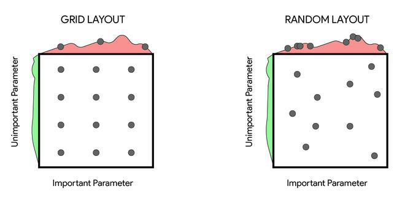

**中文**：用网格搜索调参。网格布局 / 随机布局 / 重要参数 / 不重要参数。

**零基础讲解**：

- **网格搜索（Grid Search）**：把每个超参数的候选值列出来，做**笛卡尔积**，逐一训练评估。
  - 例如学习率 $\{0.001,0.01,0.1\}$、层数 $\{1,2,3\}$ → 9 种组合。
- **随机搜索（Random Search）**：在每个范围内随机采样若干组。

**为什么随机搜索有时更好？** 图中"重要参数"（横轴）影响大，"不重要参数"（纵轴）影响小。网格搜索会把大量预算浪费在不重要的维度上；随机搜索能在重要维度上覆盖更多不同值。

> 经验：超参数少于 3 个、范围小 → 网格；维度高、预算有限 → 随机（或贝叶斯优化）。

---

#### P50 Tuning models using Grid Search（代码）

> **原文**：（PyTorch 网格搜索代码）
> ```python
> best_model = None
> best_loss = float('inf')
> best_params = {}
>
> for params in param_combinations:
>     print(f"Training with parameters: {params}")
>     model = train_model(params['hidden_size'], params['learning_rate'], params['num_epochs'])
>
>     # Evaluate model (using validation set or a simple train loss)
>     with torch.no_grad():
>         total_loss = 0
>         for batch_X, batch_y in train_loader:
>             outputs = model(batch_X)
>             loss = nn.MSELoss()(outputs, batch_y)
>             total_loss += loss.item()
>
>     avg_loss = total_loss / len(train_loader)
>     print(f"Average Loss: {avg_loss:.4f}")
>
>     if avg_loss < best_loss:
>         best_loss = avg_loss
>         best_model = model
>         best_params = params
>
> print(f"Best parameters: {best_params}, Best loss: {best_loss:.4f}")
> ```

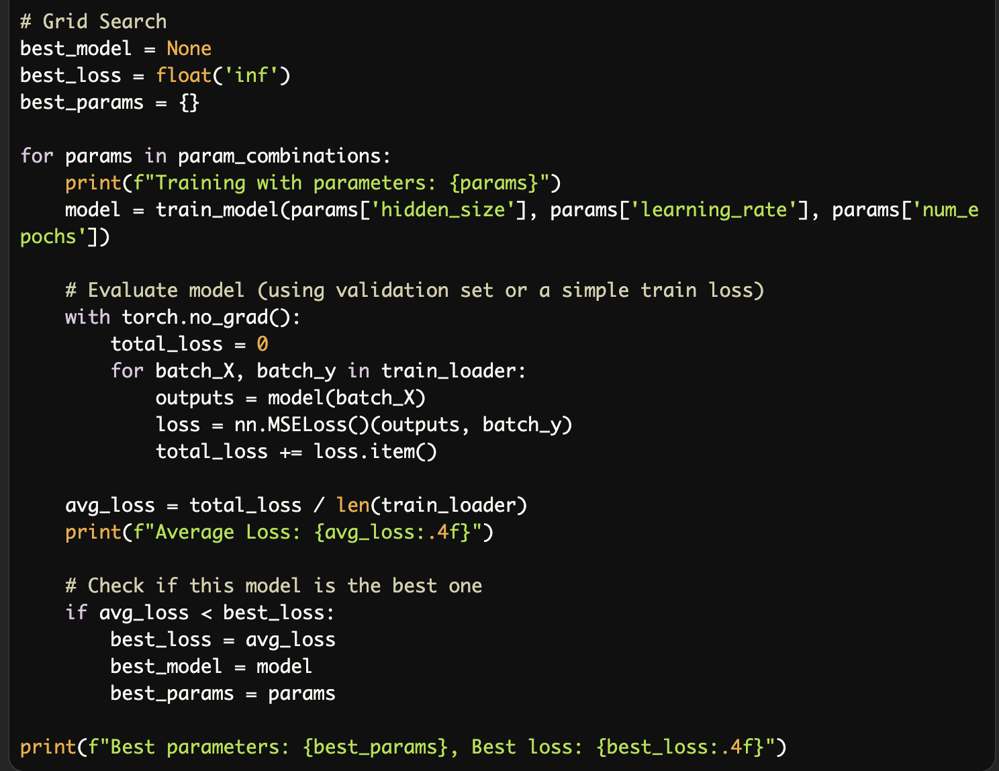

**中文**：网格搜索代码：初始化最优模型/损失/参数；遍历参数组合；训练；在 `no_grad` 下计算平均损失；若更好则记录；最后打印最优。

**零基础讲解**（逐行）：

- `best_loss = float('inf')`：初始最优损失设为正无穷，任何真实损失都比它小。
- `for params in param_combinations`：遍历所有超参数组合。
- `train_model(...)`：用这组超参数训练一个模型。
- `with torch.no_grad():`：评估时**不计算梯度**，省内存、加速。
- `for batch_X, batch_y in train_loader`：一批一批地算损失。
- `nn.MSELoss()(outputs, batch_y)`：均方误差。
- `total_loss += loss.item()`：`.item()` 把张量转成 Python 数字。
- `avg_loss = total_loss / len(train_loader)`：平均每批损失。
- `if avg_loss < best_loss:`：保留最好的。

> ⚠️ **课件代码有个方法学问题**：注释说"using validation set or a simple train loss"，但实际循环用的是 `train_loader`。**用训练损失选超参数会偏向过拟合的模型**。正确做法是用**验证集**（`val_loader`）算损失。考试如果问"这段代码哪里不对"，这就是答案。

---

#### P51 Model Complexity（模型复杂度曲线）

> **原文**：Training error and cross-validation error, as a function of model complexity

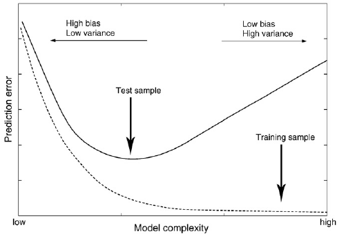

**中文**：训练误差与交叉验证误差随模型复杂度变化的曲线。

**零基础讲解**：这张图和 P48 是"同一件事的两种横轴"：

- P48 横轴是 **训练时间（epoch）**；
- P51 横轴是 **模型复杂度**（层数、参数数量、多项式阶数）。

**两条曲线**：
- **训练误差**（虚线）：复杂度越高，越低，最终接近 0。
- **测试/验证误差**（实线）：**U 形**。最低点是"最佳复杂度"。

**左右两端**：
- 左边（低复杂度）：**欠拟合（underfitting）**，也就是 **high bias / low variance**。模型太简单，训练误差和测试误差都高。
- 右边（高复杂度）：**过拟合（overfitting）**，也就是 **low bias / high variance**。训练误差很低，测试误差高。

**偏差-方差分解**：

$$\mathbb{E}\big[(y-\hat y)^2\big]=\text{Bias}^2+\text{Variance}+\text{Irreducible Noise}$$

**通俗解释**：
- **Bias（偏差）**：模型平均预测与真实值的差距。"模型太笨"。
- **Variance（方差）**：换训练集，预测的波动。"模型太敏感"。
- **Irreducible Noise（不可约噪声）**：数据本身的随机性，任何模型都消不掉。

> 一个好模型是在 bias 和 variance 之间找平衡，而不是把训练误差压到 0。

---

### D6. 网格搜索与模型选择

#### P52 Model Selection

> **原文**：
> • Learning is an ill-posed problem
> • Data alone is not sufficient to find a unique solution
> • Inductive bias (i.e., assumptions about H) is needed.
> • Generalization: how well a learned model performs on new data.
> • Overfitting: H is more complex than C
> • Underfitting: H is less complex than C
> • Model selection: choosing the right inductive bias.

**中文**：学习是一个"不适定问题"；仅凭数据不足以找到唯一解；需要**归纳偏置**（对假设空间 $H$ 的假设）。**泛化**：学到的模型在新数据上的表现。**过拟合**：$H$ 比 $C$ 更复杂。**欠拟合**：$H$ 比 $C$ 更简单。**模型选择**：选择合适的归纳偏置。

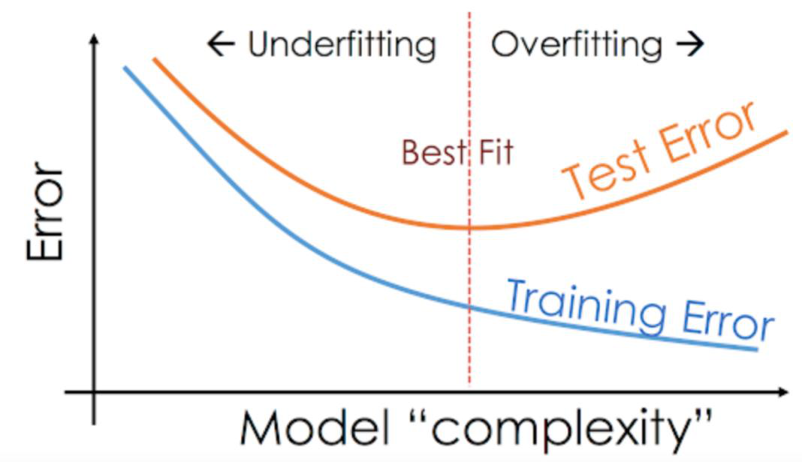

**零基础讲解**：

**为什么"不适定（ill-posed）"？** 给你 5 个点，能穿过它们的曲线有**无穷多条**：

- 一条直线（简单）；
- 一个 4 次多项式（正好穿过 5 个点）；
- 无数条弯弯曲曲的线。

数据本身不能告诉你选哪条。你必须加**假设**，比如"我偏好简单的线"——这就是**归纳偏置（inductive bias）**。

**常见归纳偏置**：
- 线性回归：假设输出是输入的线性组合。
- KNN：假设"离得近的样本，标签相似"。
- CNN：假设图像有局部性、平移不变性。
- RNN/Transformer：假设序列有顺序/长程依赖。

**过拟合 vs 欠拟合（用 $H$ 与 $C$ 解释）**：
- $H$ 比 $C$ **复杂** → 模型有能力学噪声 → **过拟合**。
- $H$ 比 $C$ **简单** → 模型连真实规律都表达不了 → **欠拟合**。

> 注意：这里的"复杂"是相对**真实概念**而言，不是绝对的参数量。

**怎么判断？**

| 现象 | 训练误差 | 验证误差 | 诊断 |
|---|---|---|---|
| 欠拟合 | 高 | 高 | 模型太简单/特征不够/训练不足 |
| 刚好 | 低 | 低 | 理想 |
| 过拟合 | 很低 | 高 | 模型太复杂/数据太少/训练太久 |

**怎么修？**
- 欠拟合：加特征、加容量、减少正则化、训练更久。
- 过拟合：加数据、加正则化、简化模型、early stopping、dropout。

---

#### P53 Model Selection（验证曲线）

> **原文**：Model selection

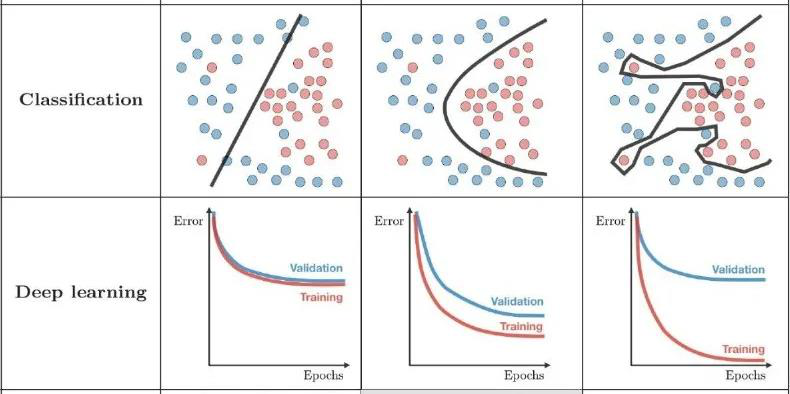

**中文**：模型选择。

**零基础讲解**：模型选择就是"在候选模型/超参数中，选验证误差最低的那个"。

**标准流程**：

```
for 每个候选模型/超参数组合:
    在训练集上训练
    在验证集上评估
选验证误差最低的模型
在测试集上评估一次（最终报告）
```

> 千万不要：用测试集选模型 → 再用同一个测试集报告分数。这等于"偷看答案"，分数不可信。

---

## Part E. Python 与 NumPy（P54–P58）

> 这部分是**工具课**，考试可能考代码输出/索引，务必动手跑一遍。

### P54 How do we process the Big Data? Python!

> **原文**：How do we process the Big Data? Python!

**中文**：我们如何处理大数据？Python！

**零基础讲解**：Python 是机器学习的"通用语言"，因为生态最全：NumPy（数值）、pandas（表格）、matplotlib（画图）、scikit-learn（传统 ML）、PyTorch（深度学习）。

---

### P55 Python

> **原文**：
> • Easy to use and easy to maintain
> • Portable library with supports from GUI programing
> • Cross platform: Mac, Windows and Unix
> • Free and open-source

**中文**：易用易维护；可移植，支持 GUI 编程；跨平台（Mac/Windows/Unix）；免费开源。

**零基础讲解**：这些是"为什么选 Python"的官方理由。实际体验：语法接近伪代码，社区大，遇到问题容易搜到答案。

---

### P56 NumPy

> **原文**：
> • Library for the Python programming language
> • Support for large, multi-dimensional arrays and matrices
> • Useful for linear algebra, Fourier transform, and random number capabilities

**中文**：Python 的库；支持大型多维数组与矩阵；适用于线性代数、傅里叶变换和随机数。

**零基础讲解**：NumPy 的核心是 **`ndarray`（N 维数组）**。

- Python 原生 list 慢：每个元素都是对象，逐个循环。
- NumPy 数组快：连续内存 + C 实现 + **向量化（vectorization）**。

```python
# 慢：Python 循环
total = 0
for x in data:
    total += x

# 快：NumPy 向量化
total = data.sum()
```

> 深度学习框架（PyTorch）的 Tensor 用法和 NumPy 很像，所以学好 NumPy 是学 PyTorch 的捷径。

---

### P57 NumPy Examples

> **原文**：Need to import NumPy (and other libraries)

```python
import numpy as np

a = np.array([1, 2, 3])          # 一维数组
b = np.arange(0, 10, 2)          # [0 2 4 6 8]
c = np.zeros((2, 3))             # 2x3 全 0
d = np.ones((2, 3))              # 2x3 全 1
e = np.eye(3)                    # 3x3 单位矩阵
f = np.random.rand(2, 3)         # 2x3 随机数 [0,1)

a + 1          # [2 3 4]        广播
a * 2          # [2 4 6]
a @ a          # 14             点积
np.dot(a, a)   # 14
a.shape        # (3,)
c.shape        # (2, 3)
```

**零基础讲解**：

- `np.array([...])`：从 Python 列表创建数组。
- `np.arange(start, stop, step)`：左闭右开，和 `range` 一样。
- `np.zeros((行, 列))`：创建矩阵。
- `np.eye(n)`：单位矩阵（对角线为 1）。
- `@`：矩阵乘法/点积。
- **广播（broadcasting）**：`a + 1` 会把标量 1 自动"扩展"到每个元素。

> 形状（shape）是 NumPy 最容易出错的地方。记住：`(3,)` 是一维，`(3,1)` 是二维列向量，`(1,3)` 是二维行向量。

---

### P58 NumPy Indexing

> **原文**：The index start from "0", negative indexing are also supported

```python
x = np.array([[1, 2, 3],
              [4, 5, 6]])

x[0, 0]      # 1
x[0]         # array([1, 2, 3])   第 0 行
x[:, 1]      # array([2, 5])      第 1 列
x[-1, -1]    # 6                 最后一行最后一列
x[0, 1:]     # array([2, 3])
x[x > 3]     # array([4, 5, 6])   布尔索引
x.shape      # (2, 3)
x.T          # 转置，形状 (3, 2)
```

**中文**：索引从 0 开始，也支持负索引。

**零基础讲解**：

- `x[0, 0]`：第 0 行第 0 列（左上角）。
- `x[0]`：第 0 行（省略列索引 = 整行）。
- `x[:, 1]`：所有行的第 1 列。冒号 `:` 表示"全部"。
- `x[-1]`：最后一行；`-2` 是倒数第二行。
- `x[x > 3]`：**布尔掩码**，返回所有大于 3 的元素（拉平成一维）。

> 常见错误：`x[0, 1:]` 是"第 0 行，从第 1 列到末尾"，结果是 `[2,3]`，不是 `[1,2]`。

---

### P64（补充）NumPy 课堂练习

> 说明：这页在课件里排在 KNN 部分，但内容是 NumPy 练习，所以放在 Part E 讲，方便你连着练。

> **原文**（slide 64 代码）：
> ```python
> import numpy as np
> score = np.array([10, 3, 2, 4, 5, 10, 8])
> nationality = np.array([1, 1, 1, 0, 0, 2, 2])
> # task 1: print the first element
> # task 2: write a for loop to calculate the sum of all elements
> # task 3: find the sum of the second and the last elements of score
> # task 4: find the min, max and mean of score
> # task 5: obtain the elements that are greater than 5
> # task 6: obtain the elements that nationality is 1
> # task 7: find the mean of the elements that nationality is 1
> # task 8: write a function that will return the mean of the input data
> # task 9: write a for loop to find the nationality with highest mean using the function
> ```

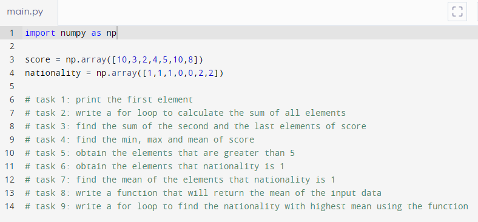

**中文**：成绩数组与国籍数组的 9 个练习。

**零基础讲解 + 参考答案**：

```python
import numpy as np
score = np.array([10, 3, 2, 4, 5, 10, 8])
nationality = np.array([1, 1, 1, 0, 0, 2, 2])

# task 1
print(score[0])                      # 10

# task 2
total = 0
for s in score:
    total += s
print(total)                         # 42

# task 3
print(score[1] + score[-1])          # 3 + 8 = 11

# task 4
print(score.min(), score.max(), score.mean())   # 2 10 6.0

# task 5
print(score[score > 5])              # [10 10  8]

# task 6
print(score[nationality == 1])       # [10  3  2]

# task 7
print(score[nationality == 1].mean())  # 5.0

# task 8
def mean(data):
    return np.sum(data) / len(data)
    # 或直接 return np.mean(data)

# task 9
best_nat, best_mean = None, -np.inf
for nat in np.unique(nationality):
    m = mean(score[nationality == nat])
    print(nat, m)
    if m > best_mean:
        best_nat, best_mean = nat, m
print(best_nat)                      # 2（均值 9.0）
```

**手算验证**：
- 总和 $=10+3+2+4+5+10+8=42$。
- 国籍 0：$(4+5)/2=4.5$。
- 国籍 1：$(10+3+2)/3=5.0$。
- 国籍 2：$(10+8)/2=9.0$ → 最高。

> 这题同时练了：索引、循环、聚合函数、布尔索引、函数封装。考试很可能出类似小题。

---

## Part F. K 近邻 KNN（P59–P65）

### F1. KNN 是"懒学生"

#### P59 K-Nearest Neighbors

> **原文**：
> • KNN is a lazy learner. It builds no mathematical model during training; it simply memorizes the dataset and defers all computation to the moment a query is made.

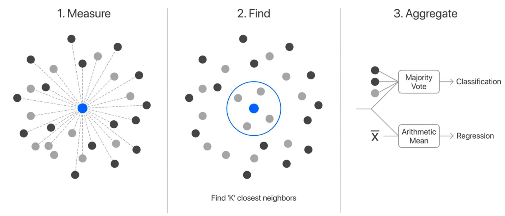

**中文**：KNN 是一种"懒惰学习器"。训练时它不构建任何数学模型，只是记住数据集，把所有计算推迟到查询时刻。

**零基础讲解**：KNN 的"训练"几乎为零：

- **训练阶段**：把 $(x_i,y_i)$ 全部存起来，结束。
- **预测阶段**：来了一个新样本 $x$，计算它到所有训练样本的距离，找最近的 $K$ 个，投票/平均。

```
训练：  memorize(X_train, y_train)     # 没有参数要学
预测：  distances = dist(x, X_train)
        idx = argsort(distances)[:K]
        return majority_vote(y_train[idx])   # 分类
        return mean(y_train[idx])            # 回归
```

**三步图**：
1. **Measure**：量新样本到每个训练点的距离。
2. **Find**：找最近的 $K$ 个。
3. **Aggregate**：分类→多数投票；回归→取平均。

**优点**：
- 简单、直观、无需训练。
- 天然支持多分类。
- 加新数据很方便（直接存）。

**缺点**：
- 预测慢：每次都要和所有训练点算距离，$O(n d)$。
- 占内存：要存全部数据。
- 对特征尺度敏感（所以要做标准化）。
- 高维下效果差（**维度灾难**）。
- 对噪声/离群点敏感（可以用距离加权缓解）。

> **"lazy" 不是贬义**，是术语：**lazy learning（懒惰学习）** = 把计算推迟到预测时；对应的 **eager learning（急切学习）** = 训练时就把模型学好（如线性回归、神经网络）。

---

### F2. 三种距离

#### P60 The Three Foundations of Distance

> **原文**：
> • Straight-line geometric distance.
> • Sum of absolute coordinate differences.
> • Measures directional alignment, ignoring magnitude.
> • Best for continuous, low-dimensional, isotropic feature spaces.
> • Best for high-dimensional, sparse spaces; highly robust to outliers.
> • Best for scale-independent text processing and document representation.

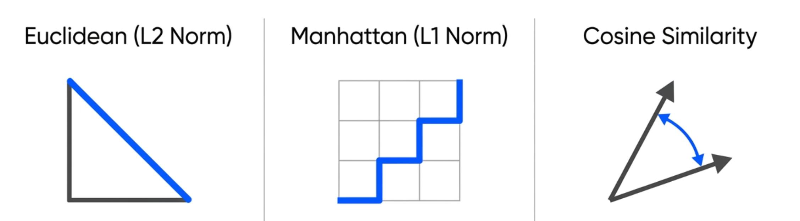

**中文**：
- 直线几何距离（欧氏）。
- 坐标差绝对值之和（曼哈顿）。
- 衡量方向一致性，忽略长度（余弦）。
- 欧氏：适合连续、低维、各向同性的特征空间。
- 曼哈顿：适合高维稀疏空间，对离群点稳健。
- 余弦：适合与尺度无关的文本处理和文档表示。

**零基础讲解**：

**(1) 欧氏距离（Euclidean / L2 Norm）**

$$d_2(a,b)=\sqrt{\sum_{j=1}^{d}(a_j-b_j)^2}$$

**通俗解释**：
- $a,b$ 是两个样本的特征向量；
- $a_j,b_j$ 是第 $j$ 个特征；
- 先算每个特征的差，平方，求和，再开根号；
- 就是"两点之间的直线距离"（勾股定理的推广）。

例子：$a=(1,2)$，$b=(4,6)$：$d_2=\sqrt{3^2+4^2}=\sqrt{25}=5$。

**(2) 曼哈顿距离（Manhattan / L1 Norm）**

$$d_1(a,b)=\sum_{j=1}^{d}|a_j-b_j|$$

**通俗解释**：
- 只取绝对值，不平方；
- 像在城市网格里走路：不能穿墙，只能横着走 + 竖着走；
- 对大的差异没有平方放大，所以**对离群点更稳健**。

例子：$a=(1,2)$，$b=(4,6)$：$d_1=|3|+|4|=7$。

**(3) 余弦相似度（Cosine Similarity）**

$$\cos\theta=\frac{a\cdot b}{\|a\|\,\|b\|}=\frac{\sum_j a_jb_j}{\sqrt{\sum_j a_j^2}\sqrt{\sum_j b_j^2}}$$

$$d_{\cos}(a,b)=1-\cos\theta$$

**通俗解释**：
- $a\cdot b$ 是点积；
- $\|a\|$ 是向量长度；
- 分子除以分母，把长度"归一化"掉，只剩**夹角**；
- $\cos\theta=1$：方向完全相同；$0$：垂直；$-1$：相反。
- 距离用 $1-\cos\theta$，这样"越相似距离越小"。

例子：$a=(1,0)$，$b=(2,0)$：方向相同，$\cos=1$，$d_{\cos}=0$——尽管长度差一倍，余弦认为它们"完全一样"。

**什么时候用哪个？**

| 距离 | 适合 | 不适合 |
|---|---|---|
| 欧氏 L2 | 连续、低维、各特征尺度相近 | 高维稀疏、尺度差异大 |
| 曼哈顿 L1 | 高维稀疏、有离群点 | 需要旋转不变性时 |
| 余弦 | 文本/嵌入、方向重要 | 长度/幅度重要时 |

> 文本为什么用余弦？因为文档长短不同，但"主题方向"才是关键。一篇长文和一篇短文只要词频比例相似，余弦就认为相似。

---

#### P61 First, you need a space

> **原文**：
> • A KNN algorithm is dependent on how closeness is defined
> • Changing the mathematical rules for measuring space fundamentally alters which neighbors are considered closest

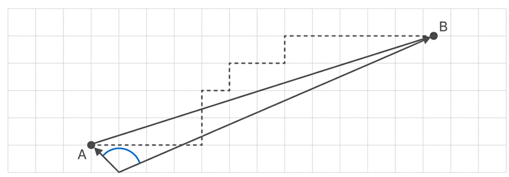

**中文**：KNN 算法依赖于" closeness（接近）"如何定义；改变度量空间的数学规则，会从根本上改变哪些邻居被认为最近。

**零基础讲解**：图中 A、B 两点：

- **欧氏**：直接连直线（最短）。
- **曼哈顿**：只能沿网格走折线（更长）。
- **余弦**：看两条从原点出发的箭头的夹角（方向）。

**同一个数据集，换一种距离，KNN 的预测可能完全不同。** 所以"距离"是 KNN 的**超参数/设计选择**，不是固定的。

> 类比：评价两个人"像不像"——
> - 欧氏：比较身高、体重、年龄的绝对差；
> - 曼哈顿：各项差的和；
> - 余弦：比较"兴趣方向"是否一致（都爱篮球），不管水平高低。

---

### F3. 空间、标准化与 CNN

#### P62 Preparing the Space

> **原文**：
> Standardization: Normalizes coordinates to prevent large-scale variables from dominating distance
> Condensed Nearest Neighbor (CNN): A memory-saving technique that deletes redundant interior data points, keeping only the boundary prototypes necessary to maintain decision accuracy, calculations.

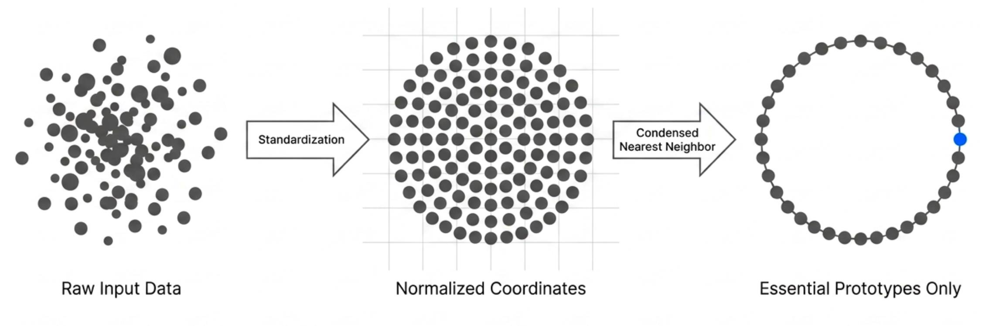

**中文**：**标准化**：归一化坐标，防止大尺度变量主导距离。**浓缩最近邻（Condensed Nearest Neighbor, CNN）**：一种节省内存的技术，删除冗余的内部数据点，只保留维持决策精度所需的边界原型。

**零基础讲解**：

**(1) 标准化（Standardization / Z-score）**

$$z_j=\frac{x_j-\mu_j}{\sigma_j}$$

**通俗解释**：
- $x_j$：第 $j$ 个特征的原始值；
- $\mu_j$：该特征在**训练集**上的均值；
- $\sigma_j$：该特征在**训练集**上的标准差；
- $z_j$：标准化后的值，表示"偏离均值几个标准差"；
- 标准化后，每个特征的均值≈0，标准差≈1。

**为什么必须做？** 看一个例子：

| 样本 | 房价（元） | 房龄（年） |
|---|---|---|
| A | 5,000,000 | 10 |
| B | 5,100,000 | 30 |

欧氏距离：$\sqrt{100000^2+20^2}\approx100000$。房龄的 20 年差异**完全被房价淹没**。但房龄可能更重要！

标准化后：房价差约 0.1 个标准差，房龄差约 2 个标准差 → 房龄终于"说话"了。

> ⚠️ 标准化的 $\mu,\sigma$ 只能从**训练集**计算，然后应用到验证/测试集。否则数据泄漏。

**(2) 浓缩最近邻（CNN）**

> ⚠️ **术语陷阱**：这里的 **CNN = Condensed Nearest Neighbor**，不是卷积神经网络（Convolutional Neural Network）！同一门课后面 L5 会讲卷积神经网络，也是 CNN。**看上下文**。

思路：
- KNN 要存所有训练点，内存大、预测慢。
- 但很多**内部点**对决策没用——它们被同类点包围，删掉也不影响边界。
- 只保留**边界附近的原型（prototypes）**，就能维持差不多的精度。

```
原始数据（很多点） → 标准化 → 浓缩最近邻 → 只留边界点
```

**算法直觉**（Hart, 1968）：
1. 从每个类别取一个种子点。
2. 遍历其他点，如果它被当前原型集**错误分类**，就加入原型集。
3. 重复直到稳定。
4. 最终只保留"容易分错"的边界点。

> 图中间是标准化后的规则网格，右边是只保留圆周上的点（边界）。蓝色点是查询点。

---

### F4. 手算例子

#### P63 Using KNN in Python（数据表）

> **原文**：

| Points | $X_1$ (Acid Durability) | $X_2$ (strength) | $Y$ = Classification |
|---|---|---|---|
| P1 | 7 | 7 | BAD |
| P2 | 7 | 4 | BAD |
| P3 | 3 | 4 | GOOD |
| P4 | 1 | 4 | GOOD |

**中文**：点 / 耐酸性 / 强度 / 分类。P1、P2 是 BAD；P3、P4 是 GOOD。

**零基础讲解**：这是一个二维二分类玩具数据。

- 特征：耐酸性（1–7）、强度（4–7）。
- 标签：BAD / GOOD。
- 训练集只有 4 个点。

**手算预测**：查询点 $Q=(5,5)$（耐酸性 5，强度 5）。

| 训练点 | 坐标 | 与 $Q$ 的欧氏距离 | 标签 |
|---|---|---|---|
| P1 | (7,7) | $\sqrt{(5-7)^2+(5-7)^2}=\sqrt{8}\approx2.83$ | BAD |
| P2 | (7,4) | $\sqrt{4+1}=\sqrt5\approx2.24$ | BAD |
| P3 | (3,4) | $\sqrt{4+1}=\sqrt5\approx2.24$ | GOOD |
| P4 | (1,4) | $\sqrt{16+1}=\sqrt{17}\approx4.12$ | GOOD |

**$K=3$**：最近的三个是 P2（2.24）、P3（2.24）、P1（2.83）。

投票：BAD 2 票（P1、P2）vs GOOD 1 票（P3）→ 预测 **BAD**。

> 注意 P2 和 P3 距离相同（并列）。$K=3$ 时还能靠 P1 打破平局；如果 $K=2$，就会 1:1 平票。**这就是为什么分类任务通常选奇数 $K$**。

**再试 $Q=(5,3)$**：

| 训练点 | 距离 | 标签 |
|---|---|---|
| P1 (7,7) | $\sqrt{4+16}=\sqrt{20}\approx4.47$ | BAD |
| P2 (7,4) | $\sqrt{4+1}=\sqrt5\approx2.24$ | BAD |
| P3 (3,4) | $\sqrt{4+1}=\sqrt5\approx2.24$ | GOOD |
| P4 (1,4) | $\sqrt{16+1}=\sqrt{17}\approx4.12$ | GOOD |

$K=3$：P2、P3、P4 → GOOD 2 票，BAD 1 票 → 预测 **GOOD**。

> 同一个模型，查询点稍微移动，预测就变了。这说明 **KNN 的决策边界是"锯齿状"的**，由训练点决定。

**$K$ 怎么选？**
- $K$ 太小（如 1）：对噪声敏感，容易过拟合。
- $K$ 太大（如 $n$）：所有点都参与，偏向多数类，欠拟合。
- 常用：$K=3,5,7$，用**验证集**选；分类选奇数避免平票。

---

### F5. sklearn 代码

#### P63–P64 sklearn 示例

> **原文**（图）：
> ```python
> >>> from sklearn.neighbors import NearestNeighbors
> >>> import numpy as np
> >>> X = np.array([[-1, -1], [-2, -1], [-3, -2], [1, 1], [2, 1], [3, 2]])
> >>> nbrs = NearestNeighbors(n_neighbors=2, algorithm='ball_tree').fit(X)
> >>> distances, indices = nbrs.kneighbors(X)
> >>> indices
> array([[0, 1],
>        [1, 0],
>        [2, 1],
>        [3, 4],
>        [4, 3],
>        [5, 4]]...)
> >>> distances
> array([[0.        , 1.        ],
>        [0.        , 1.        ],
>        [0.        , 1.41421356],
>        [0.        , 1.        ],
>        [0.        , 1.        ],
>        [0.        , 1.41421356]])
> ```

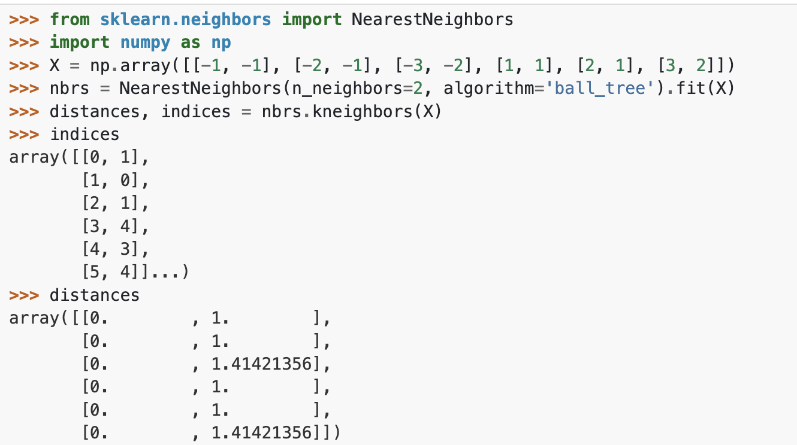

**中文**：导入 `NearestNeighbors` 和 NumPy；创建 6 个二维点；用 `n_neighbors=2`、`ball_tree` 算法拟合；查询每个点的最近邻；输出索引和距离。

**零基础讲解**：

- `X` 的 6 个点：左边三个（负坐标），右边三个（正坐标）。
- `NearestNeighbors(n_neighbors=2)`：找最近的 2 个（**包括自己**）。
- `fit(X)`：KNN 的"训练"就是存数据。
- `kneighbors(X)`：查询**训练点自己**的邻居。

**读输出**：
- 第 0 行 `[0, 1]`：点 0 的最近邻是点 0（自己，距离 0）和点 1（距离 1）。
- 第 3 行 `[3, 4]`：点 3 的最近邻是点 3（自己）和点 4（距离 1）。
- 距离矩阵第一列全是 0，因为**查询的是训练点本身**。

> ⚠️ **常见坑**：`kneighbors(X)` 会把查询点自己算进去。如果你要预测**新样本**，应该用 `kneighbors([[x1, x2]])`，或者用 `KNeighborsClassifier.predict([[x1, x2]])`，否则"自己"会占据一个邻居名额。

**分类用法**：

```python
from sklearn.neighbors import KNeighborsClassifier

X = [[7, 7], [7, 4], [3, 4], [1, 4]]
y = ['BAD', 'BAD', 'GOOD', 'GOOD']

knn = KNeighborsClassifier(n_neighbors=3)
knn.fit(X, y)

print(knn.predict([[5, 5]]))        # ['BAD']
print(knn.predict_proba([[5, 5]]))  # [[0.6667 0.3333]]
print(knn.kneighbors([[5, 5]]))     # 返回距离和索引
```

**输出解释**：
- `predict`：预测类别。
- `predict_proba`：各类别概率（3 个邻居中 2 个 BAD → 0.667）。
- `kneighbors`：返回距离和训练点索引，方便调试。

**`algorithm='ball_tree'` 是什么？**
- 暴力搜索要算 $n$ 次距离；树结构（ball tree / kd-tree）能加速高维/大数据查询。
- 数据量小的时候差别不大，默认 `auto` 即可。

---

#### P65 Demo: Scraping with OpenCode

> **原文**：
> • prepare a python to collect the brand from https://www.lanecrawford.com.hk/
> • Visualize the brand

**中文**：用 Python 从 Lane Crawford 网站收集品牌，并可视化。

**零基础讲解**：这是一个"数据收集 → 可视化"的小项目，流程：

```
1. 用 requests 下载网页 HTML
2. 用 BeautifulSoup 解析品牌名
3. 用 pandas 去重/计数
4. 用 matplotlib 画条形图
```

示例骨架：

```python
import requests
from bs4 import BeautifulSoup
import pandas as pd
import matplotlib.pyplot as plt

url = "https://www.lanecrawford.com.hk/"
html = requests.get(url, headers={"User-Agent": "Mozilla/5.0"}, timeout=10).text
soup = BeautifulSoup(html, "html.parser")

brands = [a.get_text(strip=True) for a in soup.select("a.brand")]  # 选择器需按实际页面调整
df = pd.Series(brands).value_counts().head(20)

df.plot(kind="barh")
plt.xlabel("Count")
plt.ylabel("Brand")
plt.tight_layout()
plt.show()
```

> ⚠️ 实际注意：
> - 很多电商页面是 **JavaScript 动态渲染**，`requests` 拿不到品牌，需要 Playwright/Selenium。
> - 遵守 `robots.txt` 和网站条款，控制请求频率，别把人家服务器打挂。
> - 这只是演示，考试不会考具体选择器。

---

## Part G. 收尾（P66–P68）

### P66 Readings

> **原文**：
> • Numpy: https://numpy.org/doc/stable/user/quickstart.html
> • PyCharm: https://www.jetbrains.com/help/pycharm/creating-and-running-your-first-python-project.html#prerequisites
> • Opencode: https://opencode.ai

**中文**：NumPy 快速入门；PyCharm 创建并运行第一个 Python 项目；OpenCode 官网。

**零基础讲解**：建议顺序：
1. NumPy Quickstart（30 分钟，跟着敲）。
2. PyCharm 建项目 + 虚拟环境（venv）。
3. OpenCode 文档，试着让它读一个 CSV 并画图。

---

### P67 Others

> **原文**：
> • Please bring your computer for the next lecture
> • Install Opencode and PyCharm (professional version, free for students)
> • Learn virtual environment and install library
> • Run the example in this lecture

**中文**：下节课带电脑；安装 OpenCode 和 PyCharm（专业版，学生免费）；学习虚拟环境并安装库；运行本讲示例。

**零基础讲解**：**虚拟环境（virtual environment）** 是什么？

- 每个项目一个"独立的工具箱"，避免不同项目的库版本打架。
- 常用命令：

```powershell
# 创建
python -m venv .venv

# 激活（Windows PowerShell）
.\.venv\Scripts\Activate.ps1

# 安装
pip install numpy scikit-learn matplotlib torch
```

> 如果 PowerShell 报"禁止运行脚本"，用 `Set-ExecutionPolicy -Scope CurrentUser RemoteSigned` 放行。

---

### P68 Questions?

> **原文**：Questions? Email: pakmingcheung@cuhk.edu.hk

**中文**：有问题？邮箱：pakmingcheung@cuhk.edu.hk

---

## 公式总表

| 名称 | 公式 | 一句话解释 |
|---|---|---|
| 直线 | $y=mx+c$ | $m$ 斜率，$c$ 截距 |
| 斜率 | $m=\Delta y/\Delta x$ | 横向走一格，纵向升多少 |
| 线性回归（多特征） | $\hat y=\sum_j w_jx_j+b$ | 每个特征乘权重再求和 |
| 均方误差 | $J=\frac1n\sum_i(y_i-\hat y_i)^2$ | 预测误差平方的平均 |
| 梯度下降 | $\theta_{t+1}=\theta_t-\eta\nabla_\theta J$ | 沿负梯度方向走一小步 |
| 学习率 | $\eta$ | 每步走多大 |
| 欧氏距离 | $d_2=\sqrt{\sum_j(a_j-b_j)^2}$ | 直线距离 |
| 曼哈顿距离 | $d_1=\sum_j|a_j-b_j|$ | 网格距离 |
| 余弦相似度 | $\cos\theta=\frac{a\cdot b}{\|a\|\|b\|}$ | 看方向，忽略长度 |
| 标准化 | $z=\frac{x-\mu}{\sigma}$ | 变成"偏离均值几个标准差" |
| 偏差-方差 | $\text{Err}=\text{Bias}^2+\text{Var}+\sigma^2$ | 误差的三个来源 |
| KNN 分类 | $\hat y=\text{mode}\{y_i:i\in N_K(x)\}$ | 最近的 K 个邻居投票 |
| KNN 回归 | $\hat y=\frac1K\sum_{i\in N_K(x)}y_i$ | 最近的 K 个邻居取平均 |

---

## 术语表

| 英文 | 中文 | 一句话解释 |
|---|---|---|
| Machine Learning | 机器学习 | 从数据中自动找规律 |
| Deep Learning | 深度学习 | 用多层神经网络做机器学习 |
| Supervised Learning | 监督学习 | 用"输入+标准答案"训练 |
| Unsupervised Learning | 无监督学习 | 只有输入，没有标签（聚类等） |
| Classification | 分类 | 输出离散类别 |
| Regression | 回归 | 输出连续数值 |
| Feature | 特征 | 描述样本的属性 |
| Feature Vector | 特征向量 | 多个特征组成的向量 |
| Label | 标签 | 样本的标准答案 |
| Parameter | 参数 | 模型从数据中学到的量（如 $m,c$、权重） |
| Hyperparameter | 超参数 | 人设定的量（如 $K$、学习率） |
| Loss / Cost | 损失/成本 | 预测与答案的差距 |
| Gradient | 梯度 | 损失上升最快的方向 |
| Gradient Descent | 梯度下降 | 沿负梯度方向最小化损失 |
| Learning Rate | 学习率 | 每次更新的步长 |
| Epoch | 轮次 | 把训练集完整过一遍 |
| Batch | 批 | 一次更新用的样本子集 |
| Generalization | 泛化 | 在新数据上的表现 |
| Overfitting | 过拟合 | 训练集很好，新数据很差 |
| Underfitting | 欠拟合 | 训练集都不好 |
| Inductive Bias | 归纳偏置 | 模型对"什么形状合理"的预设 |
| Capacity | 容量 | 模型能表达多复杂的函数 |
| Validation Set | 验证集 | 用来选超参数/模型 |
| Test Set | 测试集 | 最后评估一次 |
| Lazy Learner | 懒惰学习器 | 训练时不建模，预测时才计算（KNN） |
| Euclidean Distance | 欧氏距离 | 直线距离（L2） |
| Manhattan Distance | 曼哈顿距离 | 绝对差之和（L1） |
| Cosine Similarity | 余弦相似度 | 看方向一致性 |
| Standardization | 标准化 | 减均值、除标准差 |
| Curse of Dimensionality | 维度灾难 | 高维空间里"近"变得没意义 |
| Prototype | 原型 | 代表一个类别的样本点 |
| Condensed Nearest Neighbor | 浓缩最近邻 | 删掉冗余内部点，只留边界点 |

---

## 10 个最容易错的地方

1. **把 $m,c$ 叫"常数"**：在 ML 里它们是**参数**，是学出来的；$x,y$ 才是变量。
2. **以为梯度下降一定"下山"到全局最优**：只有凸函数（如线性回归+MSE）保证全局；神经网络可能陷入局部最优/鞍点。
3. **以为训练误差越低越好**：训练误差 0 往往意味着过拟合。要看验证/测试误差。
4. **用测试集调参**：这是数据泄漏，分数会虚高。测试集只能用一次。
5. **标准化时用了全部数据**：$\mu,\sigma$ 只能从训练集算。
6. **KNN 的 $K$ 取偶数**：二分类容易平票；通常取奇数。
7. **KNN 不做标准化**：量纲大的特征会主导距离。
8. **把 Condensed NN 当成卷积神经网络**：同一个缩写 CNN，本讲指"浓缩最近邻"。
9. **`kneighbors(X)` 忘了包含自己**：查询训练点时第一个邻居距离为 0；预测新样本要用新点。
10. **以为模型越复杂越好**：复杂度要匹配真实规律；简单模型方差低、可解释性好（奥卡姆剃刀）。

---

## 本讲 10 句话总结

1. 机器学习 = 用数据调参数，而不是人写死规则。
2. 分类输出类别，回归输出数值。
3. $y=mx+c$ 是最简单的模型；$m,c$ 是要学的参数。
4. 损失函数衡量"预测差多少"；MSE 是最常用的回归损失。
5. 梯度下降 = 沿负梯度方向一步步走，学习率决定步长。
6. 学习率太小走不动，太大飞出去。
7. 训练集学参数，验证集选超参数，测试集只考一次。
8. 训练误差低、验证误差高 = 过拟合；两者都高 = 欠拟合。
9. KNN 不训练，只记忆；预测时看最近的 $K$ 个邻居投票/平均。
10. 距离的选择和特征标准化，会根本改变 KNN 的行为。

---

## 与 L2 的衔接

L2 会讲 **迁移学习（Transfer Learning）与 ResNet**。先埋三个伏笔：

- L1 的"模型容量/过拟合"会在 ResNet 里以"更深的网络 + 残差连接"的形式出现。
- L1 的"训练/验证/测试"会在迁移学习里变成"预训练/微调/评估"。
- L1 的 KNN 是"用特征空间距离"的最朴素模型；L2 之后你会看到**神经网络学到的特征**比手工特征强得多。

> 建议在进入 L2 前，确保你能独立回答：
> 1. 为什么测试集不能调参？
> 2. 梯度下降的更新公式每一项是什么意思？
> 3. KNN 为什么要标准化？$K$ 太大/太小会怎样？
>
> 如果这三题能讲清楚，L1 就过关了。
