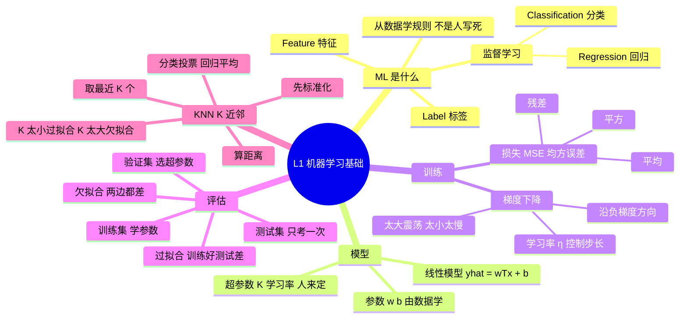
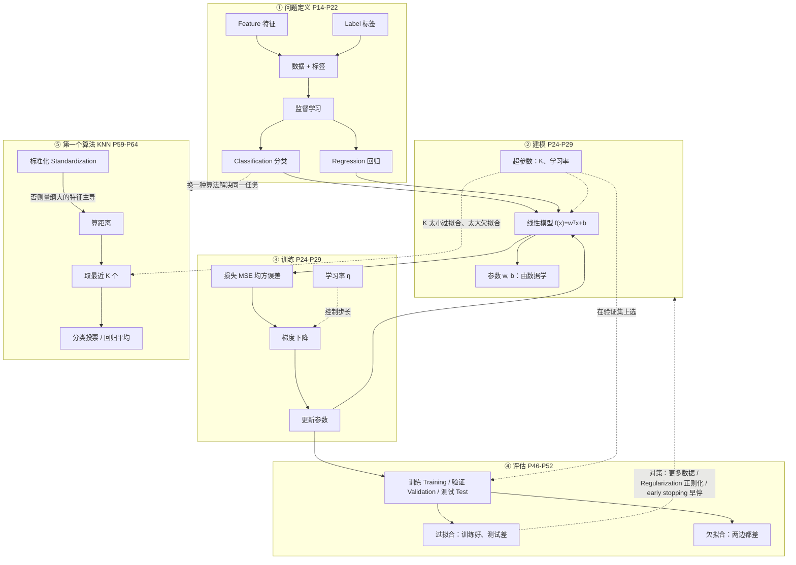

# STAT6207 L1 要领提纲（复习用）

> 对应笔记：[`L1_notes.md`](L1_notes.md) ｜ 练习：[`L1_quiz.md`](L1_quiz.md)
> 用法：先看 🧠 思维导图建立骨架 → 用 🗺️ 知识地图理清关系 → 再逐节回忆；卡住的地方回 notes 对应页码。
> 术语写法：**English（中文）**，以英文为主，方便考试和代码里认词。

---

## 1. 一句话定位

L1 建立三个最基本的问题：**模型是什么、怎么训练、怎么判断学得好不好**；并用 KNN 作为第一个可手算的算法。

```
数据 → 特征 + 标签 → 模型 → 损失 → 梯度下降 → 验证/测试 → 部署
```

---

## 🧠 思维导图（合上书，先盯这张看 30 秒）

> 读法：从中心往外，每问一句"这是什么、为什么需要它"。
> 需要支持 Mermaid 的阅读器（Typora / Obsidian / VS Code + MPE）；不显示时看第 2 节概念表。



---

## 🗺️ 知识地图（概念之间怎么连）

> 实线 = 流程/依赖；虚线 = 影响/选择。箭头读作"用来…"或"导致…"。



**60 秒回忆路线**（按顺序自问，答不出就回 notes）

1. **数据**：一条样本由什么组成？→ 特征 + 标签（P41）
2. **任务**：输出类别还是数值？→ 分类 vs 回归（P14）
3. **模型**：预测怎么写？→ $\hat y=w^Tx+b$（P24）
4. **好坏**：用什么量误差？→ MSE：残差 → 平方 → 平均（P24）
5. **改进**：参数往哪走？→ 负梯度方向，步长由 $\eta$ 决定（P29）
6. **验真**：谁调参、谁考试？→ 验证集选超参数、测试集只考一次（P46–P47）
7. **诊断**：训练好测试差 / 两边都差？→ 过拟合 / 欠拟合（P48、P51）
8. **算法**：KNN 三步是什么？→ 算距离、取 $K$ 个、投票或平均（P59–P64）

> 自检：能不看图把这 8 个箭头画出来，L1 就过关了。

---

## 2. 核心概念清单（能各用 1 句话解释）

| # | 概念 | 一句话 | notes |
|---|---|---|---|
| 1 | Machine Learning（机器学习） | 从数据中调参数，而不是人写死规则 | P14 |
| 2 | Classification vs Regression（分类 vs 回归） | 输出类别 vs 输出连续数值 | P14/P22 |
| 3 | Feature / Label（特征 / 标签） | 描述样本的属性 / 标准答案 | P41–P42 |
| 4 | Parameter vs Hyperparameter（参数 vs 超参数） | 模型自己学（$w,b$）vs 人设定（$K$、学习率） | P29 |
| 5 | Loss (MSE，损失 / 均方误差) | 预测与真值的平方误差平均 | P24 |
| 6 | Gradient Descent（梯度下降） | 沿负梯度方向一步步降低损失 | P28–P29 |
| 7 | Learning Rate（学习率） | 每步走多大；太大会震荡，太小会慢 | P29 |
| 8 | Train / Validation / Test（训练 / 验证 / 测试） | 学参数 / 选超参数 / 最后考一次 | P46–P47 |
| 9 | Overfitting vs Underfitting（过拟合 vs 欠拟合） | 训练好测试差 vs 两者都差 | P48/P51–P52 |
| 10 | K-Nearest Neighbors (KNN，K 近邻) | 找最近 $K$ 个邻居，分类投票、回归平均 | P59–P64 |
| 11 | Standardization（标准化） | 减均值除标准差，防止量纲主导距离 | P62 |
| 12 | Generalization（泛化） | 在没见过的数据上表现好 | P46 |

---

## 3. 必记公式（知道每个符号 + 什么时候用）

**线性模型（单样本）**

$$\hat y=w^Tx+b$$

- $w$：权重向量；$x$：特征向量；$b$：偏置；$\hat y$：预测。
- 一维时退化为 $y=mx+c$。分类时 $w^Tx+b=0$ 是决策边界。

**均方误差 MSE**

$$J=\frac1n\sum_{i=1}^n(y_i-\hat y_i)^2$$

- 回归任务的默认损失；$n$ 样本数，$y_i$ 真值，$\hat y_i$ 预测。
- 先残差 → 平方 → 平均。

**梯度下降**

$$\theta_{t+1}=\theta_t-\eta\nabla J(\theta_t)$$

- $\theta$：参数；$\eta$：学习率；$\nabla J$：梯度（上升最快方向）。
- 负号 = 往下降方向走。

**KNN 分类**

$$\hat y=\operatorname{mode}\{y_i:\ i\in N_K(x)\}$$

- $N_K(x)$：离 $x$ 最近的 $K$ 个训练样本；mode = 众数（多数投票）。
- 回归则把 mode 换成平均。

**距离与标准化**

$$d_2(a,b)=\|a-b\|_2,\qquad
d_1(a,b)=\|a-b\|_1,\qquad
\cos\theta=\frac{a^Tb}{\|a\|_2\|b\|_2}$$

$$z_j=\frac{x_j-\mu_j}{\sigma_j}$$

- 欧氏：直线距离；曼哈顿：绝对差之和；余弦：只看方向。
- 标准化后再算距离，避免大单位特征主导。

---

## 4. 流程与对比表

### 4.1 训练流程

| 步骤 | 用什么数据 | 目的 |
|---|---|---|
| 训练 | Training（训练集） | 更新参数 $w,b$ |
| 选超参数 | Validation（验证集） | 选 $K$、学习率、模型复杂度 |
| 最终评估 | Test（测试集） | 只测一次，估计泛化能力 |

### 4.2 过拟合 vs 欠拟合

| | 训练误差 | 验证误差 | 原因 | 对策 |
|---|---|---|---|---|
| 欠拟合 | 高 | 高 | 模型太简单/特征不够 | 加特征、加容量、训练更久 |
| 过拟合 | 很低 | 高（U 形上升） | 模型太复杂/数据太少 | 更多数据、Regularization（正则化）、early stopping（早停）、简化模型 |

### 4.3 KNN 的三步

```
1. Measure（度量）   算查询点到所有训练点的距离
2. Find（查找）      取最近的 K 个
3. Aggregate（聚合） 分类投票 / 回归平均
```

**K 的影响**：$K$ 太小 → 对噪声敏感（过拟合）；$K$ 太大 → 偏向多数类（欠拟合）。二分类常用奇数。

---

## 5. 易错点 Top 5

1. **$m,c$ 是参数，不是常数**；它们由数据学出来。
2. **训练误差低 ≠ 模型好**；要看验证/测试误差。
3. **测试集不能调参**；否则数据泄漏，分数虚高。
4. **KNN 必须先标准化**；否则量纲大的特征支配距离。
5. **KNN 的"训练"只是存数据**，慢在预测；不要把 lazy（惰性学习）理解成"训练慢"。

---

## 6. 自测 5 问（先答，再回 notes）

1. 分类和回归的区别是什么？各举一个例子。→ P14
2. 为什么 MSE 要平方？它对离群点友好吗？→ P24
3. 梯度下降的公式里，负号和学习率各起什么作用？→ P29
4. 训练误差很低、验证误差很高，说明什么？怎么缓解？→ P48/P51
5. KNN 中 $K$ 太大或太小分别会怎样？为什么分类常取奇数？→ P63

---

## 7. 与 L2 的衔接

- L1 的"模型容量/过拟合" → L2 的 ResNet（残差网络：更深 + 残差连接）。
- L1 的"训练/验证/测试" → L2 的"预训练/微调/评估"。
- L1 的 KNN（手工特征 + 距离）→ L2 的神经网络自动学特征。

> 进入 L2 前，确保能独立回答上面 5 个自测问题。
