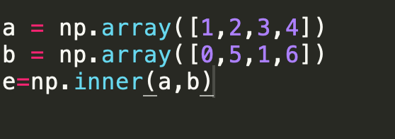
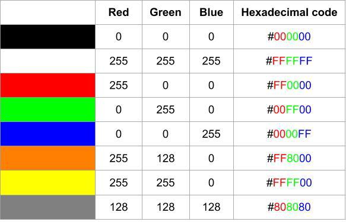
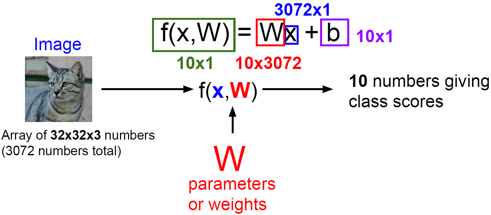
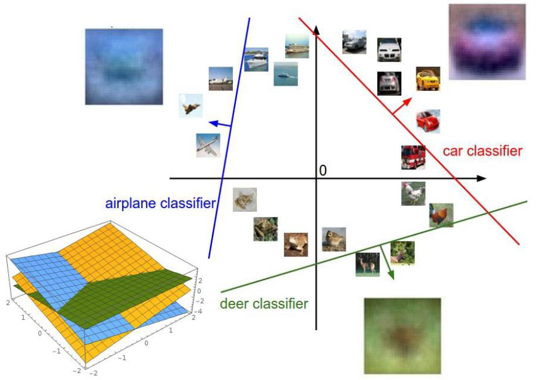
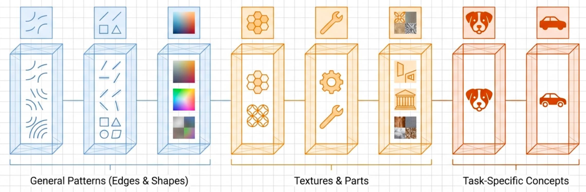
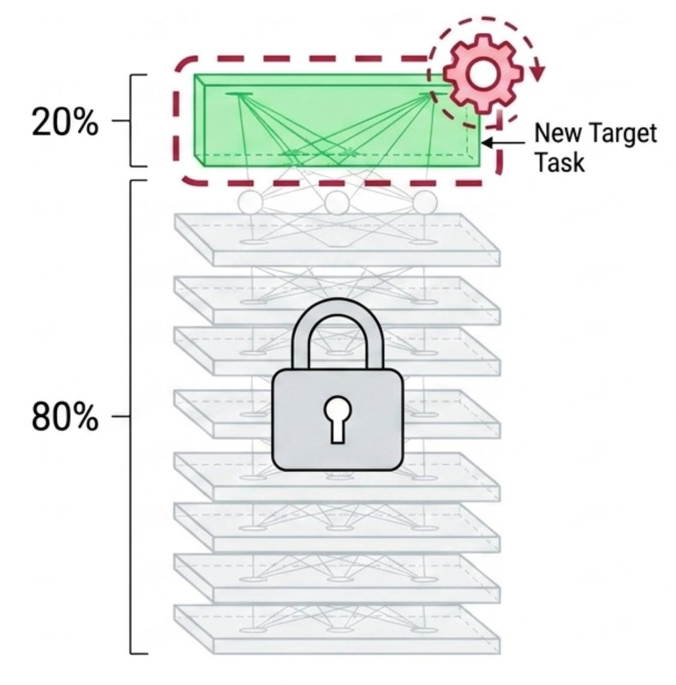
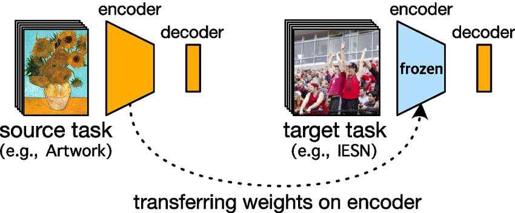
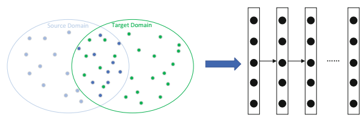
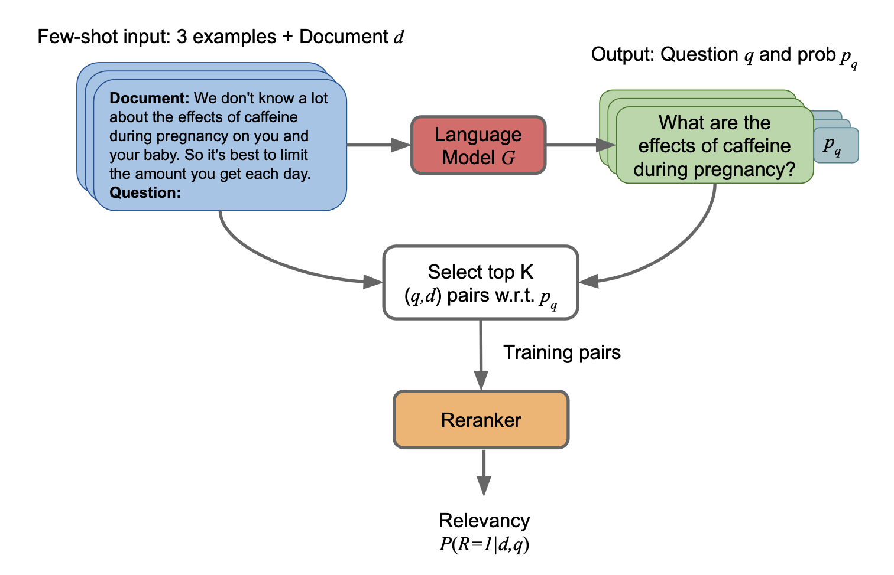

# STAT6207 Applied Deep Learning — L2 学习笔记

> 课件：`2026_6207_lecture_L2_final.pdf`（85 页，2026-09-18，Dr. Ming Cheung）
> 要领提纲：[`L2_outline.md`](L2_outline.md) ｜ 练习：[`L2_quiz.md`](L2_quiz.md) ｜ 答疑：[`L2_qa.md`](L2_qa.md)
> 排版：每页 = 原文（引用块）→ 中文（逐条）→ 讲解（要点/例子/易错）。

---

## 目录

- [0. 本讲地图](#0-本讲地图)
- [Part A. 课程事务与上节回顾（P1–P5）](#part-a-课程事务与上节回顾p1p5)
- [Part B. Linear Classifier（P6–P20）](#part-b-linear-classifierp6p20)
  - [B1. 线代三件套：加法、Hadamard、内积（P6–P9）](#b1-线代三件套加法hadamard内积p6p9)
  - [B2. Logistic Regression 与决策规则（P10–P11）](#b2-logistic-regression-与决策规则p10p11)
  - [B3. 多类决策区域（P12）](#b3-多类决策区域p12)
  - [B4. 用线性分类器做图像分类（P13–P18）](#b4-用线性分类器做图像分类p13p18)
  - [B5. 文本数据与 One-Hot（P19–P20）](#b5-文本数据与-one-hotp19p20)
- [Part C. Transfer Learning（P21–P65）](#part-c-transfer-learningp21p65)
  - [C1. 动机：数据不够怎么办（P22–P25）](#c1-动机数据不够怎么办p22p25)
  - [C2. 定义与术语（P26）](#c2-定义与术语p26)
  - [C3. 为什么可迁移：层次特征（P27）](#c3-为什么可迁移层次特征p27)
  - [C4. 三大类型总览（P28）](#c4-三大类型总览p28)
  - [C5. Representation-based（P29–P43）](#c5-representation-basedp29p43)
  - [C6. Model Sharing / Fine-tuning（P44–P51）](#c6-model-sharing--fine-tuningp44p51)
  - [C7. Instance-based（P52–P57）](#c7-instance-basedp52p57)
  - [C8. LLM 生成数据（P58–P64）](#c8-llm-生成数据p58p64)
  - [C9. 三种方法可以叠加（P65）](#c9-三种方法可以叠加p65)
- [Part D. Local LLM（P66–P83）](#part-d-local-llmp66p83)
  - [D1. 什么是 LLM（P67）](#d1-什么是-llmp67)
  - [D2. 为什么要本地跑（P68–P69）](#d2-为什么要本地跑p68p69)
  - [D3. 怎么用（P70–P73）](#d3-怎么用p70p73)
  - [D4. 显存与算力估算（P74–P76）](#d4-显存与算力估算p74p76)
  - [D5. Latency vs Throughput（P77）](#d5-latency-vs-throughputp77)
  - [D6. 四个模型点评（P78–P81）](#d6-四个模型点评p78p81)
  - [D7. 怎么选模型（P82–P83）](#d7-怎么选模型p82p83)
- [Part E. 作业与收尾（P84–P85）](#part-e-作业与收尾p84p85)
- [公式总表](#公式总表)
- [术语表](#术语表)
- [10 个最容易错的地方](#10-个最容易错的地方)
- [本讲 10 句话总结](#本讲-10-句话总结)
- [与 L3 的衔接](#与-l3-的衔接)

---

## 0. 本讲地图

L1 回答"什么是模型、怎么训练"。L2 回答三个更实际的问题：

1. **模型的最简形式长什么样？** → Linear Classifier（线性分类器），把 L1 的 $y=mx+c$ 推广到多维、多类。
2. **数据不够怎么办？** → Transfer Learning（迁移学习），借别人训好的模型。
3. **大模型怎么在自己电脑上跑？** → Local LLM（本地大语言模型）。

```
L1: 数据 → 模型 → 损失 → 梯度下降
L2: 线性模型（w^T x + b）        ← 模型形式
    预训练模型 → 迁移 → 微调      ← 没数据时的办法
    本地 LLM：显存估算 + 工具     ← 大模型落地
```

学完你应该能：

- 用 $w^Tx+b$ 写出二分类与多分类的决策规则；
- 说清 Sigmoid、logit 与"线性决策边界"的关系；
- 判断一个场景该用 Feature Extraction、Fine-tuning 还是 From Scratch；
- 用 $P\times b/8+2$ 估算本地跑一个模型要多少显存。

---

## Part A. 课程事务与上节回顾（P1–P5）

### P1 封面

> **原文**：
> • STAT6207 Applied Deep Learning
> • L2, 18 Sep 2026
> • By Dr. Ming Cheung

**中文**

- STAT6207 应用深度学习。
- 第 2 讲，2026 年 9 月 18 日。
- 授课：张明博士。

**讲解**

- 这是 L2 的封面页，无知识点。
- 记住日期：本讲内容对应 9 月 18 日那一次课。

---

### P2 Announcement

> **原文**：
> • Midterm exam (papers + programming) will be on 23 Oct 26
> • Location: TBC
> • There will be two parts
> • Written: MC and short question
> • Programming: You can use your computer and agent coder
> • No communication is allowed

**中文**

- 期中考试（笔试 + 编程）在 2026 年 10 月 23 日。
- 地点：待定。
- 分两部分：
- 笔试：选择题与简答题。
- 编程：可以带电脑、可以用 Agentic Coder（智能编程工具）。
- 不允许互相交流。

**讲解**

- **考试形式是"两段式"**：先考概念（MC + 短答），再上机写代码。
- 允许用 AI 编程工具，说明老师考的是**你能不能判断 AI 写的东西对不对**，不是背 API。
- `TBC = to be confirmed`（待确认），地点要留意后续通知。

---

### P3 Lecture Room

> **原文**：
> • L1 11-Sept BMS G18
> • L2 18-Sept BMS G18
> • L3 25-Sept CYT LT1A
> • L4 2-Oct CYT LT1A
> • L5 9-Oct CYT LT1A
> • L6 16-Oct BMS G18
> • L7 (Mid Term) 23-Oct To be confirmed
> • L8 30-Oct CYT LT1A
> • L9 6-Nov UCC C1
> • L10 13-Nov CYT LT1A
> • L11 20-Nov UCC C1
> • L12 27-Nov UCC C1
> • L13 4-Dec UCC C1
> • L14 11-Dec UCC C1

**中文**

- 上课时间与教室表：L1/L2 在 BMS G18，L3–L5 在 CYT LT1A，L6 回 BMS G18。
- L7（期中）10 月 23 日，地点待定。
- L8–L14：CYT LT1A 与 UCC C1 交替，具体见上表。

**讲解**

- 纯事务页，考试不考。
- 实用信息：**教室会换**，L9 起在 UCC C1，别走错。

---

### P4 Last Lecture

> **原文**：
> • What is STAT6207
> • 1. Learn the theory of machine learning and deep learning;
> • 2. Understand machine learning applications ...
> • 3. Gain hands on experience ...
> • What is Machine Learning – Classification
> • Training – following the slope

**中文**

- 上节回顾：课程三条腿（Theory / Application / Hands-on）。
- 机器学习分类：用一条直线 $y=mx+c$ 作分界线。
- 训练：沿着斜率走（梯度下降）。

**讲解**

- 老师用一页把 L1 压缩成三块，这是**考试常考的复述题**：
  1. ML = 从数据学规则，不是人写规则；
  2. 分类 = 找决策边界；
  3. 训练 = 沿负梯度方向调参数。
- 本讲正是从"一条直线"出发，把它推广成**线性分类器**（多维、多类）。

---

### P5 Agenda

> **原文**：
> • Linear classifier
> • Transfer Learning
> • Local Large Language Model

**中文**

- 线性分类器。
- 迁移学习。
- 本地大语言模型。

**讲解**

- 三块内容对应三种能力：
  - **Linear Classifier**：数学骨架（内积、Sigmoid、决策区域）。
  - **Transfer Learning**：工程策略（没数据怎么借力）。
  - **Local LLM**：部署能力（显存估算、本地工具）。
- 顺序有讲究：先有"模型 = 线性打分"，才理解"预训练模型输出的特征"为什么能直接拿来分类。

---

## Part B. Linear Classifier（P6–P20）

### B1. 线代三件套：加法、Hadamard、内积（P6–P9）

#### P6 Linear Algebra

> **原文**：
> • Matrix addition ($A+B=C$)
> • Matrix element-wise multiplication (Hadamard product)

**中文**

- 矩阵加法：$A+B=C$（同形状，逐元素相加）。
- 矩阵逐元素乘法：Hadamard Product（哈达玛积），记 $A\odot B$。

**讲解**

- **Matrix Addition（矩阵加法）**：形状必须相同，对应位置相加。

$$A+B=\begin{bmatrix}a_{11}&a_{12}\\a_{21}&a_{22}\end{bmatrix}+\begin{bmatrix}b_{11}&b_{12}\\b_{21}&b_{22}\end{bmatrix}=\begin{bmatrix}a_{11}+b_{11}&a_{12}+b_{12}\\a_{21}+b_{21}&a_{22}+b_{22}\end{bmatrix}$$

- **Hadamard Product（哈达玛积）**：也是同形状逐元素乘，但**不是**矩阵乘法。

$$A\odot B=\begin{bmatrix}a_{11}b_{11}&a_{12}b_{12}\\a_{21}b_{21}&a_{22}b_{22}\end{bmatrix}$$

- 一眼区分：
  - $AB$（普通矩阵乘法）：左行 × 右列，形状可以变；
  - $A\odot B$（Hadamard）：同位相乘，形状不变。
- 深度学习里 Hadamard 常用于**掩码**（mask）与逐元素缩放，例如 Dropout 就是乘一个 0/1 矩阵。

> ⚠️ 注意：课件把 Hadamard 写作 "element-wise multiplication"，中文常译"逐元素乘法"，不要与矩阵乘法混淆。

---

#### P7 Linear Algebra（内积）

> **原文**：
> • Inner product: measuring the similarity of 2 vectors
> • $(w_1,w_2,\dots,w_N)\cdot(x_1,\dots,x_N)=w_1x_1+w_2x_2+\dots+w_Nx_N=\sum_{i=1}^{N}w_ix_i$
> • $\text{inner}(x,w)=\|x\|\|w\|\cos(\theta)$

**中文**

- 内积：衡量两个向量的相似度。
- 代数定义：对应分量相乘再求和。
- 几何定义：$\|x\|\|w\|\cos\theta$，其中 $\theta$ 是两向量夹角。



**讲解**

- **Inner Product（内积）** 两个等价定义：

$$\langle x,w\rangle=\sum_{i=1}^{N}w_ix_i=\|x\|\,\|w\|\cos\theta$$

- 逐符号：
  - $x,w$：两个 $N$ 维向量；
  - $w_ix_i$：同一维度的分量相乘；
  - $\sum$：全部加起来，得到一个**标量**；
  - $\|x\|$：向量长度（L2 范数）；
  - $\theta$：两向量夹角。
- **几何直觉**：内积 = $x$ 在 $w$ 方向上的**投影长度** × $\|w\|$。
  - 同向（$\theta=0$）→ 内积最大；
  - 垂直（$\theta=90°$）→ 内积为 0；
  - 反向（$\theta=180°$）→ 内积最小（负）。
- **为什么 ML 关心内积**：线性模型的打分就是内积 $w^Tx$。
  - $w$ 可理解成"模板"；
  - $x$ 与模板越同向，分数越高 → 越可能属于这一类。
- 考试常问："内积为 0 说明什么？" → 两向量正交（不相关/无投影），**不代表**没有信息。

> 🔭 拓展（不影响本课）：内积诱导出范数 $\|x\|=\sqrt{\langle x,x\rangle}$，这是后面 cosine similarity 与 embedding 检索的基础。

---

#### P8 Recall: Classification with a straight line

> **原文**：
> • Using a straight line equation as the separator.
> • Variables: $x$ and $y$
> • Constants: $m$ and $c$
> • On graph: $m$ = gradient, $c$ = y-axis intercept
> • How's about higher dimension?

**中文**

- 用直线方程作分界线。
- 变量是 $x$ 和 $y$。
- 常量是 $m$ 和 $c$。
- 图上：$m$ 是斜率，$c$ 是 y 轴截距。
- 高维怎么办？

**讲解**

- 二维：$y=mx+c$，一条直线。
- 三维：$z=ax+by+c$，一个平面。
- $N$ 维：$w^Tx+b=0$，一个 **Hyperplane（超平面）**。
- 统一写法：

$$f(x)=w^Tx+b=\sum_{i=1}^{N}w_ix_i+b$$

- 这里的 $b$ 对应原来的 $c$，$w$ 对应 $m$ 的推广（每一维一个斜率）。
- **关键转变**：L1 的"直线"只是二维特例；L2 把它写成向量形式，才能处理图像（上千维）与多类。

> ⚠️ 注意：课件仍称 $m,c$ 为 "constants"。在 ML 里它们是**参数**，由数据学出来。

---

#### P9 Linear Algebra（神经元视角）

> **原文**：
> • Input neurons $r_1,r_2,\dots,r_n$
> • Output $=\sum_i w_ix_i$
> • weights $w_1,w_2,\dots,w_N$

**中文**

- 输入神经元 $r_1,\dots,r_n$。
- 输出 = 加权和 $\sum_i w_ix_i$。
- 权重 $w_1,\dots,w_N$。

**讲解**

- 这就是**感知机（Perceptron）**的计算：每个输入乘一个权重，加起来。
- 用矩阵写：

$$z=Wx$$

- 维度检查：$W$ 是 $(K\times N)$，$x$ 是 $(N\times 1)$，结果 $z$ 是 $(K\times 1)$——一次算出 $K$ 个类的分数。
- **直觉**：一个线性层 = $K$ 个"评委"，每个评委用一组权重给输入打分。
- 这也是神经网络的**最小单元**：多个这样的单元堆起来 + 非线性激活 = 多层网络（L8 起细讲）。

---

### B2. Logistic Regression 与决策规则（P10–P11）

#### P10 Examples of Linear Classification

> **原文**：
> • Training set $\mathcal{D}=\{(\mathbf{x}_i,y_i)\}_{i=1}^{N}$, where $y_i\in[0,1]$
> • $p(y=1|\mathbf{x},\mathbf{w})=\sigma(\mathbf{w}^T\mathbf{x})=\dfrac{1}{1+\exp(-\mathbf{w}^T\mathbf{x})}$
> • $p(y=0|\mathbf{x},\mathbf{w})=1-\sigma(\mathbf{w}^T\mathbf{x})=\dfrac{\exp(-\mathbf{w}^T\mathbf{x})}{1+\exp(-\mathbf{w}^T\mathbf{x})}$
> • Consider the logit: $\log\dfrac{p(y=1|\mathbf{x},\mathbf{w})}{1-p(y=1|\mathbf{x},\mathbf{w})}=\mathbf{w}^T\mathbf{x}$

**中文**

- 训练集 $\mathcal{D}=\{(x_i,y_i)\}_{i=1}^{N}$，标签 $y_i\in\{0,1\}$。
- 模型用 Sigmoid 把线性打分压到 $(0,1)$，当作概率。
- 两类概率互补，和为 1。
- 取 logit（对数几率）后，右边正好是线性的 $w^Tx$。

**讲解**

**（1）Sigmoid 是什么**

$$\sigma(z)=\frac{1}{1+e^{-z}}$$

- 逐符号：
  - $z=w^Tx$：线性打分，可正可负、可大可小；
  - $e^{-z}$：指数函数，$z$ 越大它越小；
  - 输出永远在 $(0,1)$ 之间。
- 关键点：

| $z$ | $\sigma(z)$ | 含义 |
|---|---|---|
| $-5$ | $\approx0.007$ | 几乎肯定是类 0 |
| $0$ | $0.5$ | 完全不确定 |
| $+5$ | $\approx0.993$ | 几乎肯定是类 1 |

- **为什么需要它**：线性打分给出的是任意实数，不能直接当概率。Sigmoid 把它"压"进 0–1，且**不改变分界位置**（$\sigma(z)=0.5 \iff z=0$）。
- **为什么偏偏用 $e$**：见 [`L2_qa.md`](L2_qa.md) Q2（$e$ 与 $\log$ 的来龙去脉、Softmax 的"差 1 分 = 2.72 倍"）。

**（2）logit：把概率拉回线性**

$$\text{logit}(p)=\log\frac{p}{1-p}=w^Tx$$

- $\dfrac{p}{1-p}$ 叫 **Odds（几率）**：类 1 的概率是类 0 的几倍。
- 取对数后，**"对数几率"是 $x$ 的线性函数**——这就是"线性分类器"这个名字的来源。
- 反解出 $p$：$p=\sigma(w^Tx)$，与上面的定义一致。

**（3）训练在干什么**

- 参数仍是 $w,b$，和 L1 一样用 Gradient Descent；
- 损失换成 **Cross-Entropy (CE，交叉熵)**，不是 MSE（分类问题用 MSE 会把概率压得很别扭；公式与直觉见 [`L2_qa.md`](L2_qa.md) Q1）。

**（4）手算一个**

取 $w=(2,-1)$、$b=0.5$、$x=(1,1)$：

$$z=2\times1+(-1)\times1+0.5=1.5,\qquad p=\sigma(1.5)=\frac{1}{1+e^{-1.5}}\approx0.818$$

- 解读：这个样本有约 82% 的概率属于类 1。

---

#### P11 Classification: Decision Rule

> **原文**：
> • To classify instances, we obtain a point estimation of $y$: $\hat y=\arg\max p(y|x,w)$
> • In other words, the rule is: $\hat y=1$ iff $p(y=1|x,w)>0.5$
> • This is called the optimal Bayes classifier
> • e.g., $\hat y=1$ iff $w^Tx>0$ as a linear classifier

**中文**

- 分类时取概率最大的类别作为预测。
- 二分类规则：概率大于 0.5 就判为 1。
- 这叫最优贝叶斯分类器。
- 因为 Sigmoid 单调，$p>0.5$ 等价于 $w^Tx>0$。

**讲解**

- **Decision Rule（决策规则）**：$\hat y=\arg\max_k p(y=k|x)$。
- 二分类时简化成"看 0.5"：

$$\hat y=1 \iff \sigma(w^Tx)>0.5 \iff w^Tx>0$$

- **这条等价关系是考点**：概率阈值 0.5 对应**几何上的超平面** $w^Tx=0$。
- 三件事其实是同一件事：
  1. 概率 $p>0.5$；
  2. 打分 $w^Tx>0$；
  3. 点在超平面的正侧。
- 超平面的法向量就是 $w$：$w$ 指向"判为 1"的一侧。

> ⚠️ 课件笔误：原文写 "$p(y=1|x,w)>0$"，应为 $>0.5$。概率永远大于 0，写成 $>0$ 就没有分类作用了。考试按 $>0.5$ 或 $w^Tx>0$ 写。

> 🔭 拓展（不影响本课）：严格说"最优贝叶斯分类器"要求知道真实分布 $p(x|y)$；这里只是**假设**模型形式为 Logistic 时的最优决策，两者不要混。

---

### B3. 多类决策区域（P12）

#### P12 Decision Regions for Multi-classes

> **原文**：
> • The feature space is divided into $K$ decision regions $\mathcal{R}_1,\dots,\mathcal{R}_K$, where $\mathcal{R}_i=\{x: g_i(x)=\max_k g_k(x)\}$
> • The decision regions are separated by decision boundaries where ties occur among the largest discriminant functions
> • Choose $C_i$ if $g_i(x)=\max_k g_k(x)$

**中文**

- 特征空间被分成 $K$ 个决策区域。
- 每个区域 = 让第 $i$ 个判别函数取最大值的点集。
- 区域之间的边界出现在"两个判别函数并列最大"的地方。
- 规则：哪个 $g_k$ 最大就判给哪类。

**讲解**

- **Discriminant Function（判别函数）**：每一类一个打分函数，多类线性分类器里就是

$$g_k(x)=w_k^Tx+b_k,\qquad k=1,\dots,K$$

- **Decision Region（决策区域）**：

$$\mathcal{R}_i=\{x:\ g_i(x)\ge g_k(x)\ \text{对所有 }k\}$$

- **Decision Boundary（决策边界）**：两类打分相等的地方

$$g_i(x)=g_j(x)\ \Longleftrightarrow\ (w_i-w_j)^Tx+(b_i-b_j)=0$$

- 这仍是一个**超平面**：多类线性分类器的边界是**分段线性**的（由多个超平面拼成）。
- **直觉**：想象三个人各自报一个分数，谁最高就归谁；分数相同的边界就是"分界线"。
- **常见误解**：多类不是"训练 K 个独立的二分类器然后投票"（那是 One-vs-Rest）；这里是**一起比较打分**，边界由分数差决定。

> 🔭 拓展（不影响本课）：把 $g_k$ 换成 softmax 输出，就得到多类 Logistic Regression；边界位置不变，因为 softmax 也是单调的。

---

### B4. 用线性分类器做图像分类（P13–P18）

#### P13 预训练 + 分类头

> **原文**：
> • Pre-train model (encoder)
> • encode → encode → classifier

**中文**

- 预训练模型（编码器）先把输入编码。
- 编码后的特征再送进分类器。

**讲解**

- 这张图是**本讲的枢纽**：它同时属于线性分类器与迁移学习两部分。
- 结构：

```
输入 x → [Encoder 编码器] → 特征 h → [Classifier 分类头] → 分数/概率
```

- 关键观察：**分类头可以只是一个线性层** $g(h)=Wh+b$。
- 于是"迁移学习"变得很自然：编码器用别人训好的，只训练最后那个小的线性分类头。
- 这也解释了为什么小数据集也能做深度学习：要学的参数只剩一点点。

---

#### P14 RGB

> **原文**：
> • RGB

**中文**

- RGB：红、绿、蓝三通道。

**讲解**

- 彩色图在计算机里是一个三维数组：高 × 宽 × 3。
- 一张 $32\times32$ 的 RGB 图 → $32\times32\times3=3072$ 个数。
- 把这 3072 个数拉直成一个向量 $x\in\mathbb{R}^{3072}$，就能送进线性分类器。
- **这一步叫 Flatten（展平）**：把图像变成向量，是"图像 → 数学"的接口。



---

#### P15 Image Classification with Linear Classifier

> **原文**：
> • Training is to find $W$ such that $f(x,W)$ gives the desired output, for an input image $x$

**中文**

- 训练就是找一组 $W$，使 $f(x,W)$ 对输入图像给出想要的输出。

**讲解**

- 模型：

$$f(x,W)=Wx+b$$

- 维度检查（关键，考试爱考）：
  - $x$：$(D\times1)$，如图像展平后 $D=3072$；
  - $W$：$(K\times D)$，$K$ 是类别数；
  - $b$：$(K\times1)$；
  - 输出：$(K\times1)$，每个类一个分数。
- **W 的每一行 = 一个类的模板**：把这一行重新排成图像形状，看起来就像该类别的"平均图"。
- 参数量：$K\times D+K$。10 类、3072 维 → 30730 个参数。



---

#### P16 分数与可视化

> **原文**：
> • Image Classification with Linear Classifier（示意图）

**中文**

- 示意图：图像 → 打分 → 取最高分。

**讲解**

- 前向计算三步：
  1. 展平：$x$（3072 维）；
  2. 打分：$z=Wx+b$（每类一个分数）；
  3. 决策：$\hat y=\arg\max_k z_k$。
- 注意：**线性分类器对每个像素只有"一个权重"**，所以它只能学"整幅图上的加权投票"，学不到"猫耳朵"这种局部结构。
- 这正是 CNN（L5）要解决的问题：用卷积核提取局部特征。

---

#### P17 手算例子（鹿分类器）

> **原文**：
> • e.g., $W$ is $m$ and $c$: $f(x,y)=y-mx-c$
> • Assume $m=1$, $c=-2$ (deer classifier):
> • $f(1,1)=1-1\times1+2=2>0$ → above the line
> • $f(-5,0)=0-1\times5+2=-3<0$ → below the line

**中文**

- 把 $W$ 理解成 $m$ 和 $c$：$f(x,y)=y-mx-c$。
- 设 $m=1,\ c=-2$：
- 点 $(1,1)$：代入得 $2>0$，在直线上方 → 判为鹿。
- 点 $(-5,0)$：代入得 $-3<0$，在直线下方 → 不是鹿。

**讲解**

- 这是一维玩具例子，把"分类"变成"点在直线哪一侧"。
- 代入 $(1,1)$：$1-1\times1-(-2)=1-1+2=2>0$ ✔
- 代入 $(-5,0)$：$0-1\times(-5)-(-2)=0+5+2=7$，**不是 $-3$**。

> ⚠️ 课件此处数字有误：按 $f=y-mx-c$ 且 $m=1,c=-2$，$f(-5,0)=7>0$（在直线上方），不是 $-3$。若想让结果为负，需要取 $x=5$：$f(5,0)=0-5+2=-3$。考试以公式为准，遇到具体数字自己代一遍。

- 记住判定逻辑：**符号决定类别**，绝对值大小表示"离边界多远"（越远越有把握）。


---

#### P18 三条直线 = 一个矩阵

> **原文**：
> • $m_1,m_2,m_3,c_1,c_2,c_3$ for 3 lines
> • $z_{01}=y-m_1x-c_1$, $z_{02}=y-m_2x-c_2$, $z_{03}=y-m_3x-c_3$
> • matrix form

**中文**

- 三条直线各有自己的 $m_k,c_k$。
- 每条线算一个分数 $z_{0k}=y-m_kx-c_k$。
- 把三条线排成矩阵，一次算出三个分数。

**讲解**

$$\begin{bmatrix}-m_1&1\\-m_2&1\\-m_3&1\end{bmatrix}\begin{bmatrix}x\\y\end{bmatrix}+\begin{bmatrix}-c_1\\-c_2\\-c_3\end{bmatrix}=\begin{bmatrix}z_{01}\\z_{02}\\z_{03}\end{bmatrix}$$

- 逐块看：
  - 左边矩阵：每一行是一条直线的系数 $( -m_k,\ 1)$；
  - 输入向量：$(x,y)$；
  - 偏置：$-c_k$；
  - 输出：三个分数。
- 这就是**多类线性分类器的矩阵形式**：一个矩阵乘一次，$K$ 个类同时打分。
- 维度检查：$(3\times2)(2\times1)+(3\times1)=(3\times1)$ ✔
- **易错点**：矩阵里第二列是 1，不是 $x$——因为它乘的是 $y$。



---

### B5. 文本数据与 One-Hot（P19–P20）

#### P19 Textual Data

> **原文**：
> • neural network models for labelled data: $\{(x_i,y_i)\}_{i=1}^{N}\to P(y|x)$
> • Each training example consists of a sequence of inputs $(x^{(1)},\dots,x^{(\tau_i)})$ and outputs $(y^{(1)},\dots,y^{(\tau_i)})$
> • ("How","are","you",−,−,−), (−,−,−,"I","am","fine")
> • Training data can be from dialogue or machine translation

**中文**

- 有标签数据的神经网络模型：从样本学 $P(y|x)$。
- 每个训练样本是一串输入和对应的输出序列。
- 例：输入 "How are you"，输出 "I am fine"。
- 训练数据可来自对话或机器翻译。

**讲解**

- 文本与图像的根本差别：**长度可变**、**离散符号**。
- **Sequence（序列）**：输入不是固定长度向量，而是一串 token。
- 机器翻译任务的形式：

$$\text{输入序列 }(x^{(1)},\dots,x^{(T)}) \longrightarrow \text{输出序列 }(y^{(1)},\dots,y^{(T')})$$

- 注意输入与输出长度可以不同（$T\ne T'$），这就是为什么需要专门的序列模型（L3–L4 的 Transformer）。
- **难点**：词不能直接做加减，必须先变成向量 → One-Hot 或 Embedding。

---

#### P20 Textual Data: One Hot Vectors

> **原文**：
> • a binary vector used to represent categorical/text data
> • Each category is represented by a unique index in the vector
> • without any implicit relationships between categories

**中文**

- 用 0/1 向量表示类别或文本。
- 每个类别占一个唯一位置。
- 不引入类别之间的隐含关系。

**讲解**

- **One-Hot Vector（独热向量）**：词表有 $V$ 个词，每个词是一个 $V$ 维向量，只有自己那一位是 1。

| 词 | 向量（词表：I, am, fine, you） |
|---|---|
| I | (1,0,0,0) |
| am | (0,1,0,0) |
| fine | (0,0,1,0) |
| you | (0,0,0,1) |

- 性质：
  - 任意两个不同词的内积为 0 → **彼此正交**，不暗示"相似"；
  - 每个向量长度都是 1。
- **优点**：简单、无偏（不会把"猫"和"狗"人为拉近）。
- **缺点**：
  - 维度 = 词表大小，十万词就是十万维，**稀疏且巨大**；
  - 学不到语义："猫"和"狗"的距离与"猫"和"飞机"一样远。
- 所以后面会用 **Embedding（词嵌入）** 把 One-Hot 压成低维稠密向量（L3 讲）。

> 🔭 拓展（不影响本课）：One-Hot 乘一个矩阵 $E$（$V\times d$）等价于"查表取第 $i$ 行"，这就是 Embedding 层的实现方式。

---

## Part C. Transfer Learning（P21–P65）

### P21 Agenda（进入第二部分）

> **原文**：
> • Linear classifier
> • Transfer Learning
> • Local Large Language Model

**中文**

- 线性分类器（已完成）。
- 迁移学习（本部分）。
- 本地大语言模型（后面）。

**讲解**

- 议程页重复出现，说明老师用它划分三大块。
- 上半场解决"模型长什么样"，下半场解决"没数据怎么办"。

---

### C1. 动机：数据不够怎么办（P22–P25）

#### P22 Summary so far

> **原文**：
> • Data is represented as a point
> • Classification is to learn the equation
> • What if we don't know how to represent the data?

**中文**

- 数据被表示成一个点。
- 分类就是学一个方程。
- 如果我们不知道该怎么表示数据呢？

**讲解**

- 这三句是 L1 → L2 的转折：
  1. 数据 = 特征空间里的点；
  2. 分类 = 找一个把这些点分开的方程；
  3. **可是特征从哪来？**
- 传统做法是人工设计特征（Feature Engineering，L1 的 P41）。
- 深度学习答案是：**让网络自己学特征**；而迁移学习的答案是：**用别人已经学好的特征**。
- 本讲后面所有内容，本质都在回答第三句。

---

#### P23 Transfer Learning

> **原文**：
> • aims to leverage the learned knowledge from a resource-rich domain/task to help learning a task with not sufficient training data

**中文**

- 迁移学习：利用资源充足领域/任务中学到的知识，帮助数据不足的新任务。

**讲解**

- **Transfer Learning（迁移学习）** 一句话：**把 A 任务学到的本事，用到 B 任务上**。
- 两个角色：
  - 资源多的一方：数据多、算力足、标签全；
  - 资源少的一方：数据少、标注贵、但才是你真正要解决的问题。
- 类比：会骑自行车的人学摩托车更快——不是从头学平衡，而是迁移"平衡感"。
- 成立的前提：**两个任务共享某些底层规律**（后面 P27 解释为什么深度网络恰好满足）。

---

#### P24 Transfer Learning（source / target）

> **原文**：
> • The resource-rich domain is known as the source and the low-resource task is known as the target
> • Transfer learning works the best if the model features learned from the source task are general (i.e., domain-independent)
> • e.g., trained from ImageNet

**中文**

- 资源多的叫 **Source（源域）**，资源少的叫 **Target（目标域）**。
- 当源任务学到的特征足够"通用"（与领域无关）时，迁移效果最好。
- 例：在 ImageNet 上预训练。

**讲解**

- 三个必背术语：

| 术语 | 含义 | 例子 |
|---|---|---|
| **Source Domain（源域）** | 数据充足、用来预训练的领域 | ImageNet 的 120 万张图 |
| **Target Domain（目标域）** | 你真正要解决、数据少的领域 | 你自己拍的 200 张花 |
| **Pre-trained Model（预训练模型）** | 在源域上训好的模型 | ResNet-50、BERT |

- **为什么"通用特征"重要**：如果源域学的是"如何识别车牌字体"，对"花的种类"几乎无用；如果学的是"边缘、纹理、形状"，几乎对所有图像任务都有用。
- **ImageNet** 是视觉迁移的"通用起点"：1000 类日常物体，学到的特征覆盖边缘、纹理、部件、物体。

---

#### P25 Transfer Learning（两个例子）

> **原文**：
> • Image Processing: Learning flower classification system — How much data can we have?
> • Text Sentiment Analysis: Learning a sentiment on camera review — Need to label many camera reviews from scratch? Can we use online datasets?
> • What are source and target tasks/domain in the above examples?

**中文**

- 图像：做花卉分类系统，你能有多少数据？
- 文本：做相机评论的情感分析，需要从零标注大量评论吗？能不能用公开数据集？
- 问：上面两个例子里，源域/源任务与目标域/目标任务各是什么？

**讲解**

- 例 1（花分类）：
  - Source：ImageNet（通用物体，百万级）；
  - Target：你的花卉数据集（可能只有几百张）；
  - 迁移什么：边缘/纹理/花瓣形状的检测能力。
- 例 2（相机评论情感）：
  - Source：公开的影评/商品评论情感数据集（几十万条）；
  - Target：相机领域的评论（少、且术语特殊）；
  - 迁移什么：情感词与句式的判别能力。
- **判断口诀**：数据多、通用、公开的是 source；数据少、具体、私有的是 target。

> ⚠️ 注意：迁移不总是有效。如果目标域与源域差别极大（如用 ImageNet 迁移医学 CT），底层特征仍可用，但深层特征可能需要重训——这正是后面 Fine-tuning 的动机。

---

### C2. 定义与术语（P26）

#### P26 (Deep) Transfer Learning

> **原文**：
> • aims to help improve the learning of the target predictive function $f_T$ in $D_t$ using the knowledge in $D_s$ and $\mathcal{T}_s$, where $D_s\ne D_t$ and/or $\mathcal{T}_s\ne\mathcal{T}_t$
> • $\mathcal{D}_s$ and $\mathcal{D}_t$ denote the source and target domains
> • $\mathcal{T}_s$ and $\mathcal{T}_t$ the source and target tasks
> • (Deep learning) Models can be pre-trained on one domain

**中文**

- 迁移学习：用源域 $D_s$ 与源任务 $\mathcal{T}_s$ 的知识，改进目标域 $D_t$ 上的目标函数 $f_T$。
- 条件是 $D_s\ne D_t$ 和/或 $\mathcal{T}_s\ne\mathcal{T}_t$。
- 深度学习模型可以先在一个领域上预训练。

**讲解**

- 形式化定义拆开看：
  - $D_s$：源域（数据 + 分布）；
  - $D_t$：目标域；
  - $\mathcal{T}_s$：源任务（如 1000 类分类）；
  - $\mathcal{T}_t$：目标任务（如 5 类花分类）；
  - $f_T$：你要学的目标函数。
- **两种情况都算迁移**：
  1. **同任务、不同域**：ImageNet 分类 → 你的图像分类（$D_s\ne D_t$，任务相似）；
  2. **同域、不同任务**：同一批图片，先学"物体分类"，再学"缺陷检测"（$\mathcal{T}_s\ne\mathcal{T}_t$）。
- **不算迁移**：$D_s=D_t$ 且 $\mathcal{T}_s=\mathcal{T}_t$，那就是普通训练。

> ⚠️ 注意：课件用 $D$（斜体大写）与 $\mathcal{D}$（花体）混写，指同一件事；考试用哪个都行。

---

### C3. 为什么可迁移：层次特征（P27）

#### P27 The General-to-Specific Spectrum of Deep Learning

> **原文**：
> • Deep networks learn hierarchical features. Early layers act as universal feature detectors. Only the deepest layers specialize in the original training task, making early layers highly transferable across domains

**中文**

- 深度网络学的是**层次化特征**。
- 浅层是通用特征检测器。
- 只有最深层才专门服务原始任务，所以浅层跨领域可迁移性很强。

**讲解**

- 这是迁移学习**为什么有效**的核心解释：

| 层 | 学到什么 | 可迁移性 |
|---|---|---|
| 第 1–2 层 | 边缘、颜色斑块、简单纹理 | ⭐⭐⭐ 几乎通用 |
| 中间层 | 角点、部件（眼睛、轮子） | ⭐⭐ 多数视觉任务通用 |
| 深层 | 物体、场景、任务特定概念 | ⭐ 只对原任务有效 |

- 直觉：不管拍猫还是拍 CT，"边缘"就是"亮度突变"，物理意义相同；但"猫耳朵"只对猫有用。
- 实践推论：
  - 数据很少 → 冻结浅层，只训最后几层；
  - 数据较多 → 连深层一起微调；
  - 数据极多 → 干脆从头训。



---

### C4. 三大类型总览（P28）

#### P28 Major types of Deep Transfer Learning

> **原文**：
> • Representation-based: use a pre-trained model to encode data into a representation
> • Model Sharing-based: reuse part of a model that is pre-trained in the source domain
> • Instance-based: reuse the instances (samples) in source domain by assigning appropriate weight to them

**中文**

- **基于表示**：用预训练模型把数据编码成特征表示。
- **基于模型共享**：复用源域预训练模型的一部分（含微调）。
- **基于样本**：复用源域的样本，并给它们合适的权重。

**讲解**

- 三种方法回答同一个问题"迁移什么"：

| 类型 | 迁移的东西 | 形象说法 |
|---|---|---|
| **Representation-based** | 特征（把输入变成向量） | 借别人的"眼睛" |
| **Model Sharing-based** | 参数（网络的层） | 借别人的"大脑"，再改一改 |
| **Instance-based** | 数据（源域样本） | 借别人的"题库"，挑相似的题 |

- 考试常考"给场景选类型"：
  - 只有 500 张图 → Representation-based；
  - 有 5000 张图，想提升精度 → Model Sharing / Fine-tuning；
  - 源域和目标域分布不同，但样本可复用 → Instance-based。

---

### C5. Representation-based（P29–P43）

#### P29 Recall: First, you need a space

> **原文**：
> • An algorithm depends on how "closeness" is defined
> • Changing the mathematical rules for measuring space fundamentally alters which neighbors are considered closest

**中文**

- 算法依赖"接近"如何定义。
- 改变度量空间的数学规则，会根本改变谁被视为最近邻。

**讲解**

- 承接 L1 的 KNN：距离度量决定邻居，邻居决定预测。
- 迁移学习里的"表示"就是**换一个空间**：
  - 原始空间：像素，$3072$ 维，猫与狗的距离没有语义；
  - 表示空间：编码器输出，$512$ 维，"猫"与"狗"靠近，"猫"与"飞机"远离。
- **一句话**：Representation-based 迁移 = 换一个更好的度量空间。

---

#### P30 Representation & Model-based

> **原文**：
> • You can leverage a pre-trained model in two ways

**中文**

- 预训练模型有两种用法。

**讲解**

- 两种用法，后面两节分别讲：
  1. **冻结（freeze）**：编码器不动，只训练新的分类头 → Representation-based；
  2. **解冻（unfreeze）**：让部分权重跟着目标数据更新 → Model Sharing / Fine-tuning。
- 选择依据：目标数据量、目标域与源域相似度（P50 的决策矩阵）。

---

#### P31 Representation-based Deep Transfer Learning

> **原文**：
> • The pre-trained layers act as a fixed feature map. Optimization is restricted entirely to the newly initialized classifier head
> • Data Requirement: Optimal for very small target datasets (< 1,000 samples)
> • Compute: Low memory footprint; gradients are computed for the classifier head only

**中文**

- 预训练层作为固定的特征映射，优化只发生在新初始化的分类头上。
- 数据需求：目标数据很少（少于 1000）时最佳。
- 算力：内存占用低，因为只对分类头算梯度。

**讲解**

- 结构：

```
x → [冻结的 Encoder] → h（特征） → [新的线性分类头] → ŷ
```

- "冻结"的含义：反向传播**不更新**编码器参数，它们被视为常数。
- 参数量对比（例：ResNet 特征 512 维、10 类）：
  - 编码器：约 2300 万参数（冻结，不训练）；
  - 分类头：$512\times10+10=5130$ 个参数（训练）。
- 优点：快、省显存、小数据不易过拟合。
- 缺点：特征不完全适配目标任务，精度有上限。



---

#### P32 Representation-based（新特征空间）

> **原文**：
> • New Feature Space
> • Pre-trained (by others)
> • Transferred

**中文**

- 新的特征空间。
- 预训练部分由他人完成。
- 被迁移过来。

**讲解**

- 图的意思：原始像素空间 →（编码器）→ 新特征空间。
- **关键**：编码器不是"分类器"，它只负责"把输入变成向量"。
- 一旦换到新空间，之前的任务（1000 类）就不再重要——向量本身才是资产。
- 类比：把英文书翻译成中文后，你可以用中文做任何事（检索、聚类、分类），不必再管原书。



---

#### P33 Representation-based（用一层或多层的输出）

> **原文**：
> • Use outputs of one or more layers to train on another model

**中文**

- 用一层或多层的输出，去训练另一个模型。

**讲解**

- 不一定要用最后一层：中间层也可以取。
- 取哪一层是个**超参数**：

| 取层 | 特征特点 | 适合 |
|---|---|---|
| 浅层 | 分辨率高、语义弱 | 细粒度任务（纹理、医学影像） |
| 中间层 | 兼顾局部与语义 | 通用 |
| 最后一层 | 语义强、空间信息少 | 普通分类 |

- 实践：把几层的特征拼起来（concat / 多尺度），常比单层好。
- **易错点**：换层就要重新训练分类头，维度不同不能直接复用。

---

#### P34 Representation-based（联合训练）

> **原文**：
> • It is also possible that the entire model is shared and trained on source and target domains jointly
> • $\mathcal{X}_1,\mathcal{Y}_1$: feature and label spaces for the source domain
> • $\mathcal{X}_2,\mathcal{Y}_2$: feature and label spaces for the target domain
> • At the runtime, only the target domain is concerned

**中文**

- 也可以整个模型共享，在源域与目标域上联合训练。
- $\mathcal{X}_1,\mathcal{Y}_1$：源域的特征空间与标签空间。
- $\mathcal{X}_2,\mathcal{Y}_2$：目标域的特征空间与标签空间。
- 运行时只关心目标域。

**讲解**

- 这是"多任务学习"式迁移：两个域的数据一起喂给共享的主干网络。
- 损失通常是加权和：

$$J=J_{\text{source}}+\lambda J_{\text{target}}$$

- $\lambda$ 控制两边的重要性，是 Hyperparameter。
- 好处：共享表示同时满足两个域；坏处：源域数据可能"带偏"目标域。
- **run-time 只关心目标域**：部署时不喂源域数据，源域只在训练时帮忙。

---

#### P35 Representation-based（两步流程）

> **原文**：
> • The layers of a trained model can be treated as feature extractor to extract high-level features from a new domain
> • Approach:
> • 1. The target domain are encoded using the pre-trained encoder using source domain
> • 2. Instances in the new feature space can be used as the training set of a new neural network

**中文**

- 训练好的模型的层可以当作特征提取器，从新领域提取高层特征。
- 做法：
- 1. 用源域预训练的编码器把目标域数据编码。
- 2. 在新特征空间里的样本，作为新神经网络的训练集。

**讲解**

- 两步走，非常实用：

```
Step 1: h_i = Encoder_frozen(x_i)     # 对全部目标域数据跑一次，存下来
Step 2: 用 {(h_i, y_i)} 训练一个小模型（线性分类器 / 小 MLP / KNN）
```

- **工程上的巨大好处**：Step 1 只需前向一次，之后反复训练分类头都很快。
- 注意：Step 1 之后，原始图像可以不再需要（只要特征和标签）。
- 这正好对应 P84 作业的第 1–3 步：ResNet 编码 → 相似度检索 → KNN。

---

#### P36 Representation-based（common items）

> **原文**：
> • Using common items to learn a representation for all items

**中文**

- 用共同的部分，为所有样本学一个表示。

**讲解**

- 意思是：不同任务的样本共享同一个编码器，得到统一表示。
- 例：图文检索里，图片和文字都被编码到**同一个向量空间**，才能算相似度。
- 关键词：**Shared Representation（共享表示）**。
- 好处：跨模态可比；坏处：编码器要兼顾多种输入，单模态精度可能下降。

---

#### P37–P38 Textual：ModernBERT

> **原文**：
> • Ref: Smarter, Better, Faster, Longer: A Modern Bidirectional Encoder ...
> • ModernBERT supports up to 8,192 tokens, a significant increase from BERT's 512
> • It incorporates Rotary Positional Embeddings and GeGLU layers
> • optimized for speed and memory efficiency

**中文**

- 参考论文：更聪明、更好、更快、更长的现代双向编码器。
- ModernBERT 支持 8192 个 token，比 BERT 的 512 长很多，能处理长文档。
- 引入旋转位置编码（RoPE）与 GeGLU 层，提升性能与灵活性。
- 针对速度与显存优化，普通 GPU 也能跑。

**讲解**

- **BERT** 是文本领域的"ImageNet 时刻"：预训练 + 微调的标准范式。
- 三个升级点：
  - **8192 tokens**：能读整篇论文，而不是一段；
  - **RoPE（旋转位置编码）**：用旋转角度表示位置，外推到长文本更自然；
  - **GeGLU**：一种门控激活，比 ReLU 表达力强。
- **为什么讲它**：说明"文本迁移"与"图像迁移"是同一套逻辑——预训练编码器 + 小分类头/微调。
- L3–L4 会详细讲 Transformer，这里只需知道：**文本也有预训练编码器可以借**。

> 🔭 拓展（不影响本课）：GeGLU 形如 $\text{GELU}(xW_1)\odot(xW_2)$，其中 $\odot$ 就是 P6 的 Hadamard 积。

---

#### P39–P42 多模态与图像示例

> **原文**：
> • Text and audio — Ref: SONAR: Sentence-Level Multimodal and Language-Agnostic Representations
> • Images — Ref: Deep Residual Learning for Image Recognition

**中文**

- 文本与音频：SONAR，句级、多模态、语言无关的表示。
- 图像：ResNet 论文《Deep Residual Learning for Image Recognition》。

**讲解**

- **SONAR** 的意义：把 200 种语言的句子映射到**同一个向量空间**，翻译/检索都变成向量运算。
- **ResNet** 是视觉迁移最常用的骨干网络：残差连接让网络能训到很深（L5 细讲）。
- 两篇论文共同点：**先学一个通用表示，再迁移到具体任务**。
- 记住这两个名字，考试可能问"图像迁移常用什么预训练模型"→ ResNet。

---

### C6. Model Sharing / Fine-tuning（P44–P51）

#### P43 回顾图：encode → classifier

> **原文**：
> • Pre-train model (encoder) → encode → encode → classifier

**中文**

- 预训练编码器 → 编码 → 分类器。

**讲解**

- 与 P13 相同，是第三部分的"回到主线"提示。
- 到这里，编码器是**冻结**的；下一节开始，编码器要**参与训练**了。

---

#### P44 Model Sharing-Based Deep Transfer Learning

> **原文**：
> • The layers of a trained model can be fine-tuned
> • Approach:
> • 1. Find or train a model in source domain with large-scale training dataset
> • 2. Part/all of the pre-trained network is reused in the architecture of the model for target model
> • 3. Weights of the reused part can be updated through training on the target domain (a.k.a. fine-tuning)

**中文**

- 训练好的模型的层可以被微调。
- 做法：
- 1. 在源域用大规模数据找到或训练一个模型。
- 2. 把预训练网络的部分或全部复用到目标模型结构里。
- 3. 被复用的权重可以在目标域上继续更新，这叫 **Fine-tuning（微调）**。

**讲解**

- **Fine-tuning（微调）** 三步：

```
1. 拿预训练模型（如 ResNet-50 on ImageNet）
2. 换掉最后一层（1000 类 → 你的 K 类）
3. 用较小学习率在目标数据上继续训练（全部或部分层）
```

- **为什么要"小学习率"**：预训练权重已经很好，大步长会把它们"洗掉"（Catastrophic Forgetting，灾难性遗忘）。
- 常见设置：编码器学习率 $10^{-5}$，新分类头 $10^{-3}$。
- 与 P31 的差别一句话：**冻结 = 只训头；微调 = 头 + 部分/全部身体一起训**。

---

#### P45 The Paradigm Shift

> **原文**：
> • Instead of training from scratch, transfer learning takes a model already trained on a massive dataset (ImageNet / BERT) and uses its learned features as a starting point
> • The Result: 80–90% reduction in required training data and compute costs. You bypass the phase of teaching the network basic reality

**中文**

- 不再从零训练，而是拿在海量数据上训好的模型（ImageNet / BERT）当起点。
- 结果：所需训练数据与算力减少 80–90%。
- 你跳过了"教网络认识世界基本规律"的阶段。

**讲解**

- "站在巨人肩膀上"：预训练模型已经学会了"什么是边缘、什么是物体"。
- 数字记法：**80–90%** 的数据与算力节省（课件原话，考试可引用）。
- 类比：学开车不用先学造轮胎；直接用现成车，练驾驶即可。
- **代价**：受源域限制（源域没有的概念，迁移也学不到），且可能有 license 限制。

---

#### P46–P47 ImageNet 与你的数据

> **原文**：
> • Model trained from ImageNet
> • Model trained from your data
> • Others / ImageNet

**中文**

- 一个模型在 ImageNet 上训练。
- 另一个在你自己的数据上训练。
- 其他公开数据集同样可用。

**讲解**

- 图的对比意图：**同一架构，数据来源不同，效果差别很大**。
- 实务选择：
  - 你的数据 ≥ 源域规模 → 自己训；
  - 你的数据很少 → 用 ImageNet 预训练 + 微调。
- **ImageNet** 是视觉界的"公共底座"，几乎所有视觉论文都从它出发。

---

#### P48 三种方法可一起用

> **原文**：
> • Note: all 3 methods can be applied together

**中文**

- 注意：三种方法可以一起使用。

**讲解**

- 真实项目常是组合拳：

```
1. Representation：先用编码器提特征
2. Model Sharing：再解冻后几层微调
3. Instance：对源域样本加权，挑出相似的
```

- 考试若问"能不能同时用"→ 能，三者不互斥，分别作用在**表示、参数、样本**三个层面。

---

#### P49 Partial and Full Fine-Tuning

> **原文**：
> • Definition: Unfreezing some or all of the deeper pre-trained layers to actively adapt the pre-trained weights to a new domain
> • Data Requirement: Requires a larger dataset (1,000 to 50,000 samples) to prevent overfitting
> • Compute: Medium to high memory footprint; requires gradient computation across the unfrozen backbone

**中文**

- 定义：解冻部分或全部较深的预训练层，让权重适应新领域。
- 数据需求：需要较多样本（1000–50000）以防过拟合。
- 算力：中到高显存，因为要在解冻的主干上算梯度。

**讲解**

- 两种粒度：
  - **Partial Fine-tuning（部分微调）**：只解冻最后几层（如最后一个 stage）；
  - **Full Fine-tuning（全量微调）**：全部层都更新。
- 数据量与解冻程度要匹配：

| 目标数据 | 建议解冻 |
|---|---|
| < 1000 | 不解冻（只训头） |
| 1000–10000 | 解冻最后 1–2 个 block |
| 10000–50000 | 可全量微调 |
| > 50000 | 可考虑从头训练 |

- **显存代价**：冻结时不用存编码器的梯度与优化器状态；解冻后显存可能翻 2–3 倍。

---

#### P50 The Architectural Decision Matrix

> **原文**：
> • Criterion / Feature Extraction / Fine-Tuning / Train From Scratch
> • Target Data Volume: <1,000 / 1,000–50,000 / >50,000
> • Domain Similarity: High semantic overlap / Moderate to low / Very low or unrelated
> • Overfitting Risk: Minimal / Medium to High / High
> • GPU Memory Footprint: Low / Medium to High / Maximum

**中文**

- 决策矩阵，按四个维度比较三种策略：
- 目标数据量：少于 1000 / 1000–50000 / 超过 50000。
- 领域相似度：高度重叠 / 中等偏低 / 极低或不相关。
- 过拟合风险：极小 / 中到高 / 高。
- 显存占用：低 / 中到高 / 最高。

**讲解**

- 这张表是**本讲最可能出大题的地方**，背下来：

| 判据 | Feature Extraction | Fine-Tuning | From Scratch |
|---|---|---|---|
| 数据量 | < 1,000 | 1,000–50,000 | > 50,000 |
| 领域相似度 | 高 | 中/低 | 极低/无关 |
| 过拟合风险 | 最小 | 中–高 | 高 |
| 显存 | 低 | 中–高 | 最高 |
| 训练参数 | 只有分类头 | 部分/全部 | 全部 |

- 读表方法：**先看数据量，再看相似度**。
  - 数据少 + 相似 → 冻结；
  - 数据中等 + 不太相似 → 微调；
  - 数据多 + 不相似 → 从头训。
- **易错点**：数据少但领域差异大时，并不是"直接微调"，而是"冻结 + 只训头"，必要时换更浅的层。

---

#### P51 Many pre-trained models

> **原文**：
> • https://modelzoo.co/
> • https://www.tensorflow.org/resources/models-datasets
> • https://pytorch.org/hub/
> • https://paperswithcode.com/
> • Or search from Google directly

**中文**

- 预训练模型仓库：Model Zoo、TensorFlow Hub、PyTorch Hub、Papers with Code。
- 也可以直接 Google 搜。

**讲解**

- 四个入口的定位：

| 平台 | 特点 |
|---|---|
| **PyTorch Hub** | `torch.hub.load()` 一行下载，最常用 |
| **TensorFlow Hub** | TF/Keras 生态 |
| **Model Zoo** | 老牌索引站，链接多 |
| **Papers with Code** | 论文 + 代码 + 榜单，找 SOTA |

- 实务提醒：下载前看清 **license**（商用/研究）与 **输入预处理**（归一化方式必须与预训练一致）。
- 预处理不一致是最常见的"迁移失败"原因：同一张图，归一化不同，特征就变了。

---

### C7. Instance-based（P52–P57）

#### P52 Instance-based Deep Transfer Learning

> **原文**：
> • Instances shown in light blue in the source domain are not similar to the target domain and therefore are excluded from the training dataset
> • Similar instances in the source domain (dark blue) are included in the training dataset with appropriate weights

**中文**

- 源域中与目标域不相似的样本（浅蓝）被排除。
- 相似的样本（深蓝）以适当权重加入训练集。

**讲解**

- **Instance-based（基于样本）** 迁移：不动模型结构，动**数据**。
- 两步：
  1. **Filter（过滤）**：丢掉与目标域不像的源域样本；
  2. **Reweight（重加权）**：相似的样本给更大权重。
- 类比：准备考研时，你不会把小学题库全做一遍，只挑与考纲相关的题，且重点题多做几遍。



---

#### P53 Instance-based（原理）

> **原文**：
> • Reweight the samples in the source domain to correct for marginal distribution differences
> • Use only the relevant information from the source domain
> • Work best when the conditional distribution is the same in both domains
> • Methods:
> • 1. finds and applies the weight that matches up the mean of the target and source domains
> • 2. train a binary classifier to separate source samples from target samples; the output is the sample weights

**中文**

- 给源域样本重新加权，以修正边缘分布差异。
- 只使用源域中相关的信息。
- 当两个域的条件分布相同时效果最好。
- 方法：
- 1. 找一组权重，让源域与目标域的均值对齐。
- 2. 训练一个二分类器区分"源域/目标域"，其输出当作样本权重。

**讲解**

- 两个分布名词，用一句话区分：
  - **Marginal Distribution（边缘分布）** $P(x)$：输入长什么样；
  - **Conditional Distribution（条件分布）** $P(y|x)$：给定输入，答案是什么。
- Instance-based 的假设：**$P(x)$ 不同，但 $P(y|x)$ 相同**。
  - 例：白天拍的猫 vs 夜晚拍的猫（$P(x)$ 变了），但"猫是猫"不变。
- 方法 2 的直觉：如果分类器都分不出样本来自哪个域，说明两域已对齐 → 权重接近 1。
- **易错点**：如果 $P(y|x)$ 也变了（同样的图，标签规则不同），重加权**救不了**。

---

#### P54 Instance-based（三步流程）

> **原文**：
> • 'Some' samples in the source domain can be utilized in the target domain with appropriate weights
> • Approach:
> • 1. Filtering out the samples that are not similar to the target
> • 2. Re-weighting instances in source domain to obtain a distribution similar to target domain
> • 3. Training a deep neural network on the collection of re-weighted instances as well as labeled instances (if any) in the target domain

**中文**

- 源域中"一部分"样本可以带权重用于目标域。
- 做法：
- 1. 过滤掉与目标域不相似的样本。
- 2. 对源域样本重加权，使分布接近目标域。
- 3. 在"重加权后的源域样本 + 目标域有标签样本"上训练深度网络。

**讲解**

- 三步可写成公式：

$$J=\sum_{i\in\text{source}} \alpha_i\,\ell(f(x_i),y_i)+\sum_{j\in\text{target}}\ell(f(x_j),y_j)$$

- $\alpha_i$：第 $i$ 个源域样本的权重（相似度越高越大）。
- 关键点：**目标域样本权重固定为 1**，源域样本被"打折"。
- 这是 L1 中"样本加权"思想的直接应用。

---

#### P55 Instance-based（示意）

> **原文**：
> • Instance-based Deep Transfer Learning（示意图）

**中文**

- 示意图：源域中只有一部分样本与目标域相似，可以带权重使用。

**讲解**

- 图想说明"不是全用，也不是全不用"：
  - 全用 → 引入无关样本，干扰模型；
  - 全不用 → 浪费源域数据。
- 正确做法：**过滤 + 加权**，让源域分布尽量贴近目标域。
- 判断相似度的方法：在特征空间里算距离，或用域分类器（P53 方法 2）。

---

#### P56–P57 公开数据集与 ImageNet

> **原文**：
> • Many open datasets: https://datasetsearch.research.google.com/
> • ImageNet / Your small dataset

**中文**

- 公开数据集入口：Google Dataset Search。
- ImageNet 与你的小数据集并列。

**讲解**

- **Dataset Search** 是找数据的第一站，按主题、大小、license 过滤。
- Instance-based 的前提是"你有权使用源域数据"——很多公开数据集只允许研究用途。
- 实务顺序：先找现成数据 → 不够再合成 → 最后才人工标注（标注最贵）。

---

### C8. LLM 生成数据（P58–P64）

#### P58 LLM-based: Dataset Generation

> **原文**：
> • Ref: InPars: Unsupervised Dataset Generation for Information Retrieval

**中文**

- 参考：InPars，用无监督方式为信息检索生成数据集。

**讲解**

- **InPars** 的做法：让 LLM 读一段文档，自己出题（生成查询），文档就是答案。
- 好处：不用人工标注，就能造出大量"查询–文档"配对。
- 这是**用 LLM 造数据**的典型范式：**LLM 当出题人，人类只做质检**。



---

#### P59 LLM-based: Text Data Augmentation

> **原文**：
> • Ref: AugGPT: Leveraging ChatGPT for Text Data Augmentation

**中文**

- 参考：AugGPT，用 ChatGPT 做文本数据增强。

**讲解**

- **Data Augmentation（数据增强）**：不改标签，只改输入的表达方式，造出更多样本。
- 图像常用翻转、裁剪、变色；文本不能这样，于是用 LLM **改写**：
  - 同义替换："这家店很好" → "这家店相当不错"；
  - 句式变换、增删细节。
- 注意：改写**不能改变情感极性**，否则标签就错了（这叫 label-preserving）。

---

#### P60 LLM-based: Generate Triplet Samples

> **原文**：
> • Ref: Improving Text Embeddings with Large Language Models

**中文**

- 参考：用大语言模型改进文本嵌入（生成三元组样本）。

**讲解**

- **Triplet（三元组）** = (anchor, positive, negative)：

```
anchor   : "如何退款"
positive : "退款流程是什么"     # 意思相同
negative : "如何修改密码"       # 意思不同
```

- 训练目标：让 anchor 与 positive 靠近，与 negative 远离。
- 这是 **Contrastive Learning（对比学习）** 的数据形式，L6 会再遇到。
- LLM 的作用：批量生成高质量三元组，省掉人工配对。

---

#### P61–P62 LLM-based: Tagging / generate data

> **原文**：
> • Ref: Is GPT-3 a Good Data Annotator?

**中文**

- 参考：GPT-3 是好的数据标注员吗？

**讲解**

- 用 LLM 做 **Annotation（标注）**：给样本打标签。
- 论文结论（大意）：在**简单、定义清晰**的任务上接近人类；在**需要领域知识或细微判断**的任务上会出错。
- 实务建议：
  - 让 LLM 标 + 人工抽检 10%；
  - 用**置信度**过滤低质量标注；
  - 关键任务不要全自动。
- **易错点**：LLM 标注会引入系统性偏差（比如总把中性判成正面），不是随机噪声。

---

#### P63–P64 Data Augmentations

> **原文**：
> • Data Augmentations
> • LLM-based: Tagging/generate data — Adding extra data points

**中文**

- 数据增强。
- 用 LLM 打标签/造数据，本质是"增加额外的数据点"。

**讲解**

- 数据增强在坐标图上的意义：在特征空间里**填补空洞**，让决策边界更稳。
- 常见手段对比：

| 数据类型 | 传统增强 | LLM 增强 |
|---|---|---|
| 图像 | 翻转、裁剪、旋转、变色 | 生成新图（扩散模型） |
| 文本 | 同义替换、回译 | 改写、扩写、生成问答 |
| 表格 | 加噪、插值 | 合成少数类样本 |

- **风险**：增强过强会改变语义 → 标签错误 → 模型学歪。

---

### C9. 三种方法可以叠加（P65）

> **原文**：
> • Pre-train model (encoder) → encode → encode → classifier
> • Note: all 3 methods can be applied together

**中文**

- 预训练编码器 → 编码 → 分类器。
- 三种迁移方法可以同时使用。

**讲解**

- 回到主线图：编码 + 分类头。
- 三种方法分别作用在不同位置：

```
数据层（Instance）      → 挑样本、加权
表示层（Representation）→ 冻结编码器，用其特征
参数层（Model Sharing） → 解冻部分层，微调
```

- 考试若给一个真实场景，答题模板：
  1. 数据量多少 → 决定冻结/微调；
  2. 领域相似度 → 决定用哪层特征；
  3. 源域样本是否可用 → 决定是否做 instance reweighting；
  4. 数据是否够标注 → 决定是否用 LLM 造数据。

---

## Part D. Local LLM（P66–P83）

### P66 Agenda（进入第三部分）

> **原文**：
> • Linear classifier
> • Transfer Learning
> • Local Large Language Model

**中文**

- 线性分类器（已完成）。
- 迁移学习（已完成）。
- 本地大语言模型（本部分）。

**讲解**

- 前两部分是"模型与数据"，这一部分是"**落地部署**"。
- 问题很具体：想在**自己电脑**上跑一个大模型，需要什么条件？

---

### D1. 什么是 LLM（P67）

#### P67 What is Large Language Model

> **原文**：
> • What they are: LLMs are advanced AI programs trained on massive datasets of text and code to understand, generate, and translate human-like language
> • How they work: Built on transformer architecture, they function as powerful prediction machines that analyze context to guess the most mathematically probable next word or token
> • Normally hosted by big tech giants, can be called with API

**中文**

- 是什么：在海量文本与代码上训练的 AI 程序，能理解、生成、翻译类人语言。
- 怎么工作：基于 Transformer 架构，本质是"预测机器"——分析上下文，猜下一个最可能的词/token。
- 通常由大厂托管，通过 API 调用。

**讲解**

- **LLM（Large Language Model，大语言模型）** 三个关键词：
  1. **Large**：参数量十亿到万亿级；
  2. **Language**：输入输出都是 token 序列；
  3. **Model**：本质是一个概率模型 $P(\text{next token}\mid\text{context})$。
- **Token（词元）**：文本被切成的最小单位，可能是一个词、半个词或一个标点。英文约 4 字符/token，中文约 1–2 字/token。
- **自回归生成**：一次只出一个 token，把它接到输入后面，再预测下一个——所以叫 Autoregressive（L3 详讲）。
- **"最可能的词"不等于"最好的回答"**：采样策略（temperature）会让输出有随机性。
- 云端 API vs 本地运行：前者省事，后者隐私可控（下一节）。

> ⚠️ 注意：课件说"猜最可能的词"，但实际部署多用**采样**（按概率抽），不是每次取最大。取最大叫 greedy decoding，容易重复。

---

### D2. 为什么要本地跑（P68–P69）

#### P68 Why Local LLMs?

> **原文**：
> • Privacy: You can prompt local LLMs in a multi-turn manner without your prompt data leaving your localhost
> • Support and Security: similar support and security as OpenAI or Claude
> • Offline Support: Use LLM while offline

**中文**

- 隐私：多轮对话时，提示词数据不离开本机。
- 支持与安全：与 OpenAI / Claude 类似的支持与安全性。
- 离线：断网也能用。

**讲解**

- 本地部署的三大动机：

| 动机 | 具体含义 | 典型人群 |
|---|---|---|
| **Privacy（隐私）** | 数据不出本机，不用上传 | 医疗、法务、公司内部文档 |
| **Security（安全）** | 不受服务商策略变动影响 | 合规要求高的行业 |
| **Offline（离线）** | 无网络也能跑 | 现场作业、出差、内网 |

- 隐含的第四个动机：**成本**（P69），没有按 token 计费。
- 代价：要自己管硬件、模型更新、显存。

---

#### P69 Why Use Local LLMs?

> **原文**：
> • Customization Options: Local LLMs provide advanced configurations for CPU threads, temperature, context length, GPU settings, and more
> • Subscription and Cost: These tools are free to use to save money

**中文**

- 可定制：CPU 线程数、temperature、上下文长度、GPU 设置等都能调。
- 订阅与成本：工具免费，省钱。

**讲解**

- 可调参数（考试可能问"本地部署能调什么"）：
  - **temperature**：越大越随机，越小越确定；
  - **context length**：能记住多长的对话；
  - **CPU threads / GPU layers**：算力分配；
  - **quantization**：精度换显存。
- 成本对比：
  - API：按 token 付费，用多少花多少；
  - 本地：一次性买硬件，之后边际成本≈电费。
- **拐点**：高频、大量调用时本地更划算；偶尔用一下，API 更省。

---

### D3. 怎么用（P70–P73）

#### P70 How to Use Local LLMs?（软件方案）

> **原文**：
> • software-based: Jan / Llamafile / LM Studio and more

**中文**

- 软件方案：Jan、Llamafile、LM Studio 等。

**讲解**

- 三个工具定位：

| 工具 | 特点 | 适合 |
|---|---|---|
| **LM Studio** | 图形界面，模型市场一键下载 | 新手 |
| **Jan** | 开源、界面类似 ChatGPT | 想要桌面 App |
| **Llamafile** | 单个可执行文件，跨平台 | 极简、便携 |

- 共同点：底层都跑 **GGUF** 格式的量化模型。
- **GGUF**：一种把模型权重打包成单文件的格式，支持 4-bit/8-bit 量化，CPU/GPU 混合推理。

---

#### P71 How to Use Local LLMs?（代码方案）

> **原文**：
> • Code-based

**中文**

- 代码方案。

**讲解**

- 两条主流代码路径：
  1. **HuggingFace Transformers**：`from_pretrained()` 加载，灵活但依赖多；
  2. **Ollama**：本地起服务，用 HTTP/Python 调用，最省事。
- 选择：
  - 要做研究、改模型 → Transformers；
  - 只想调用 → Ollama。

---

#### P72 HuggingFace with Transformers

> **原文**：
> • How to use HuggingFace with Transformers (Local Models)

**中文**

- 如何用 HuggingFace 的 Transformers 跑本地模型。

**讲解**

- 最小代码骨架（示意）：

```python
from transformers import AutoTokenizer, AutoModelForCausalLM
import torch

name = "Qwen/Qwen3-1.7B"
tok = AutoTokenizer.from_pretrained(name)
model = AutoModelForCausalLM.from_pretrained(
    name, torch_dtype=torch.float16, device_map="auto"
)

inputs = tok("用一句话解释迁移学习：", return_tensors="pt").to(model.device)
out = model.generate(**inputs, max_new_tokens=64)
print(tok.decode(out[0], skip_special_tokens=True))
```

- 逐行要点：
  - `AutoTokenizer`：文本 → token；`AutoModelForCausalLM`：因果语言模型；
  - `torch_dtype=float16`：半精度，省一半显存；
  - `device_map="auto"`：自动把层放到 GPU/CPU；
  - `max_new_tokens`：最多生成多少 token。
- **易错点**：不设 `dtype` 会用 float32，显存直接翻倍。

---

#### P73 Other options: Ollama

> **原文**：
> • Other options: Ollama

**中文**

- 另一个选择：Ollama。

**讲解**

- Ollama 的用法极简：

```bash
ollama pull qwen3:8b      # 下载模型
ollama run qwen3:8b       # 命令行对话
```

```python
import ollama
r = ollama.chat(model="qwen3:8b",
                messages=[{"role": "user", "content": "解释一下迁移学习"}])
print(r["message"]["content"])
```

- 优点：自动管理显存与量化；缺点：定制能力弱于 Transformers。
- **考试可能问**："本地跑模型的两种方式" → 软件界面（LM Studio/Jan）与代码（Transformers/Ollama）。

---

### D4. 显存与算力估算（P74–P76）

#### P74 Compute & Memory Requirements

> **原文**：
> • Memory Required (GB) = (Number of Parameters × Quantization Bits ÷ 8) + 2 GB (allocated for Context Window/KV Cache)
> • Compute needs scale with parameter size
> • FLOPs per token: ≈ 2P (P = parameters)
> • 7B models: ~14B FLOPs/token
> • 70B models: ~140B FLOPs/token

**中文**

- 显存需求（GB）= 参数量 × 量化位数 ÷ 8 + 2 GB（留给上下文/KV Cache）。
- 算力需求随参数量增长。
- 每个 token 的计算量约为 $2P$。
- 7B 模型约 140 亿 FLOPs/token；70B 约 1400 亿。

**讲解**

**（1）显存公式**

$$\text{Memory (GB)}=\frac{P\times b}{8}+2$$

- 逐符号：
  - $P$：参数量（如 7B = $7\times10^9$）；
  - $b$：每个参数占几位（4-bit、8-bit、16-bit）；
  - $\div 8$：位 → 字节；
  - $+2$：KV Cache 与上下文的固定开销（GB）。
- 为什么参数量 × 位数就是显存：每个参数都要存在显存里，位数决定它占多大。

**（2）手算三个**

| 模型 | 量化 | 计算 | 结果 |
|---|---|---|---|
| 7B | 16-bit | $7\times16/8+2$ | $14+2=16$ GB |
| 7B | 4-bit | $7\times4/8+2$ | $3.5+2=5.5$ GB |
| 70B | 4-bit | $70\times4/8+2$ | $35+2=37$ GB |

- **结论**：4-bit 量化把 70B 从"需要 140GB"降到"约 37GB"，这就是消费级显卡能跑大模型的原因。

**（3）算力公式**

$$\text{FLOPs per token}\approx 2P$$

- 直觉：每个参数要做一次乘、一次加 → 约 2 次浮点运算。
- 手算：7B → $2\times7\times10^9=1.4\times10^{10}=14$ GFLOPs；70B → 140 GFLOPs。

> ⚠️ 课件单位笔误：原文写 "7B models: ∼14B FLOPs/token"，正确应是 **14 GFLOPs**（$1.4\times10^{10}$）。70B 对应 140 GFLOPs。考试写单位时注意 B（十亿）与 G（十亿）在这里都是 $10^9$，容易混。

**（4）KV Cache 是什么**

- 生成时要把之前 token 的 Key/Value 存下来，避免重复计算 → 占显存。
- 上下文越长、并发越多，KV Cache 越大，所以公式里固定留 2GB，实际可能更多。

---

#### P75 Model Size（小模型）

> **原文**：
> • <4B: Gemma 4 (E2B/E4B), Qwen 3 (0.6B/1.7B), Phi-4 Mini (3.8B), SmolLM2 (1.7B)
> • Minimum VRAM: 4–6 GB
> • Recommended: integrated graphics / GTX 1060 / RTX 3050 / base Apple M-series (8GB)
> • Performance: ultra-fast generation, lightweight tasks, runs on basic laptops

**中文**

- 4B 以下：Gemma 4（E2B/E4B）、Qwen 3（0.6B/1.7B）、Phi-4 Mini（3.8B）、SmolLM2（1.7B）。
- 最低显存 4–6 GB。
- 推荐硬件：核显、GTX 1060 / RTX 3050、8GB 内存的 Apple M 系列。
- 性能：生成极快，适合轻量任务，普通笔记本可跑。

**讲解**

- "B" = billion，十亿参数。0.6B 就是 6 亿。
- 这个档位的定位：**能跑、够快、但不聪明**。
- 适合：文本分类、简单问答、摘要、嵌入式设备。
- 用公式验证：1.7B 4-bit → $1.7\times4/8+2=2.85$ GB ✔ 与 4–6GB 相符（留余量）。

---

#### P76 Model Size（中大模型）

> **原文**：
> • 7B–9B: Llama 4 Scout (11B), Qwen 3 (8B/14B), Phi-4 Reasoning-Vision (15B), Gemma 3 (12B); 6–10 GB
> • 14B–32B: Gemma 4 (26B A4B MoE/31B Dense), Qwen 3.8 (27B), Qwen 3 (32B), Command R (35B); 12–24 GB
> • 70B+: DeepSeek-V4-Flash (284B MoE/~13B Active), DeepSeek-V4-Pro (1.6T MoE/~49B Active), Kimi K3 (2.8T MoE), Llama 4 Maverick (MoE); 40–128 GB+

**中文**

- 7B–9B 档：Llama 4 Scout（11B）、Qwen 3（8B/14B）、Phi-4 Reasoning-Vision（15B）、Gemma 3（12B）；显存 6–10 GB。
- 14B–32B 档：Gemma 4（26B MoE/31B Dense）、Qwen 3.8（27B）、Qwen 3（32B）、Command R（35B）；显存 12–24 GB。
- 70B 以上：DeepSeek-V4-Flash（284B MoE，约 13B 激活）、DeepSeek-V4-Pro（1.6T MoE，约 49B 激活）、Kimi K3（2.8T MoE）、Llama 4 Maverick；显存 40–128 GB+。

**讲解**

- 三个档位的定位：

| 档位 | 硬件 | 能干什么 |
|---|---|---|
| 7–9B | RTX 3060 / Mac 16GB | 日常问答、写代码、Agent 工具调用 |
| 14–32B | RTX 4090 / Mac 32GB | 复杂推理、数学、视觉语言 |
| 70B+ | 多卡 / 工作站 | 前沿推理、百万上下文 |

- **MoE（Mixture of Experts，混合专家）**：模型总参数很大，但每个 token 只激活一小部分。
  - "284B MoE / ~13B Active"：总共 2840 亿参数，每个 token 只用约 130 亿。
  - 好处：算力按"激活参数"算，接近 13B 的速度；
  - 坏处：**显存仍要装下全部参数**（284B 4-bit ≈ 142GB），所以 P79 说 MoE 显存开销高。
- **Dense vs MoE**：Dense 每个 token 用全部参数；MoE 只用一部分。
- 记忆点：**MoE 省算力，不省显存**。

---

### D5. Latency vs Throughput（P77）

#### P77 Latency vs Throughput

> **原文**：
> • Smaller models: Lower latency, suitable for real-time tasks
> • Larger models: Higher throughput, better for batch processing
> • Mistral's SWA and DeepSeek's MLA improve efficiency

**中文**

- 小模型：延迟低，适合实时任务。
- 大模型：吞吐高，适合批处理。
- Mistral 的 SWA 与 DeepSeek 的 MLA 提升了效率。

**讲解**

- 两个指标，方向相反：
  - **Latency（延迟）**：一个请求多久返回 → 越小越好，实时对话关键；
  - **Throughput（吞吐）**：单位时间能处理多少请求/token → 越大越好，批处理关键。
- 小模型单次快，但并行处理能力有限；大模型单次慢，但 GPU 利用率高、批量吞吐大。
- 两个效率技术（只需知道名字与作用）：
  - **SWA（Sliding Window Attention，滑动窗口注意力）**：只看最近一段上下文，降低长文本计算量；
  - **MLA（Multi-head Latent Attention，多头潜在注意力）**：压缩 KV Cache，省显存。
- **易错点**：低延迟 ≠ 高吞吐。聊天机器人要低延迟，离线批量摘要要高吞吐。

---

### D6. 四个模型点评（P78–P81）

#### P78 GPT-OSS (20B)

> **原文**：
> • Strengths: exceptional on complex reasoning, math, multi-step logic; outperforms similar-size open models on AIME; can use tools (code execution, web browsing, document search); open license allows fine-tuning and commercial use
> • Weaknesses: less reliable for trivia, pop culture, basic fact recall; not the strongest pure coding model

**中文**

- 优点：复杂推理、数学、多步逻辑强；在同尺寸开源模型中 AIME 表现突出；能调用工具（执行代码、浏览网页、检索文档）；开源许可允许微调与商用。
- 缺点：常识/流行文化/事实记忆较弱；纯代码生成不是最强。

**讲解**

- **推理型模型**的特点：先"想"再答，擅长数学与多步问题，但事实性知识不一定好。
- **AIME**：美国数学邀请赛，常用来测数学推理。
- 许可（license）很关键：能商用 + 能微调，才适合做产品。
- 选型提示：做数学/逻辑 Agent → 它；做百科问答 → 换更擅长事实的模型。

---

#### P79 Gemma 4（E2B/E4B/12B/26B/31B）

> **原文**：
> • Strengths: native multimodality (text, image, video, audio on 12B and smaller); encoder-free architecture (12B feeds vision/audio directly into the LLM loop); agentic reasoning with native `<|think|>` loop; fast local speeds with Multi-Token Prediction (MTP) drafters
> • Weaknesses: overly strict guardrails (false-positive refusals); modality sensitivity (rigid prompt formatting); high MoE memory footprint (26B variant loads all 25B+ parameters despite routing ~3.8B per token)

**中文**

- 优点：原生多模态（12B 及以下支持文本、图像、视频、音频）；无编码器架构（12B 直接把视觉/音频送进 LLM 循环）；原生 `<|think|>` 循环带来 Agent 推理提升；自带多 token 预测（MTP）加速本地推理。
- 缺点：护栏过严（无害问题也会拒答）；对模态顺序敏感（如必须先图后文）；26B MoE 变体显存开销大（虽然每 token 只路由约 3.8B，但要装下 25B+ 全部参数）。

**讲解**

- 三个技术点：
  1. **Encoder-free（无编码器）**：传统多模态是"图像 → 视觉编码器 → 向量 → LLM"；它把视觉/音频直接喂进 LLM，省一层、省延迟。
  2. **`<|think|>`**：模型内部的"思考标记"，触发分步推理。
  3. **MTP（Multi-Token Prediction）**：一次预测多个 token，用"草稿 + 校验"加速。
- 缺点的本质：**护栏**是安全策略，过严会误伤；**MoE 显存**再次印证 P76 的"省算力不省显存"。

---

#### P80 Qwen 3.6（27B / 35B-A3B）

> **原文**：
> • Strengths: agentic coding leader (repository-level reasoning, front-end workflows, SWE-bench Verified); thinking preservation across multi-turn history; efficient MoE (35B-A3B sparse routing); massive context (256K) and 201 languages
> • Weaknesses: thinking overhead increases VRAM in long sessions; architecture complexity requires separate quantization strategies for dense vs MoE

**中文**

- 优点：Agent 编程强（仓库级推理、前端开发、SWE-bench）；多轮对话中保留思维链上下文；高效 MoE（35B-A3B 稀疏路由）；256K 上下文、201 种语言。
- 缺点：保留思维链会增大长会话显存；Dense 与 MoE 两种架构需分别优化量化策略。

**讲解**

- **35B-A3B** 读法：总参数 35B，每 token 激活 3B（A = Active）。这是 MoE 的命名惯例。
- **SWE-bench**：用真实 GitHub issue 测"能不能改对代码"，是目前编程能力的主榜。
- **Thinking Preservation（思维保留）**：把上一轮的推理过程留给下一轮，调试时很有效——但会占上下文。
- 选型提示：写代码、做 Agent → Qwen 系；显存紧 → 27B Dense 4-bit（约 15.5GB）。

---

#### P81 Qwen3-VL（8B / 32B / 235B-A22B）

> **原文**：
> • Strengths: visual reasoning with "Thinking" editions and dynamic image zooming; spatial 3D grounding; GUI agent automation; massive video context (256K, expandable to 1M); advanced OCR & math
> • Weaknesses: high compute for 235B MoE; VRAM overhead for long video tracking

**中文**

- 优点：视觉推理（Thinking 版本 + 动态放大细节）；3D 空间定位；GUI 自动化（桌面/手机界面操作）；超长视频上下文（256K，可扩到 1M）；OCR 与视觉数学强。
- 缺点：235B MoE 算力需求大；长视频跟踪显存开销高。

**讲解**

- **VL（Vision-Language，视觉语言模型）**：同时理解图像与文本。
- 三个应用场景：
  - **GUI Agent**：看屏幕截图，点按钮、填表单；
  - **Spatial Grounding**：在 3D 场景里定位物体（机器人、具身智能）；
  - **OCR + 视觉数学**：看图做题、读表格。
- 与 L6（多模态 AI）直接衔接。

---

### D7. 怎么选模型（P82–P83）

#### P82 How do you select a model?

> **原文**：
> • ref: https://artificialanalysis.ai/leaderboards/models

**中文**

- 参考：Artificial Analysis 模型榜单。

**讲解**

- 选模型看五个维度，不要只看"排名"：
  1. **能力**：推理、代码、多模态，按任务看分项；
  2. **显存**：用 P74 公式算，别买回来跑不动；
  3. **速度**：tokens/s，交互场景要 > 20；
  4. **上下文**：文档问答需要长上下文；
  5. **许可**：能否商用、能否微调。
- **榜单会过时**：模型迭代以月计，方法比排名重要。

---

#### P83 Demo

> **原文**：
> • Using Ollama
> • Calling LLM with Ollama with Python
> • Output the full history as part of the grading

**中文**

- 演示：用 Ollama。
- 用 Python 调用 Ollama。
- 输出完整对话历史，作为评分的一部分。

**讲解**

- 课堂演示两件事：命令行跑模型 + Python 调用。
- **"输出完整历史"是评分要求**：目的是证明你真的跑过、而不是抄结果。
- 这也呼应 P5（L1）的 AI 使用政策：**用 AI 要留痕**。

---

## Part E. 作业与收尾（P84–P85）

### P84 Tasks: Build an image classification using OpenCode

> **原文**：
> • Basic Tasks (50%)
> • 1. Download a set of images and encode them using pre-trained ResNet model — at least 100 cat images and 100 dog images
> • 2. Find and visualize the top 5 most similar and dissimilar images, for a given query image
> • 3. Build a KNN classifier using the dataset
> • 4. Visualize the performance using 10 unseen images, visualize failed cases
> • 5. Build a website to show the results
> • Advance (50%)
> • 1. Implement and compare 3 different encoding models
> • 2. Implement and compare 3 different distance calculations in L1
> • 3. Analyze their strength and weakness using the results, and explain using the knowledge from STAT6207

**中文**

- 基础任务（50%）：
- 1. 下载一批图片，用预训练 ResNet 编码——至少 100 张猫、100 张狗。
- 2. 给定一张查询图，找出并可视化最相似与最不相似的前 5 张。
- 3. 用这份数据建一个 KNN 分类器。
- 4. 用 10 张没见过的图测试，并可视化失败案例。
- 5. 做一个网站展示结果。
- 进阶（50%）：
- 1. 实现并比较 3 种编码模型。
- 2. 实现并比较 3 种距离计算（L1 指标）。
- 3. 用结果分析优缺点，并用 STAT6207 的知识解释。

**讲解**

- 这份作业把 L1 + L2 串起来了：

```
ResNet 编码（L2 表示迁移）
   ↓ 特征向量
KNN 分类（L1）
   ↓ 距离选择：L1 / L2 / cosine（L1 三种距离）
可视化 + 网站（工程）
```

- 评分要点拆解：
  - **基础 50%**：跑通流程 + 可视化 + 失败案例分析；
  - **进阶 50%**：对比实验 + 用课程概念解释（不是堆结果）。
- 写报告的结构建议：
  1. 方法（编码器、距离、K 值）；
  2. 结果表（三种编码 × 三种距离的准确率）；
  3. 失败案例图 + 原因分析（光照？姿态？背景？）；
  4. 结论与局限。
- **易错点**：
  - 编码前预处理必须与预训练模型一致（尺寸、归一化）；
  - KNN 的 $K$ 要用验证集选；
  - 相似度检索要用**同一空间**的向量，不能混用不同编码器。
- 截止：2026-09-23（周三）前提交到 Blackboard，含 `.py`、PDF 报告、网站、会话记录。

---

### P85 Questions?

> **原文**：
> • Questions?
> • Email: pakmingcheung@cuhk.edu.hk

**中文**

- 有问题？
- 邮箱：pakmingcheung@cuhk.edu.hk

**讲解**

- 课程事务页。
- 提问建议：附上**页码 + 你的理解 + 卡在哪一步**，回复会快很多。

---

## 公式总表

| 名称 | 公式 | 什么时候用 |
|---|---|---|
| 内积 | $\langle x,w\rangle=\sum_i w_ix_i=\|x\|\|w\|\cos\theta$ | 线性打分、相似度 |
| 线性分类器 | $f(x)=w^Tx+b$ | 二分类打分 |
| Sigmoid | $\sigma(z)=\dfrac{1}{1+e^{-z}}$ | 把打分变概率 |
| 两类概率 | $p(y=1)=1-p(y=0)=\sigma(w^Tx)$ | 二分类输出 |
| logit | $\log\dfrac{p}{1-p}=w^Tx$ | 证明决策边界是线性的 |
| 决策规则 | $\hat y=1 \iff w^Tx>0$ | 从概率到类别 |
| 多类判别 | $g_k(x)=w_k^Tx+b_k$，取 $\arg\max_k$ | 多分类 |
| 决策边界 | $g_i(x)=g_j(x)$ | 求分界面 |
| 多类矩阵形式 | $z=Wx+b$ | 一次算 K 个分数 |
| 显存估算 | $\text{GB}=\dfrac{P\times b}{8}+2$ | 本地部署选硬件 |
| 每 token 算力 | $\approx 2P$ FLOPs | 估算推理速度 |

---

## 术语表

| 英文 | 中文 | 一句话 |
|---|---|---|
| Linear Classifier | 线性分类器 | 用 $w^Tx+b$ 打分分类 |
| Inner Product | 内积 | 对应相乘再求和 |
| Hadamard Product | 哈达玛积 | 逐元素相乘 |
| Sigmoid | S 型函数 | 把实数压到 (0,1) |
| Logit | 对数几率 | $\log\frac{p}{1-p}$ |
| Decision Boundary | 决策边界 | 两类打分相等的地方 |
| Discriminant Function | 判别函数 | 每类一个打分器 |
| One-Hot Vector | 独热向量 | 只有一位是 1 |
| Transfer Learning | 迁移学习 | 借源域知识学目标域 |
| Source / Target Domain | 源域/目标域 | 资源多的一方/要解决的一方 |
| Pre-trained Model | 预训练模型 | 已在大数据上训好的模型 |
| Representation-based | 基于表示 | 冻结编码器，用其特征 |
| Model Sharing | 基于模型共享 | 复用并微调网络层 |
| Fine-tuning | 微调 | 用目标数据继续训练 |
| Instance-based | 基于样本 | 过滤/加权源域样本 |
| Feature Extraction | 特征提取 | 只训分类头 |
| Data Augmentation | 数据增强 | 不改标签造新样本 |
| Contrastive Learning | 对比学习 | 拉近相似、推远不同 |
| KV Cache | 键值缓存 | 生成时缓存历史计算 |
| MoE | 混合专家 | 总参数大、每 token 只激活一部分 |
| Latency / Throughput | 延迟/吞吐 | 单次多快/单位时间多少 |

---

## 10 个最容易错的地方

1. **把 Sigmoid 当成"分类器"**：它只是把打分变概率，分类靠阈值。
2. **写 $p>0$ 当决策规则**：应该是 $p>0.5$，等价于 $w^Tx>0$。
3. **混淆 Hadamard 与矩阵乘法**：$A\odot B$ 同位相乘，形状不变。
4. **以为多类 = 训 K 个二分类器**：线性多类是**比较打分**，边界由差值决定。
5. **以为冻结编码器还能提升特征**：冻结就是常数，梯度不流过去。
6. **数据少还全量微调**：会过拟合，应只训分类头。
7. **微调用大学习率**：会把预训练权重"洗掉"，要用小学习率。
8. **以为 MoE 省显存**：MoE 省算力，全部参数仍要装进显存。
9. **显存公式忘记 +2GB**：KV Cache 与上下文有固定开销。
10. **单位混淆**：7B 模型每 token ≈ 14 **G**FLOPs，不是 14B。

---

## 本讲 10 句话总结

1. 线性分类器 = 内积打分 + 阈值决策；多维时边界是超平面。
2. Sigmoid 把打分压成概率，logit 把它变回线性。
3. 多类分类是"谁的判别函数最大就归谁"。
4. 图像先展平成向量，才能进线性分类器；$W$ 的每一行是一个类模板。
5. 文本先变 One-Hot 或 Embedding，才能做数学运算。
6. 迁移学习 = 借源域知识解决目标域数据不足。
7. 深度网络浅层通用、深层专用，所以浅层最值得迁移。
8. 迁移三件套：表示（冻结）、参数（微调）、样本（加权）。
9. 选策略看数据量与领域相似度：少→冻结，中→微调，多→从头训。
10. 本地跑大模型先算显存：$P\times b/8+2$ GB；MoE 省算力不省显存。

---

## 与 L3 的衔接

L3 讲 **LLM、RAG、CoT、Agentic AI**。本讲已经埋好三个伏笔：

- **P67 的"预测下一个 token"** → L3 展开自回归生成、上下文窗口。
- **P19–P20 的文本序列与 One-Hot** → L3 的 Tokenization 与 Embedding。
- **P58–P62 的 LLM 造数据/标注** → L3 的 RAG 与 Agent 工作流。

> 进入 L3 前，确保能回答：
> 1. $w^Tx>0$ 为什么等价于 $p>0.5$？
> 2. 什么时候该冻结编码器，什么时候该微调？
> 3. 7B 模型 4-bit 量化需要多少显存？

---

## 答疑记录

本讲问答独立成册：[`L2_qa.md`](L2_qa.md)
