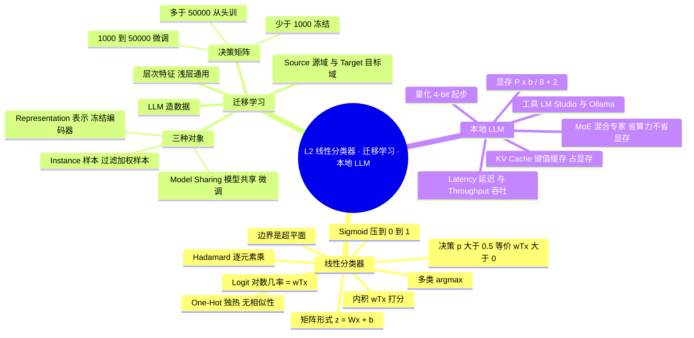
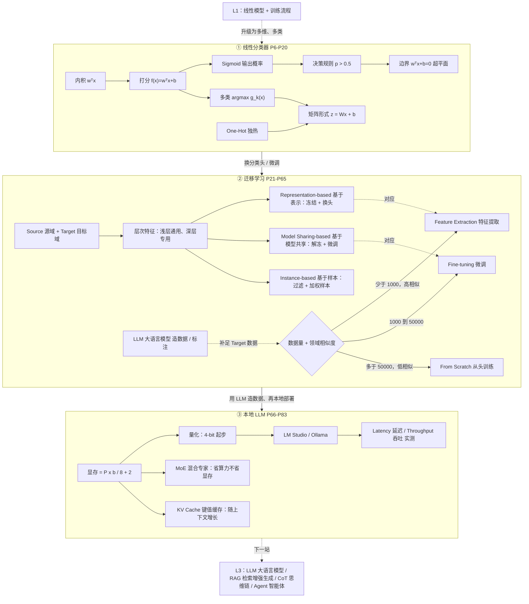

# STAT6207 L2 要领提纲（复习用）

> 对应笔记：[`L2_notes.md`](L2_notes.md) ｜ 练习：[`L2_quiz.md`](L2_quiz.md) ｜ 答疑：[`L2_qa.md`](L2_qa.md)
> 用法：先看 🧠 思维导图建立骨架 → 用 🗺️ 知识地图理清关系 → 再逐节回忆；卡住的地方回 notes 对应页码。
> 术语写法：**English（中文）**，以英文为主，方便考试和代码里认词。

---

## 1. 一句话定位

L2 把 L1 的"一条直线"升级为**线性分类器**（多维、多类），再回答两个工程问题：**数据不够怎么借力**（Transfer Learning）、**大模型怎么在自己电脑上跑**（Local LLM）。

```
线性模型 w^T x + b  →  迁移学习（冻结 / 微调 / 加权）  →  本地 LLM（显存估算）
```

---

## 🧠 思维导图（合上书，先盯这张看 30 秒）

> 读法：从中心往外，每问一句"这是什么、为什么需要它"。
> 需要支持 Mermaid 的阅读器（Typora / Obsidian / VS Code + MPE）；不显示时看第 2 节概念表。



---

## 🗺️ 知识地图（概念之间怎么连）

> 实线 = 流程/依赖；虚线 = 影响/选择。三个方框分别对应 Part B / C / D。



**60 秒回忆路线**（按顺序自问，答不出就回 notes）

1. **打分**：线性分类器怎么算分？→ 内积 $w^Tx$ 加偏置 $b$（P7–P9）
2. **概率**：分数怎么变成概率？→ Sigmoid（S 形函数）；反函数是 logit（对数几率）（P10）
3. **边界**：为什么边界是直线/超平面？→ $\log\frac{p}{1-p}=w^Tx$ 是线性的（P10–P11）
4. **多类**：三个类怎么一次算完？→ $z=Wx+b$，再 argmax（取最大的类）（P18）
5. **借力**：数据不够怎么办？→ 迁移学习三选一（表 4.1）
6. **区别**：冻结和微调差在哪？→ 梯度是否回流到编码器（P31/P44）
7. **部署**：7B 模型 4-bit 要多少显存？→ $3.5+2=5.5$ GB（P74）
8. **误区**：MoE（混合专家）省什么？→ 只省算力，不省显存（P76）

> 自检：能不看图把"打分 → 概率 → 边界 → 多类"和"数据量 → 三种迁移"两条链画出来，L2 就过关了。

---

## 2. 核心概念清单（能各用 1 句话解释）

| # | 概念 | 一句话 | notes |
|---|---|---|---|
| 1 | Inner Product（内积） | 对应分量相乘再求和，衡量同向程度 | P7 |
| 2 | Hadamard Product（逐元素乘积） | 逐元素相乘，形状不变 | P6 |
| 3 | Linear Classifier（线性分类器） | 用 $w^Tx+b$ 打分，按符号/大小决策 | P8–P15 |
| 4 | Sigmoid（S 形函数 / 逻辑函数） | 把任意实数压到 (0,1)，当概率用 | P10 |
| 5 | Logit（对数几率） | $\log\frac{p}{1-p}$，等于 $w^Tx$，故边界线性 | P10 |
| 6 | Decision Rule（决策规则） | 二分类：$p>0.5 \iff w^Tx>0$ | P11 |
| 7 | Decision Region（决策区域） | 判别函数最大的那片区域 | P12 |
| 8 | One-Hot Vector（独热向量） | 只有一位是 1，词之间无相似性 | P20 |
| 9 | Transfer Learning（迁移学习） | 借源域知识学目标域 | P23–P26 |
| 10 | Source / Target（源域 / 目标域） | 数据多的一方 / 要解决的一方 | P24 |
| 11 | Hierarchical Features（层次化特征） | 浅层通用、深层专用，所以浅层可迁移 | P27 |
| 12 | Feature Extraction（特征提取） | 冻结编码器，只训分类头（<1000 样本） | P31 |
| 13 | Fine-tuning（微调） | 解冻部分/全部层继续训（1000–50000） | P44–P49 |
| 14 | Instance-based（基于样本的迁移） | 过滤 + 加权源域样本 | P52–P54 |
| 15 | Mixture of Experts (MoE，混合专家) | 总参数大、每 token 只激活一部分 | P76 |
| 16 | KV Cache（键值缓存） | 生成时缓存历史，占显存 | P74/P77 |
| 17 | Quantization（量化） | 用更低位数存权重，换显存与速度 | P71–P74 |
| 18 | Latency / Throughput（延迟 / 吞吐） | 单个请求多快 / 单位时间能处理多少 | P79 |

---

## 3. 必记公式

**线性打分与决策**

$$f(x)=w^Tx+b,\qquad \hat y=1 \iff f(x)>0$$

- $w$：权重（模板方向）；$b$：偏置；边界是 $w^Tx+b=0$ 的超平面。

**Sigmoid（S 形函数）与 logit（对数几率）**

$$\sigma(z)=\frac{1}{1+e^{-z}},\qquad p(y=1|x)=\sigma(w^Tx),\qquad \log\frac{p}{1-p}=w^Tx$$

- $\sigma$ 单调 → 阈值 0.5 等价于打分 0，这是"线性分类器"的根。

**多类判别**

$$g_k(x)=w_k^Tx+b_k,\qquad \hat y=\arg\max_k g_k(x)$$

- 边界在 $g_i=g_j$ 处；矩阵形式 $z=Wx+b$，$W$ 每行一个类模板。

**显存估算**

$$\text{Memory (GB)}=\frac{P\times b}{8}+2,\qquad \text{FLOPs/token}\approx 2P$$

- $P$：参数量；$b$：量化位数；$+2$：KV Cache（键值缓存）。
- FLOPs（浮点运算次数）/ token（词元）：衡量算力开销。
- 7B @ 4-bit = $3.5+2=5.5$ GB；70B @ 4-bit = $35+2=37$ GB。

---

## 4. 流程与对比表

### 4.1 迁移学习三选一（必背）

| 判据 | Feature Extraction（特征提取） | Fine-Tuning（微调） | From Scratch（从头训练） |
|---|---|---|---|
| 目标数据量 | < 1,000 | 1,000–50,000 | > 50,000 |
| 领域相似度 | 高 | 中/低 | 极低/无关 |
| 过拟合风险 | 最小 | 中–高 | 高 |
| 显存占用 | 低 | 中–高 | 最高 |
| 训练哪些参数 | 只训分类头 | 部分/全部 | 全部 |

### 4.2 三种迁移对象

| 类型 | 迁移什么 | 关键操作 |
|---|---|---|
| Representation-based（基于表示） | 特征 | 冻结编码器，换分类头 |
| Model Sharing-based（基于模型共享） | 参数 | 解冻 + 小学习率微调 |
| Instance-based（基于样本） | 样本 | 过滤不相似 + 重加权 |

### 4.3 本地部署四步

```
1. 选模型（能力/显存/上下文/许可证 license）
2. 算显存：P×b/8 + 2
3. 选量化：4-bit 起步，16-bit 精度高但翻 4 倍
4. 选工具：LM Studio（图形）/ Ollama（代码）
```

---

## 5. 易错点 Top 5

1. **决策规则写成 $p>0$**：应为 $p>0.5$，等价于 $w^Tx>0$。
2. **以为微调学习率可以很大**：会破坏预训练权重，要用 $10^{-5}$ 量级。
3. **头冻结了还期待特征变好**：冻结即常数，梯度不回流。
4. **以为 Mixture of Experts (MoE，混合专家) 省显存**：只省算力，全部参数仍要装下。
5. **显存公式漏掉 +2GB**：KV Cache（键值缓存）与上下文开销是常数项。

---

## 6. 自测 5 问（先答，再回 notes）

1. 为什么 $w^Tx>0$ 等价于 $p(y=1)>0.5$？→ P10–P11
2. 三条直线的分类器，怎样一次算出三个分数？→ P18
3. 数据只有 800 张图，但领域与 ImageNet 差别较大，该怎么做？→ P31/P50
4. Representation-based（基于表示）与 Fine-tuning（微调）的本质区别是什么？→ P31/P44
5. 7B 模型 4-bit 量化要多少显存？70B 呢？→ P74

---

## 7. 与 L3 的衔接

- **"预测下一个 token（词元）"**（P67）→ L3 的自回归生成与上下文窗口。
- **One-Hot（独热）/ 文本序列**（P19–P20）→ L3 的 Tokenization（分词）与 Embedding（词嵌入）。
- **LLM 造数据/标注**（P58–P62）→ L3 的 RAG（检索增强生成）语料构建与 Agent（智能体）工作流。

> 进入 L3 前，确保能独立回答上面 5 个自测问题。
